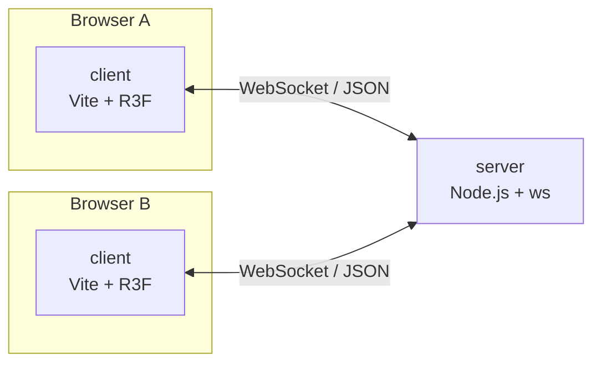

# アーキテクチャ

VR SNS (Resonite / VRChat 類似) の実現可能性を探るプロトタイプ。
**最初のゴールは「複数ユーザーが同時にアクセスできる 3D 空間」** であり、それ以外は意図的にスコープ外とする。

## 1. 方針

- **簡素さ最優先**。プロトタイプなので、認証・永続化・スケールアウト・最適化は行わない。
- **ブラウザだけで動く** (Three.js / React Three Fiber)。WebXR は後続フェーズで追加する。
- **サーバーは薄いリレー**。ワールドの状態は「接続中ユーザーの姿勢」だけを持つ。
- クライアント / サーバー間で **型を共有** し、プロトコルの不整合を防ぐ。

## 2. スコープ

### 今回の対象 (M0〜M1)

| 項目 | 内容 |
|---|---|
| 3D 空間 | 床・簡単なオブジェクトがあるだけの 1 ワールド |
| 入室 | 表示名を入力して入室 (認証なし) |
| 移動 | デスクトップ操作 (WASD + マウス視点) |
| アバター | 色付きの簡易アバター (胴体 + 頭) + 名前表示 |
| 同期 | 全ユーザーの位置・向きをリアルタイム表示 |

### 対象外 (後続)

WebXR / VR コントローラ、ボイスチャット、glTF・VRM アバター、ワールド内編集、
ユーザーアカウント、永続化、複数ルーム、物理演算、チャット。

## 3. 全体構成



- クライアントは自分の姿勢を一定間隔でサーバーに送る。
- サーバーは全員の姿勢をまとめて (スナップショット) 一定間隔で全員に配信する。
- クライアントは受信した他人の姿勢を補間して描画する。自分自身はローカルで即時反映する。

## 4. 技術選定

| 領域 | 採用 | 理由 |
|---|---|---|
| 言語 | TypeScript | client / server / 共有型を統一 |
| パッケージ管理 | pnpm workspace | 共有パッケージを簡単に扱える |
| クライアント | Vite + React + three + @react-three/fiber + @react-three/drei | 宣言的な 3D、開発サイクルが速い |
| XR (後続) | @react-three/xr | WebXR のラッパー |
| サーバー | Node.js + `ws` | WebSocket のみ必要。フレームワーク不要 |
| メッセージ形式 | JSON | デバッグ容易。必要になったらバイナリ化 |

> Node / pnpm のバージョンは実装着手時に確認して `package.json` の `engines` に記載する。

## 5. リポジトリ構成

```
.
├─ package.json
├─ pnpm-workspace.yaml
├─ docs/
│  ├─ architecture.md   # このファイル
│  ├─ design.md         # プロトコル・同期・シーンの詳細設計
│  └─ milestones.md     # 段階的な進め方
├─ packages/
│  └─ protocol/         # 共有メッセージ型 (型のみ、実行時依存なし)
└─ apps/
   ├─ server/           # WebSocket サーバー
   └─ client/           # Vite + R3F クライアント
```

## 6. コンポーネント責務

### server (`apps/server`)

- WebSocket 接続を受け付け、接続ごとにユーザー ID を採番する。
- `join` を受けたらユーザーを登録し、`welcome` を返し、他者へ `peer_joined` を通知する。
- 受信した `pose` を最新値としてメモリ上に保持する。
- 一定間隔 (20Hz) で全ユーザーの姿勢を `snapshot` として配信する。
- 切断時にユーザーを削除し、`peer_left` を通知する。
- 入力値の最低限の検証 (型・数値範囲・名前の長さ) のみ行う。

### client (`apps/client`)

- 入室画面 (名前入力) → 3D シーン。
- ローカルプレイヤーの入力処理と移動 (クライアント権威)。
- 自分の姿勢を 20Hz で送信。
- 他ユーザーのアバターを `snapshot` から生成・更新・削除し、補間表示する。

### protocol (`packages/protocol`)

- client / server 間のメッセージ型と定数 (送信間隔など) を定義する。

## 7. 設計上の判断

| 判断 | 内容 | 理由 / トレードオフ |
|---|---|---|
| クライアント権威の移動 | 自分の位置はクライアントが決めて送信 | 実装が簡単。チートは許容 (プロトタイプ) |
| スナップショット配信 | 差分でなく全員分を毎回送る | 実装が単純。人数が少ない前提で帯域は問題にならない |
| 1 ワールド・1 ルーム | ルーム ID を持たない | スコープ削減。将来はルーム ID をメッセージに追加 |
| 認証なし | 表示名のみ | プロトタイプの目的外 |
| 永続化なし | サーバー再起動で状態は消える | 同上 |

## 8. 想定する制約・リスク

- WebSocket (TCP) は遅延・ジッタに弱く、人数が増えると限界がある。まずは数人〜十数人を想定する。
  将来的に WebRTC DataChannel / WebTransport への移行を検討する。
- 状態同期の見た目の品質は補間実装に依存する (`design.md` 参照)。
- WebXR 対応は端末・ブラウザ依存が大きい。デスクトップ操作は常に併存させる。
