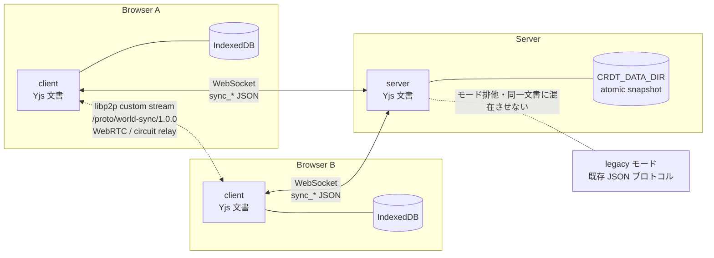

# CRDT 実験モード (crdt-v1)

> **状態**: 実装は一通り完了している。`packages/world-sync`、サーバー / クライアントの永続化、WebSocket 同期、P2P トランスポート、コンテンツ台帳は実装済みで、単体テストと Node 上の smoke test は通っている。一方、実際のブラウザでの IndexedDB、サーバー / ネットワーク障害中の P2P 生存、3 ブラウザ・100 objects の E2E は未検証。本文では「実装予定」「検証項目」「目標」を区別し、未検証の項目を実装済みとみなさない。検証の内訳は「15. 検証状況」を参照。

## 1. 目的

ワールドサーバーまたは参加ピアが一時的に停止・分断しても、ワールドの基本編集を継続し、通信復旧後に変更を統合する。Yjs を使った限定実験として実装する。

これは単なる「サーバー再起動時にワールドを復元する機能」ではない。サーバーが止まっている間もブラウザ側で編集でき、復旧後にサーバーおよび他のピアの変更とマージされることを対象にする。再起動後の復元は、その一部として含まれる。

## 2. 保証範囲

| 障害 | 期待する動作 |
|---|---|
| ワールドサーバー停止 | シーンとローカル編集を維持する。接続が残っている P2P 経路で文書の変更と claim を共有する (姿勢は CRDT 文書に含めない) |
| P2P 経路も消失 | 各端末の編集を保存し、再接続後に統合する。通信できない相手への即時反映は保証しない |
| ピア切断・タブ終了 | 他の参加者は継続する。つかみ表示は失効し、保存・複製済みの変更は残る |
| タブ再読み込み・再起動 | ページがロードでき、サーバーに接続できればローカル保存を復元して同期する。サーバーに到達できない間は Lobby のまま |
| サーバープロセス再起動 | 同じディスクから文書・保持済みコンテンツを復元し、参加者の新しい変更とマージする |
| 全プロセス停止後の再開 | 少なくとも一つの保存領域に確定した文書更新を復元する。初期ボックスを増殖させない |
| コンテンツ提供元停止 | メタデータは残し、取得不能を表示する。提供元の復帰後に再試行する |

「保存済み」の意味と、失われ得るものは「7. 永続化と『保存済み』の意味」を参照。

## 3. 合意した方針

- **編集継続を優先する**: 厳密なつかみの排他制御より、停止中も操作を止めないことを優先する。同じ物を同時に動かした場合、一方の位置が採用され、他方が補正されることを許容する。
- **同時移動は収束する**: 最終的な位置は Yjs の決定的な競合解決で決まる。実時刻の「最後の操作」が勝つことは約束しない。端末時計で勝者を決めない。
- **コンテンツの一時的な取得不能を許容する**: ファイル本体が取得できなくてもオブジェクトは残し、提供元の復帰後に再試行する。
- **信頼できる少人数の実験専用とする**: 通常モード (legacy) を残す。認証・編集権限・悪意ある CRDT 更新への防御・本番公開は対象外。
- **停止中に継続する操作**: 移動、既存オブジェクトの移動・複製・削除、ボックス・リンクの作成。ワールドのオブジェクトは表示・編集を続けられる。一方、WS 障害中は他参加者の姿勢・アバターが更新されない (姿勢は CRDT 文書に含めず、姿勢の P2P 共有も未実装)。
- **サーバー復帰を待つ操作**: 新規ファイルの検証、URL のメディア取り込み、新規参加。動画の再生同期は crdt-v1 では未対応。新規ファイルは未送信を明示して保留し (タブを閉じると失われる)、元ファイルを失った場合は再選択する。

## 4. アーキテクチャ



- ブラウザは Yjs 文書をメモリに持ち、IndexedDB にバイナリ更新を保存する。サーバーも同じ文書をメモリに持ち、`CRDT_DATA_DIR` 配下に atomic snapshot として保存する。
- 同期は WebSocket のリレーと、既存の libp2p 接続 (WebRTC / circuit relay) 上のカスタム stream `/proto/world-sync/1.0.0` の二経路で実装している。更新元の経路を origin として管理し、受信元への即時エコーを避けつつ他の経路へ中継する。
- **P2P トランスポートは実装済み**。停止前に確立していた WebRTC / circuit relay のリンクがあれば、サーバー / リレー停止中もそのリンクで交換を続けられる。ただし、実際の障害中にリンクが生存し続けるかは未検証で、停止中に新規のリンクは確立できない。TURN / リレーを含むホスト停止時は孤立編集へ縮退する。
- legacy モードとは設定・保存領域・メッセージ体系を分ける。同じ文書への旧メッセージと CRDT の二重書き込みは行わない。
- `packages/world-sync` に Yjs 文書モデル・コマンド・描画用 projection・共通フレームを集約している。既存 `packages/protocol` の軽量な型定義を不要に Yjs へ依存させない。

## 5. データモデル

```text
Y.Doc
├─ objects: Y.Map<Y.Map>
│   └─ <objectId>
│       ├─ id / kind / cid / name / size / category など (生成後不変)
│       └─ transform: { position, yaw, pitch, updateId }
└─ deleted: Y.Map<true>
```

- `transform` は position / yaw / pitch と更新識別子を **一つの値** として置換する。座標の各軸を別々にマージしない。
- 基本属性の ID・kind・CID は生成後不変とする。ファイルの検証結果は transform とは別の属性に反映し、位置変更でサイズ等を上書きしない。
- 削除は `deleted[id]=true` の単調な tombstone。移動・検証完了・古い更新が後から届いても、その ID を表示・復活させない。同じ ID の再作成は禁止し、複製は必ず新しい UUID を使う。
- tombstone と因果情報は実験ワールド中に破棄しない。JSON だけを書き戻す圧縮・初期化はしない。
- pose、つかみ claim、ドラッグプレビュー、参加状態、転送進捗は永続 CRDT に入れない。WebSocket と P2P に載せる一時メッセージとして扱う。
- つかみ claim は heartbeat で更新し、受信から **3 秒** で失効する。同時 claim は sessionId / dragId の決定的な順序で表示上の勝者を選び、敗者は操作を中止・補正する。分断をまたぐ厳密なロックではない。
- ドラッグ中は変更がある場合に **最大 1Hz** で transform を確定し、離すときは即時確定する。停止時は最後の保存済みチェックポイントまで復元する。
- `MAX_OBJECTS=100` は実験モードではローカルの新規作成抑止として扱う。分断後のマージで超過しても受信順に削除せず、全件を保持して超過表示し、新規作成を抑止する。厳密な分散上限は対象外。

## 6. 同期プロトコル

制御メッセージは JSON、Yjs の更新は base64 のバイナリとして運ぶ。クライアントが `sync_hello` で state vector を送り、サーバーが差分を `sync_init` (大きければ `sync_part`) で返す。その後は `sync_update` の増分を双方向に配り、サーバーは保存完了後に `sync_ack` で state vector を返す。

| type | 方向 | 主なフィールド | 説明 |
|---|---|---|---|
| `sync_hello` | Client → Server | `worldId`, `schemaVersion`, `stateVector` | 接続時のモード・スキーマ照合と、クライアントの state vector の送信 |
| `sync_init` | Server → Client | `update` | クライアントの vector に対するサーバーの差分。大きい場合は `sync_part` に分割する |
| `sync_update` | 双方向 | `update` | 増分更新。重複・順序逆転を許容する |
| `sync_part` | 双方向 | `transferId`, `index`, `count`, `data` | 大きな更新の分割転送。`data` は base64 |
| `sync_ack` | Server → Client | `stateVector` | 保存完了後のサーバーの state vector。クライアントは比較し、サーバーが遅れていればローカル差分を送って次の ACK を待つ |
| `claim` | Client → Server / Server → Client | `id`, `peerId`, `sessionId`, `seq`, `until` | つかみの一時 claim。サーバーは受信時に送信元の `peerId` を付けて他へ配る |
| `claim_release` | Client → Server / Server → Client | `id`, `sessionId` | claim の解放。サーバーは `until: 0` の `claim` としてブロードキャストする |

- P2P は同じ論理メッセージを `/proto/world-sync/1.0.0` 上の独自フレームで運ぶ。フレームは 4 バイト big-endian の長さ + UTF-8 JSON で、`hello` / `init` / `update` / `part` / `ack` / `claim` / `claim_release` を使う。
- 初期値: `sync_part` のチャンクは **48 KiB**、文書・再構成後の上限は **16 MiB**、接続ごとの送信待ちは **2 MiB**。base64 化で約 4/3 に増えるため、48 KiB のチャンクは概ね 64 KiB のフレームに収まる。
- 経路切替で同じ操作を再生成しない。サーバーは 10 秒ごとにも `sync_ack` を送り、クライアントは ACK の state vector を比較して取りこぼしを回復する。キュー飽和時は文書から差分同期をやり直し、未反映更新を黙って捨てない。
- 制限超過・未知スキーマ・不正な JSON は診断可能な同期エラー (`sync_error`) にし、収束済みと表示しない。
- 実装済みのメッセージ名・フィールドは上表のとおり。互換性のない変更は `schemaVersion` を上げ、自動移行しない。

## 7. 永続化と「保存済み」の意味

| 保存先 | 完了条件 | 呼び方 |
|---|---|---|
| ブラウザ | IndexedDB のトランザクションが完了した時点 | ローカル保存済み |
| サーバー | 一時ファイルへの書込・flush・atomic rename が完了し、ACK を返した時点 | サーバー保存済み |

- サーバーは受信した更新を直列化した保存キューで処理し、小規模検証向けの snapshot 方式で atomic に保存する。中途半端な状態を正本にしない。
- サーバーは受信した更新の保存が確定してから、現在の state vector を `sync_ack` で返す。クライアントはその vector を自分の文書と比較し、サーバーが遅れていればローカル差分を送り直して次の ACK を待つ。「ローカル保存済み」「他ノードへ反映」「サーバー保存済み」を区別する。
- IndexedDB の復元は接続後、CRDT の welcome を受けてから行う。welcome の objects で文書を全置換しない。サーバーは保存状態を読み終えてから接続受付・seed・コンテンツ回復を開始する。
- 壊れた保存データや未知スキーマでは空ワールドを自動生成せず、起動失敗を明示する。
- 失われ得るもの: 未完了の書き込み、ドラッグ途中の未確定プレビュー、元ファイルしかない未完了アップロード。ファイル本体がどこにも残っていない場合は CRDT でも復元できない。
- 保存領域の消失・ブラウザによるストレージ削除・ディスク故障からの復旧は対象外。

## 8. コンテンツの扱い

- 実験モードではブロックストアを起動時に削除しない。Helia の datastore・pin 情報・サーバー identity も `CRDT_DATA_DIR` 配下に永続化する。
- CID ごとの検証結果・実測サイズ・保持完了状態を **コンテンツ台帳** に保存する。取得・検証・pin・台帳保存が完了するまで「耐久保持済み」と通知しない。
- 一度検証して保持した本体は、ワールドの **明示的リセットまで pin し続ける**。削除直後の unpin は行わない。分断先で作られた複製が後から届いても本体を失わないため。
- 未参照分も容量台帳に含め、既存の **20 GiB** 上限を守る。自動期限 GC と分散 GC は対象外。
- CRDT の変更回数を retain / release に換算しない。文書の生存オブジェクトから CID 参照集合を再計算して content adapter と整合させる。
- 取得できないコンテンツは「利用不可」と表示し、提供元の復帰後に再試行する。オブジェクト自体は削除しない。
- 新規ファイル配置は requestId とクライアント生成 objectId を付け、サーバー復帰後に現在のサイズ・形式検証を通してから文書へ登録する。保留操作はタブが生きている間だけメモリに保持し、タブを閉じると失われる。任意サイズの File 本体は保存しない。

## 9. モードと設定

| 名前 | 既定値 | 説明 |
|---|---|---|
| `SYNC_MODE` | `legacy` | サーバーの同期モード。`legacy` または `crdt-v1` |
| `VITE_SYNC_MODE` | `legacy` | クライアントの同期モード。`legacy` または `crdt-v1` |
| `CRDT_DATA_DIR` | なし | `crdt-v1` では必須。文書・コンテンツ台帳・Helia datastore・ブロックストアを隔離する専用ディレクトリ |
| `worldId` | 初期化時に生成 | サーバーが生成・永続化する。クライアントの保存キーは接続先・worldId・schemaVersion の組 |
| `schemaVersion` | 実装時に固定 | handshake で照合する。不一致は明示エラーとし、自動移行しない |

- サーバー一つにつき一つのモードとする。`crdt-v1` と legacy のメッセージを同じ文書に混在させない。
- 別ワールド・別スキーマの文書をマージしない。互換性のない実験スキーマは黙って移行せず、新しい実験ワールドとして開始する。
- legacy モードの 5 個のデモボックス・`sync` なし・4 KiB 制限・起動時のブロックストア削除は変更しない。
- 通常モードへ戻す場合は設定とクライアントビルドを揃えて再起動する。実験データは削除しない。

## 10. ローカルでの起動方法

実装済み。サーバーとクライアントのモードを揃えて起動する。既存の `pnpm dev` は legacy のまま使える。

```sh
# サーバー (crdt-v1)
SYNC_MODE=crdt-v1 CRDT_DATA_DIR=./.crdt-data pnpm dev:server

# クライアント
VITE_SYNC_MODE=crdt-v1 pnpm dev:client
```

- サーバーとクライアントのモードを揃える。片方だけ `crdt-v1` にしない。
- 専用のテスト環境・専用データ領域でのみ動かす。稼働中のメモリ内ワールドを移行する機能は作らない。
- 新しい実験ワールドとして開始し、初回のデモ生成はサーバーのみが行う。クライアントは独自 seed を作らない。
- crdt-v1 の HUD には実験用の「実験: ボックスを置く」「実験: リンクを置く」ボタンがある。リンクはサーバーを通さず、URL のメディア取り込みもせずに文書へ直接置くため、WS 停止中でも配置できる。

## 11. 障害試験チェックリスト

- [ ] WebSocket のみ遮断し、P2P 経路で編集と claim が継続するか
- [ ] Node プロセスを停止し、サーバー停止中の編集が復旧後に統合されるか
- [ ] P2P のみ遮断し、WebSocket 経由の編集が継続するか
- [ ] 全経路を分断し、各端末が孤立編集して復旧後に収束するか
- [ ] ホスト / TURN を停止し、リレー喪失時に孤立編集へ縮退するか
- [ ] タブの再読み込み・終了後、保存済み変更が残り、つかみ表示が失効するか
- [ ] サーバー再起動後、同じディスクから文書と保持済みコンテンツが復元されるか
- [ ] コンテンツ提供元の消失後、利用不可表示と再試行が機能するか
- [ ] 3 browser contexts・100 objects で編集継続と再統合ができるか

Page offline だけでは WebRTC 遮断の証明にしない。サーバーが実際に停止している期間の更新を記録し、サーバー経由の動作を成功と誤認しない。P2P が成立しない環境は「孤立編集と復帰後の収束」として記録する。

## 12. 合格目標

- 通信経路と handshake の復旧後、最終編集の収束まで **5 秒以内**。
- サーバー復帰から **30 秒以内** に自動再接続する。
- 試験環境・RTT・TURN 使用・再試行回数を記録する。未達なら原因を報告する。
- ネットワーク復旧までの時間と、CRDT の統合時間を分離して評価する。

これらは **目標** であり、現時点の測定値ではない。E2E の合格目標として扱い、未測定の成功を前提にしない。

## 13. 既知の制限・対象外

- 認証・編集権限・悪意ある CRDT 更新への防御・本番公開。バイナリ更新の受信は入力認可にはならない。
- 保存領域の消失・ブラウザによるストレージ削除・ディスク故障からの復旧。
- PWA / ページ配信の冗長化。
- サーバー不在での新規参加・ピア発見。
- サーバー / リレーが停止している間は、新規の P2P リンクを確立できない。再利用できるのは停止前に成立していたリンクだけ。
- サーバー由来の文書更新は P2P へ中継しない。サーバーから受け取った更新は、WebSocket が使える間に各クライアントへ届く。
- サーバーに到達できない状態でページを再読み込みすると Lobby が表示される。IndexedDB の文書は、CRDT の welcome が成功した後に復元される。
- オフライン中の保留配置はメモリのみで、タブを閉じると失われる。
- crdt-v1 では動画再生の同期は未対応 (サーバーが `sync_error` を返す)。
- 新しい TURN / リレー基盤。
- 任意サイズのファイルのブラウザ永続複製。
- 動画再生時刻の分散合意。crdt-v1 では動画同期自体が未対応。
- Undo / 履歴 UI、複数ワールド UI。
- 厳密な分散オブジェクト上限。分断後のマージで 100 個を超えることは許容する。
- 一時的な WS 切断では、クライアントは peer 一覧と姿勢バッファを消す。そのため他参加者の姿勢・アバターは再接続まで更新されない。P2P の claim と文書編集は続くが、姿勢は P2P で共有されない。
- 姿勢の P2P 共有は未実装。

## 14. 実装状況

**実装済み・E2E 未実施**。実装項目は完了しているが、障害試験と 3 browser contexts / 100 objects の E2E は未実施で、M6 の完了条件は満たしていない。

- [x] `packages/world-sync`: Yjs 文書・作成/移動/複製/削除・projection・共通フレーム
- [x] サーバー永続化: `CRDT_DATA_DIR`・atomic snapshot・`worldId`・初回 seed・復元失敗の明示
- [x] クライアント: IndexedDB 保存・初期復元・再接続/再同期・HUD 状態
- [x] P2P transport: 既存 WebRTC / circuit relay 上の `/proto/world-sync/1.0.0` と停止中の交換 (実装。実際の障害中の生存は未検証)
- [x] コンテンツ台帳: 検証結果・pin 方針・20 GiB 上限・取得不能表示と再試行
- [ ] E2E: 障害試験・100 objects・legacy モードの回帰

## 15. 検証状況

### Node / 単体テストで確認済み

- `pnpm install --frozen-lockfile`、`pnpm typecheck`、`pnpm test`、`pnpm build` はすべて成功した。
- テストは 26 ファイル / 395 件 (protocol 22、world-sync 31、client 153、server 189)。
- `pnpm build` の Vite は既存の chunk-size 警告のみを出す。
- Node 上の smoke test (ブラウザではない): 同じ `worldId` に 2 つの WebSocket クライアントを接続し、seed 済みの 5 ボックスをそれぞれが保持した。片方でボックスを 1 個作成し、別の 1 個を移動した結果、両者の canonical projection が一致した。
- 同じ `CRDT_DATA_DIR` でサーバーを再起動すると、同じ `worldId` と 6 オブジェクト (seed 5 + 追加 1) が復元され、seed の重複はなかった。
- コンテンツ台帳の snapshot / restore と、ブロックストアに残っている内容の再 pin、欠けている内容の除外は単体テストで確認済み。起動時の照合 (文書が `stored: true` でも台帳に無ければ `stored: false, offline: true` に戻す) は実装済み。

### 実ブラウザ / 障害試験では未検証

- 実ブラウザの IndexedDB の保存・復元 (タブ再読み込みを含む)。
- 実際のサーバー / ネットワーク障害中の WebRTC / circuit relay の生存。
- TURN 経由の接続。
- 複数タブ、バックグラウンドタブのタイマー間引き。
- 悪意あるピア / 不正な CRDT 更新への耐性。
- 3 ブラウザ・100 objects の E2E。
- 実ブラウザでの HUD、ドラッグ、claim の表示と操作。
