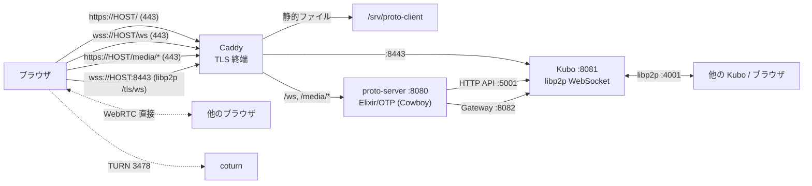

# デプロイ (開発 VPS)

Ubuntu / Debian の**開発用 VPS** にデプロイし、Kubo / Caddy / TURN を含む実環境に近い結合テストを行うための構成と手順。
スクリプトは `deploy/setup-vps.sh` (初期構築) と `deploy/deploy.sh` (ビルド・転送・再起動) にある。

**このリポジトリが使う VPS (`nemvr.nemnomi.dev` / `root@172.104.89.28`) は開発・検証環境であり、本番環境ではない。**
ワールド状態はメモリのみで、デプロイ・再起動で消える。Kubo の pin / ブロックはテスト用に残ってよい。
必要なら VPS を再構築してよい。本番向けの認証・可用性・バックアップ・監視は対象外。

構成は **Caddy (TLS 終端) + Kubo (IPFS) + proto-server (Elixir/OTP release) + coturn (TURN)**。
`proto-server` は Kubo の HTTP API とゲートウェイにだけ話し、IPFS の libp2p / bitswap / pin は Kubo が持つ。

## 開発 VPS の構成



| 公開ポート | 用途 |
|---|---|
| 22/tcp | SSH |
| 80/tcp | ACME (HTTP-01) の検証と、https へのリダイレクト |
| 443/tcp, 443/udp | サイト (静的ファイル)、`wss://HOST/ws`、`/media/*` (HTTP/3 用に udp も) |
| 8443/tcp | Kubo の libp2p WebSocket。ブラウザは `/tls/ws` で接続する |
| 4001/tcp | Kubo の libp2p swarm (TCP) |
| 3478/tcp, 3478/udp | TURN (coturn) の制御と中継 |
| 49160-49200/udp | TURN の中継ポート範囲 |

ローカルだけで待ち受けるポート:

| ポート | 用途 |
|---|---|
| 8080 | proto-server (Caddy からのみ) |
| 8081 | Kubo の libp2p WebSocket (Caddy からのみ) |
| 8082 | Kubo ゲートウェイ (proto-server からのみ) |
| 5001 | Kubo API (proto-server からのみ) |

- **Kubo の API (5001) は必ず localhost に置く**。API には pin / add / repo 操作の権限があるため、外部に公開してはいけない。
  ゲートウェイ (8082) も外部公開しない。公開するのは Caddy の 443 / 8443 だけ。
- **HTTPS が必須**: ブラウザ内の Helia / libp2p は Web Crypto を使うため、ページが安全なコンテキスト (HTTPS か localhost) でないと動かない
  (`architecture.md` の「想定する制約」参照)。
- **ホスト名が必要**: Let's Encrypt の証明書はホスト名に対して発行される。IP アドレスだけでは取れない。
  Linode の逆引きホスト名は、その IP アドレスに正引きもできるので、独自ドメインが無くても使える。
  独自ドメインを使う場合は A レコードを VPS の IP アドレスに向けて、`PROTO_HOST` をそのドメインにする。
  ホスト名を変えるときは、新しい名前で `setup-vps.sh` を再実行し (`TURN_HOST` も更新される)、`proto-server` を再起動する。
- アプリ本体は `proto` ユーザー (非 root) の systemd サービス `proto-server` として 127.0.0.1 のみで待ち受ける。外に出るのは Caddy だけ。
- クライアントは、HTTPS で開かれたときだけ、ワールド同期を `wss://<オリジン>/ws`、libp2p を `/dns4/<host>/tcp/<IPFS_PUBLIC_PORT>/tls/ws/...` に接続する
  (`apps/client/src/net/connection.ts`, `ipfs.ts`)。HTTP (開発時) の挙動は変わらない。

## サーバーの環境変数

`apps/server/config/runtime.exs` が読む値。空文字は未設定として扱う。

| 名前 | 既定値 | 説明 |
|---|---|---|
| `HOST` | `0.0.0.0` | 待ち受けアドレス。リバースプロキシの背後では `127.0.0.1` |
| `PORT` | `8080` | ワールド同期 (WebSocket) と `/media` |
| `IPFS_PORT` | `8081` | Kubo の libp2p WebSocket の待受ポート (サーバー自身は待ち受けない) |
| `IPFS_PUBLIC_PORT` | `IPFS_PORT` と同じ | ブラウザから見た libp2p のポート (Caddy の 8443)。`welcome.ipfs.wsPort` でクライアントに伝える |
| `IPFS_API_URL` | `http://127.0.0.1:5001` | Kubo の HTTP API。localhost のみ |
| `IPFS_GATEWAY_URL` | `http://127.0.0.1:8082` | Kubo のゲートウェイ。`/media` の Range ストリーミングに使う |
| `IPFS_PEER_ID` | (なし) | Kubo の peer ID。未指定なら起動時に `/api/v0/id` から取得してキャッシュする |
| `CONTENT_MAX_TOTAL_MB` | `20480` (20 GiB) | サーバーが pin する画像・ファイルの合計サイズの上限 (MB)。Kubo のディスク容量より十分小さくする |
| `TURN_HOST` | (なし) | TURN サーバーのホスト名。`TURN_SECRET` とあわせて設定したときだけ TURN を配る |
| `TURN_PORT` | `3478` | TURN のポート |
| `TURN_SECRET` | (なし) | coturn の `static-auth-secret` と同じ値。クライアントには渡らない |
| `TURN_TTL_SECONDS` | `21600` (6 時間) | 発行する認証情報の有効期間 |
| `MAX_CONCURRENT_VERIFY` | `4` | 同時に検証・取得するコンテンツ数 |
| `MAX_PENDING_PER_PEER` | `16` | 1 ピアあたりの保留ジョブ数 |

`crdt-v1` のサーバーモードはない。CRDT 用の環境変数や保存ディレクトリは存在しない (歴史的設計は [CRDT 実験モード](crdt-experiment.md))。

## Kubo の設定

Kubo は `proto` ユーザーで動かし、リポジトリを `/var/lib/proto/ipfs` に置く。

```sh
install -d -m 750 -o proto -g proto /var/lib/proto/ipfs
runuser -u proto -- env IPFS_PATH=/var/lib/proto/ipfs ipfs init --profile=server
runuser -u proto -- env IPFS_PATH=/var/lib/proto/ipfs ipfs config Addresses.API /ip4/127.0.0.1/tcp/5001
runuser -u proto -- env IPFS_PATH=/var/lib/proto/ipfs ipfs config Addresses.Gateway /ip4/127.0.0.1/tcp/8082
runuser -u proto -- env IPFS_PATH=/var/lib/proto/ipfs \
  ipfs config --json Addresses.Swarm '["/ip4/0.0.0.0/tcp/4001","/ip4/0.0.0.0/tcp/8081/ws"]'
runuser -u proto -- env IPFS_PATH=/var/lib/proto/ipfs ipfs config --json Swarm.RelayService.Enabled true
runuser -u proto -- env IPFS_PATH=/var/lib/proto/ipfs ipfs config --json Swarm.RelayClient.Enabled true
```

- Kubo が libp2p のノード、blockstore、pin、bitswap、circuit relay を持つ。
- `Swarm.RelayService.Enabled` と `Swarm.RelayClient.Enabled` を有効にする (ブラウザ同士の接続の仲介)。
- ゲートウェイは `127.0.0.1:8082`。`/media/<cid>` はサーバーがこのゲートウェイへ Range 要求を流す。
- Kubo のリポジトリはサーバーの再起動では消えない。ワールド状態はメモリのみなので、再起動後に参照のない pin が残ることがある。
- `setup-vps.sh` は `KUBO_VERSION` を指定しない場合、`https://dist.ipfs.tech/kubo/versions` の先頭 (最新) を使う。
  アーキテクチャは `amd64` / `arm64` を自動で選ぶ。

## systemd

### `kubo.service`

```ini
[Unit]
Description=Kubo IPFS daemon (API + Gateway + libp2p)
After=network-online.target
Wants=network-online.target

[Service]
Type=simple
User=proto
Group=proto
Environment=IPFS_PATH=/var/lib/proto/ipfs
ExecStart=/usr/local/bin/ipfs daemon --migrate=true
Restart=on-failure
RestartSec=3
LimitNOFILE=65536
NoNewPrivileges=true
ProtectSystem=strict
ProtectHome=true
PrivateTmp=true
ReadWritePaths=/var/lib/proto

[Install]
WantedBy=multi-user.target
```

### `proto-server.service`

```ini
[Unit]
Description=VR SNS prototype server (Elixir/OTP + Kubo)
After=network-online.target kubo.service
Wants=network-online.target kubo.service

[Service]
User=proto
Group=proto
WorkingDirectory=/opt/proto/app/apps/server
Environment=PORT=8080 HOST=127.0.0.1 IPFS_PORT=8081 IPFS_PUBLIC_PORT=8443
Environment=IPFS_API_URL=http://127.0.0.1:5001 IPFS_GATEWAY_URL=http://127.0.0.1:8082 CONTENT_MAX_TOTAL_MB=20480
Environment=RELEASE_TMP=/var/lib/proto/tmp
EnvironmentFile=-/etc/proto/server.env
ExecStart=/opt/proto/app/apps/server/_build/prod/rel/proto_server/bin/proto_server foreground
Restart=on-failure
RestartSec=3
MemoryMax=1536M
NoNewPrivileges=true
ProtectSystem=strict
ProtectHome=true
PrivateTmp=true
ReadWritePaths=/var/lib/proto

[Install]
WantedBy=multi-user.target
```

`EnvironmentFile` は TURN の 3 変数 (`TURN_HOST` / `TURN_PORT` / `TURN_SECRET`) を入れる。
Kubo の API / ゲートウェイの URL は localhost 固定。Kubo を別ホストに置く場合だけ変更する。

## Caddy

```caddyfile
HOST {
	encode zstd gzip
	header {
		X-Content-Type-Options nosniff
		Referrer-Policy no-referrer
	}
	handle /ws {
		reverse_proxy 127.0.0.1:8080
	}
	handle /media/* {
		reverse_proxy 127.0.0.1:8080
	}
	handle {
		root * /srv/proto-client
		try_files {path} /index.html
		file_server
	}
}

HOST:8443 {
	reverse_proxy 127.0.0.1:8081
}
```

`/ws` と `/media/*` は proto-server、それ以外は静的ファイル。`:8443` は Kubo の libp2p WebSocket への TLS 終端。

## リリース配置

```
/opt/proto/app/apps/server/
└─ _build/prod/rel/proto_server/
   ├─ bin/proto_server
   ├─ releases/<vsn>/
   ├─ lib/
   └─ erts-<vsn>/          # include_erts: true (Erlang の実行環境を含む)
/srv/proto-client/          # Vite の dist
/var/lib/proto/ipfs/        # Kubo のリポジトリ (blocks / pins / config / keystore)
/var/lib/proto/tmp/         # release の一時ファイル (RELEASE_TMP)
/etc/proto/server.env       # TURN_* (root:proto 0640)
```

`mix.exs` の release は `include_erts: true` なので、起動時に VPS の Elixir / Erlang は不要
(release に実行環境を含む)。ただし release は VPS の Elixir/OTP でビルドする。
Nix の Elixir/OTP で作った release は Nix ストアの glibc などへ動的リンクしており、
Ubuntu では起動できないため (`setup-vps.sh` が VPS 側の Elixir を導入する)。

## 手順

### 0. 前提: ネットワークで必要なポートを開ける

**VPS の外側のファイアウォールで、次の受信を許可しておくこと。**

| プロトコル | ポート | 用途 |
|---|---|---|
| TCP | 80, 443, 8443 | サイト、`/ws`、`/media`、libp2p、証明書の取得 |
| UDP | 443 (任意) | HTTP/3 |
| TCP | 4001 | Kubo の libp2p swarm |
| TCP / UDP | 3478 | TURN |
| UDP | 49160-49200 | TURN の中継ポート |

Linode の場合は Cloud Manager の Firewalls (Network → Firewalls) で、この Linode に割り当てられているルールを確認する。
VPS 内の ufw を開けても、手前のファイアウォールが塞いでいると通信は届かず、証明書も取得できない
(Let's Encrypt の検証が「Timeout during connect (likely firewall problem)」で失敗する)。

確認方法 (手元のマシンから。TURN の UDP は STUN の応答で確認する):

```sh
for p in 80 443 8443 4001 3478; do timeout 6 bash -c "exec 3<>/dev/tcp/<VPS の IP>/$p" 2>/dev/null && echo "$p: open" || echo "$p: no response"; done
```

### 1. VPS を構築する (初回のみ。何度実行しても同じ結果になる)

このプロジェクトの開発 VPS は `PROTO_HOST=nemvr.nemnomi.dev`、`DEPLOY_HOST=root@172.104.89.28`、
`SSH_KEY=~/.ssh/linode.com` を使う。以下は一般的なプレースホルダで書いている。

```sh
ssh root@<VPS> "PROTO_HOST=<ホスト名> bash -s" < deploy/setup-vps.sh
```

Node.js 24 (公式 tarball を SHA256 検証)、pnpm、Caddy、ufw、coturn、Elixir / Erlang、Kubo、`proto` ユーザー、
`kubo` / `proto-server` の systemd ユニット、Caddyfile、Kubo のリポジトリと設定、ファイアウォールを構成する。
release がまだ無い場合、`proto-server` は enable されるが起動しない (次の手順の後に起動する)。

### 2. アプリをデプロイする

```sh
DEPLOY_HOST=root@<VPS> SSH_KEY=~/.ssh/<鍵> deploy/deploy.sh
```

`deploy.sh` は次を行う:

1. 手元で `pnpm install --frozen-lockfile`
2. `pnpm typecheck`
3. `pnpm --filter @proto/client build`
4. `apps/server` のソース (`mix.exs` / `mix.lock` / `config/` / `lib/`) を VPS の `/opt/proto/build/apps/server` へ rsync
5. VPS 上で `runuser -u proto -- mix deps.get --only prod && mix release --overwrite`
6. 現在の release とクライアントを `.prev` として VPS 内に退避
7. `apps/client/dist/` を `/srv/proto-client/` へ rsync
8. ビルドした release を `/opt/proto/app/apps/server/_build/prod/rel/proto_server/` へ配置
9. `systemctl restart proto-server` (Kubo は再起動しない)

`node_modules`、`.git`、クライアントの `dist` をアプリのソースツリーへ転送しない。
VPS のソースは `/opt/proto/build/apps/server` にだけ置き、実行する release は
`/opt/proto/app` に置く。Kubo の設定を変えた場合は、`deploy.sh` ではなく
`setup-vps.sh` を再実行して Kubo を再起動する。

### 3. 確認する

```sh
# 静的ファイル (200)
curl -sSI https://<ホスト名>/ | head -n 1

# /media は存在しない CID で 404 (Kubo に到達できていれば、500 ではなく 404)
curl -s -o /dev/null -w '%{http_code}\n' https://<ホスト名>/media/deadbeef

# WS ハンドシェイク (Node 24 の WebSocket)
node -e 'const ws=new WebSocket("wss://<ホスト名>/ws");const t=setTimeout(()=>{console.error("timeout");process.exit(1)},5000);ws.onopen=()=>{clearTimeout(t);console.log("ws open");ws.close()};ws.onerror=()=>{clearTimeout(t);console.error("ws error");process.exit(1)}'

# VPS 内: サービスの状態と Kubo の peer ID
ssh root@<VPS> 'systemctl status kubo proto-server --no-pager'
ssh root@<VPS> 'runuser -u proto -- env IPFS_PATH=/var/lib/proto/ipfs ipfs id'
ssh root@<VPS> 'journalctl -u kubo -u proto-server -n 30 --no-pager'
```

`welcome.ipfs.wsPort` は 8443、`welcome.ipfs.peerId` は `ipfs id` の `ID` と一致する。
ブラウザで `https://<ホスト名>/` を開き、HUD に「IPFS: 接続済み」と出ることを確認する。

### 4. ロールバック

`deploy.sh` は、転送前に現在の release とクライアントを `.prev` に退避する。

```sh
REL=/opt/proto/app/apps/server/_build/prod/rel
systemctl stop proto-server
rm -rf "$REL/proto_server.failed"
mv "$REL/proto_server" "$REL/proto_server.failed"
mv "$REL/proto_server.prev" "$REL/proto_server"
systemctl start proto-server
```

クライアントも戻す場合:

```sh
rm -rf /srv/proto-client.failed
mv /srv/proto-client /srv/proto-client.failed
mv /srv/proto-client.prev /srv/proto-client
```

Kubo のリポジトリ (`/var/lib/proto/ipfs`) は削除しない。Kubo の設定を戻す場合は `setup-vps.sh` の設定値
(`IPFS_PORT` / `IPFS_PUBLIC_PORT` / `PROTO_HOST`) を戻して再実行し、`systemctl restart kubo proto-server` する。

## TURN (WebRTC の中継)

ブラウザ同士が直接つながれない環境 (NAT が厳しい、同じ LAN で折り返し通信ができない、UDP が遮断されているなど) では、WebRTC は TURN で中継する。
VPS に coturn を入れてあり、サーバーが入室 (`welcome`) のたびに ICE サーバー設定 (`iceServers`) を配る。

- **認証**: TURN REST API 方式 (`use-auth-secret`)。`username = <期限の UNIX 秒>:<ユーザー ID>`、`credential = base64(HMAC-SHA1(共有秘密, username))`。
  共有秘密は `/etc/proto/server.env` と `/etc/turnserver.conf` にだけあり (どちらも root と各サービスだけが読める)、クライアントには渡らない。
  認証情報の有効期間は 6 時間。`setup-vps.sh` が初回に秘密を生成し、再実行しても変えない。
- **経路**: `turn:HOST:3478?transport=udp` と `?transport=tcp` の両方を配る。TLS (5349 / 443) は未対応のため、3478 が通らない (443 しか通らない) ネットワークでは使えない。
- **悪用対策**: 内部ネットワーク宛ての中継を拒否 (`denied-peer-ip`)、1 ユーザー 8 割り当て・全体 300 割り当て、1 セッション 2MB/秒、中継ポートは 41 個まで。
  ただし認証情報は入室した誰にでも配られるため、公開範囲が広いと中継帯域を使われる可能性がある。
- **診断**: ページを `https://HOST/?ice=relay` で開くと、直接ではなく TURN の中継だけを使う。同じマシンの 2 つのブラウザでも `P2P 1` になれば、TURN が機能している。

## 運用上の注意

- **証明書の取得に失敗している間、Caddy は自動で再試行する** (Let's Encrypt のレート制限を避けるため、途中からステージング環境で試す)。
  ポートを開けた後に急ぐ場合は `systemctl restart caddy`。
- サーバーを再起動すると、配置・姿勢・動画の再生状態は消える (ワールド状態はメモリのみ)。
  Kubo の pin / ブロックは残るため、再起動後に同じ CID を置き直せば再取得は不要。クラッシュで参照のない pin が残ることがある。
- 認証がなく、誰でも入室して画像・ファイルを置ける。オブジェクト数 (100)・画像サイズ (5MB)・ファイルサイズ (2 GiB)・保持する合計サイズ (20 GiB)・
  同時の取り込み数 (4) の上限があるだけで、内容の検査 (ウイルス、違法なコンテンツ) や、削除の権限管理は無い。公開範囲には注意すること。
- Node / pnpm / Kubo のバージョンは `deploy/setup-vps.sh` の `NODE_VERSION` / `PNPM_VERSION` / `KUBO_VERSION` で固定できる。
- Kubo の API (5001) を公開しない。Caddy のリバースプロキシに 5001 を追加しない。

## 検証状況

- `scripts/smoke-ws.mjs` は、Kubo を起動しない状態でも WebSocket の入室・配置・操作・`/media` の 404 を確認できる。
  この smoke test は Kubo 経由の取得・pin・GC を検証しない。
- 実 Kubo (`ipfs daemon --offline`) を接続したローカル E2E で、画像・動画の配置、`/media` の GET / HEAD / Range、削除後の unpin / GC を確認済み (2026-10-21)。
- 開発 VPS では、実 Kubo / Caddy / TURN に対する次の smoke test を実行できる:

```sh
WS_URL=wss://nemvr.nemnomi.dev/ws HTTP_URL=https://nemvr.nemnomi.dev \
  SMOKE_CHECK_HTTP_404=0 node scripts/smoke-ws.mjs

# 画像のサーバーアップロード経路も確認する
WS_URL=wss://nemvr.nemnomi.dev/ws HTTP_URL=https://nemvr.nemnomi.dev \
  SMOKE_CHECK_HTTP_404=0 SMOKE_UPLOAD_IMAGE=1 node scripts/smoke-ws.mjs
```

- 複数ブラウザでの P2P / WebRTC / 画像表示は、開発 VPS の URL を 2 つのブラウザで開いて確認する。
  Firefox は同一マシン内の WebRTC を mDNS で隠すことがあり、その場合は `P2P 0` のままでよい
  (画像は Kubo / サーバー経由で共有される)。
- **IPFS 相互転送の確認 (2026-10-22)**: 開発 VPS の Kubo に 2 つの Helia クライアントを WSS で接続し、
  それぞれ 2 MiB の画像 DAG を追加して Kubo に pin したうえで、A→B / B→A の両方向を bitswap で取得した。
  取得バイト数は両方向とも 2,097,152 で、元データと一致した。`/media/<cid>` は使っていない。
- 2026-10-22 に上流ファイアウォールで 4001/tcp を開放し、Kubo を再起動した。`ipfs id` が
  `/libp2p/circuit/relay/0.2.0/hop` と公開アドレス `172.104.89.28:4001` を広告することを確認した。
  ブラウザ間の直接 WebRTC は、開発 VPS の URL を 2 つのブラウザで開いて確認する。
  4001 を変更した場合は Kubo の再起動が必要 (再起動しないと HOP が広告されない)。
- 旧 Node サーバーは削除済みで、当時の検証結果はこの Elixir/OTP + Kubo 構成には適用されない。
