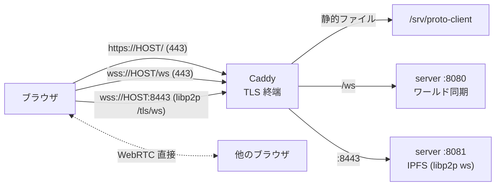

# デプロイ (VPS)

開発用の VPS (Ubuntu 26.04) にインターネット公開するための構成と手順。
スクリプトは `deploy/` にある。

## 公開構成



| 公開ポート | 用途 |
|---|---|
| 22/tcp | SSH |
| 80/tcp | ACME (HTTP-01) の検証と、https へのリダイレクト |
| 443/tcp, 443/udp | サイト (静的ファイル) と `wss://HOST/ws` (HTTP/3 用に udp も) |
| 8443/tcp | IPFS (libp2p) の WebSocket。ブラウザは `/tls/ws` で接続する |

- **HTTPS が必須**: IPFS (Helia / libp2p) は Web Crypto を使うため、ページが安全なコンテキスト (HTTPS か localhost) でないと動かない
  (`architecture.md` の「想定する制約」参照)。
- **ホスト名が必要**: Let's Encrypt の証明書はホスト名に対して発行される。IP アドレスだけでは取れない。
  Linode の逆引きホスト名 (`172-104-89-28.ip.linodeusercontent.com`) は、その IP アドレスに正引きもできるので、独自ドメインが無くても使える。
  独自ドメインを使う場合は A レコードを VPS の IP アドレスに向けて、`PROTO_HOST` をそのドメインにする。
- アプリ本体は `proto` ユーザー (非 root) の systemd サービス `proto-server` として 127.0.0.1 のみで待ち受ける。外に出るのは Caddy だけ。
- クライアントは、HTTPS で開かれたときだけ、ワールド同期を `wss://<オリジン>/ws`、libp2p を `/dns4/<host>/tcp/<IPFS_PUBLIC_PORT>/tls/ws/...` に接続する
  (`apps/client/src/net/connection.ts`, `ipfs.ts`)。HTTP (開発時) の挙動は変わらない。

## サーバーの環境変数

| 名前 | 既定値 | 説明 |
|---|---|---|
| `HOST` | `0.0.0.0` | 待ち受けアドレス。リバースプロキシの背後なら `127.0.0.1` |
| `PORT` | `8080` | ワールド同期 (WebSocket) |
| `IPFS_PORT` | `8081` | libp2p の WebSocket |
| `IPFS_PUBLIC_PORT` | `IPFS_PORT` と同じ | ブラウザから見た libp2p のポート (Caddy の 8443)。`welcome` でクライアントに伝える |

## 手順

### 0. 前提: ネットワークで 80 / 443 / 8443 を開ける

**VPS の外側のファイアウォールで、受信 TCP 80 / 443 / 8443 (と任意で UDP 443) を許可しておくこと。**
Linode の場合は Cloud Manager の Firewalls (Network → Firewalls) で、この Linode に割り当てられているルールを確認する。
VPS 内の ufw を開けても、手前のファイアウォールが塞いでいると通信は届かず、証明書も取得できない
(Let's Encrypt の検証が「Timeout during connect (likely firewall problem)」で失敗する)。

確認方法 (手元のマシンから):

```sh
for p in 80 443 8443; do timeout 6 bash -c "exec 3<>/dev/tcp/<VPS の IP>/$p" 2>/dev/null && echo "$p: open" || echo "$p: no response"; done
```

### 1. VPS を構築する (初回のみ。何度実行しても同じ結果になる)

```sh
ssh root@<VPS> "PROTO_HOST=<ホスト名> bash -s" < deploy/setup-vps.sh
```

Node.js (公式 tarball を SHA256 検証)、pnpm、Caddy、ufw、`proto` ユーザー、systemd サービス、Caddyfile、ファイアウォール (22 / 80 / 443 / 8443) を設定する。

### 2. アプリをデプロイする

```sh
DEPLOY_HOST=root@<VPS> SSH_KEY=~/.ssh/<鍵> deploy/deploy.sh
```

ビルド (型チェック + クライアントのビルド) → `rsync` で転送 → VPS で `pnpm install --frozen-lockfile` → サービス再起動。
クライアントのビルド成果物は `/srv/proto-client`、サーバーのソースは `/opt/proto/app` に置かれる。

### 3. 確認する

```sh
curl -sSI https://<ホスト名>/            # 200
ssh root@<VPS> journalctl -u proto-server -n 20 --no-pager
ssh root@<VPS> journalctl -u caddy --no-pager | grep -E "obtain|certificate"
```

ブラウザで `https://<ホスト名>/` を開き、HUD に「IPFS: 接続済み」と出ることを確認する。

## 運用上の注意

- **証明書の取得に失敗している間、Caddy は自動で再試行する** (Let's Encrypt のレート制限を避けるため、途中からステージング環境で試す)。
  ポートを開けた後に急ぐ場合は `systemctl restart caddy`。
- サーバーを再起動すると、置かれた画像とワールドの状態は消える (メモリのみ)。
- 認証がなく、誰でも入室して画像を置ける。オブジェクト数 (100)・画像サイズ (5MB)・同時検証数 (4) の上限があるだけ。公開範囲には注意すること。
- Node / pnpm のバージョンは `deploy/setup-vps.sh` の `NODE_VERSION` / `PNPM_VERSION` で固定している (開発環境と同じ)。

## 検証状況

- 公開 URL `https://172-104-89-28.ip.linodeusercontent.com/` (Linode, Ubuntu 26.04) で確認済み。
  - Let's Encrypt の証明書が自動取得され、HTTP/2、`http://` は `https://` へ 308 リダイレクト。
  - `wss://HOST/ws` で入室でき、`welcome.ipfs.wsPort` は 8443。`https://HOST:8443` は libp2p の WebSocket サーバー (HTTP リクエストには 400) に届く。
  - ヘッドレス Firefox (puppeteer-core) で、入室・IPFS 接続・画像の配置・配置した人が退室した後に入室した人への表示を確認。
    WebRTC が通る場合は `P2P 1`、通らない場合 (`P2P 0`) もサーバー経由 (libp2p wss) で画像が表示される。
  - 手順どおりの再デプロイ (`deploy/deploy.sh`) も確認済み。
- 未確認: 実機のブラウザ (別マシン、Chrome 系) からの利用、複数マシン間の WebRTC 直接接続 (TURN は無いため、環境によってはサーバー経由になる)。
