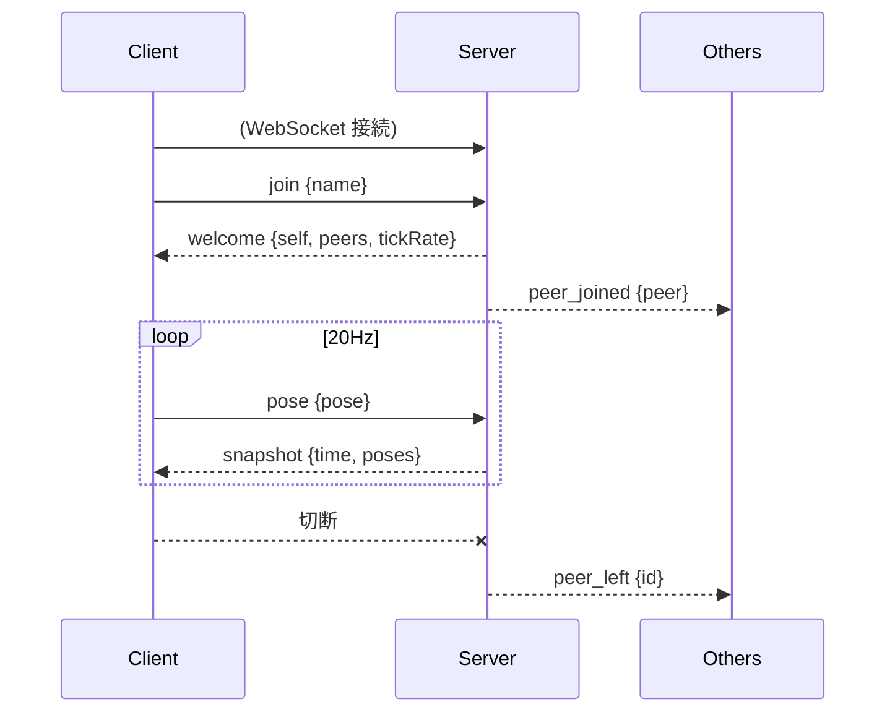
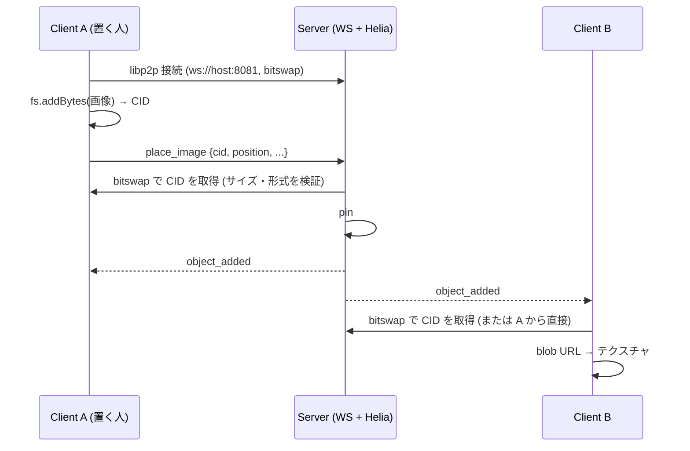

# 詳細設計

`architecture.md` の構成を前提に、プロトコル・同期・クライアント内部の設計を定める。
実装中に変更してよい。変更した場合はこのドキュメントを更新する。

## 1. 座標系・単位

- three.js の座標系に合わせる: 右手系、Y 軸が上、-Z が前方。
- 単位はメートル。
- 回転は **クォータニオン `[x, y, z, w]`** で表す (VR で頭の傾きが必要になるため、yaw のみにしない)。

## 2. データモデル

```ts
type Vec3 = [number, number, number];
type Quat = [number, number, number, number];

/** ユーザーの姿勢。将来 hands などを追加できるようにする。 */
interface Pose {
  position: Vec3; // 足元のワールド座標 (ジャンプ中は、地面 (Y=0) より上)
  head: Quat;     // 頭の向き (ワールド)
  crouch?: number; // しゃがみの深さ (0 = 立つ、1 = しゃがみきる)。無ければ 0
  lean?: number;   // リーン (-1 = 左いっぱい、0 = まっすぐ、1 = 右いっぱい)。無ければ 0
}

interface PeerInfo {
  id: string;   // サーバーが採番
  name: string; // 表示名
  color: string; // "#rrggbb"。サーバーが割り当て
  avatarCid?: string; // アップロードされた VRM の CID。無ければ簡易アバター
}

interface PeerState extends PeerInfo {
  pose: Pose;
}

/** ワールドに置かれたオブジェクトに共通の項目。 */
interface ObjectBase {
  id: string;      // サーバーが採番
  position: Vec3;  // 下辺中央
  yaw: number;     // Y 軸回り (水平方向) の向き。法線は +Z を yaw 回したもの
  pitch?: number;  // X 軸回り (垂直方向) の傾き (rad)。回転順序は YXZ。無ければ 0
  heldBy?: string; // 今つかんでいる人 (PeerInfo.id)。つかまれていなければ無い
}

/** 画像。鉛直な平面。width / height は m。 */
interface ImageObject extends ObjectBase {
  kind: "image";
  cid: string;     // 画像 (UnixFS ファイル) の CID。IPFS から取得する
  width: number;   // 0.1〜20
  height: number;  // 0.1〜20
  name?: string;   // 元のファイル名 (ダウンロード時の名前)
}

/** 任意のファイル。ファイルの形のアイコンの板 (FILE_ICON_WIDTH x FILE_ICON_HEIGHT = 0.9m x 1.2m、床から 0.6m 浮かせる)。 */
interface FileObject extends ObjectBase {
  kind: "file";
  cid: string;
  name: string;    // サーバーが sanitizeFileName で整えたもの
  size: number;    // stored ならサーバーが実際に取得して測ったバイト数。まだなら、ファイルのメタデータの宣言サイズ
  category: "audio" | "video" | "file"; // アイコンの種類。サーバーが名前と中身から判定する
  stored: boolean; // サーバーが中身を保持しているか。16MiB 超のファイルは、置いた直後は false で、サーバーが取り終えると true
  owner?: string;  // stored になるまで配っている人 (PeerInfo.id)
  offline?: boolean; // 保持しておらず、配っている人も退室した (取得できない)
}

/** デモ空間のボックス。サーバー同期オブジェクト。position は底面の中央。つかんで動かせ、複製・削除もできる (ダウンロードは無い)。 */
interface BoxObject extends ObjectBase {
  kind: "box";
  size: number;  // 一辺 (m)
  color: string; // "#rrggbb"
}

type WorldObject = ImageObject | FileObject | BoxObject;
```

## 3. プロトコル

WebSocket 上で JSON テキストメッセージを送受信する。すべてのメッセージは `type` フィールドを持つ。

### Client → Server

| type | フィールド | 説明 |
|---|---|---|
| `join` | `name: string` | 入室要求。接続後に最初に 1 回だけ送る |
| `pose` | `pose: Pose` | 自分の姿勢。20Hz で送信 |
| `place_image` | `cid`, `position`, `yaw`, `width`, `height`, `name?` | IPFS に追加済みの画像を置く。サーバーが中身を検証してから配置する |
| `place_file` | `cid`, `name`, `position`, `yaw` | IPFS に追加済みの任意のファイルを置く。`size` と `category` はサーバーが中身から決める (送っても無視される) |
| `request_file` | `id` | まだサーバーが保持していないファイル (取得中) の、取得の完了を待つ。ダウンロードで、先に試した直接の取得がだめだったときの切り替え先。要求した人にだけ `prepare_progress` / `prepare_failed` が返り、終わると `object_updated` (`stored`) が全員に配られる |
| `place_box` | `position`, `yaw`, `pitch?`, `size`, `color` | ボックスを置く (デモ・テスト用。クライアントの UI からは送らない) |
| `ipfs_peer` | `peerId: string` | 自分の libp2p ピア ID を知らせる。他のブラウザから WebRTC で接続してもらえる状態になってから送る |
| `set_avatar` | `cid: string \| null` | 自分の VRM アバターの CID を知らせる (`null` で簡易アバターに戻す)。入室時のアップロード完了後に送る |
| `grab_object` | `id` | オブジェクトをつかむ。他の人がつかんでいると拒否される |
| `move_object` | `id`, `position`, `yaw`, `pitch?` | つかんでいる間の移動 (つかんでいる本人だけが送れる)。20Hz |
| `release_object` | `id` | 離す |
| `delete_object` | `id` | 削除する。他の人がつかんでいるものは削除できない |
| `duplicate_object` | `id` | 複製する (元の隣に置かれる) |

### Server → Client

| type | フィールド | 説明 |
|---|---|---|
| `welcome` | `self: PeerInfo`, `peers: PeerState[]`, `objects: ImageObject[]`, `ipfs: { peerId, wsPort }`, `iceServers?: IceServer[]`, `tickRate: number` | `join` への応答。自分の ID、既存ユーザー、既に置かれているオブジェクト、サーバーの IPFS ノードの接続情報、WebRTC 用の STUN / TURN 設定 (TURN 未設定なら省略) |
| `object_added` | `object: WorldObject` | オブジェクトが置かれた (置いた本人を含む全員へ) |
| `object_updated` | `object: ImageObject` | 位置・向き・つかまれている状態が変わった (オブジェクト全体を送る) |
| `object_removed` | `id: string` | オブジェクトが削除された |
| `place_progress` | `cid`, `loaded`, `total?`, `queued?` | 置こうとしている中身を、サーバーが取得している途中 (置いた本人にだけ)。`queued` は順番待ち |
| `prepare_progress` | `cid`, `loaded`, `total?`, `queued?` | `request_file` の進捗。サーバーが、置いた人から取得している途中 (要求した人にだけ) |
| `prepare_failed` | `cid`, `message` | `request_file` が失敗した (置いた人が退室した、容量が足りない、など) |
| `peer_ipfs` | `id: string`, `ipfsPeerId: string` | 他のユーザーが IPFS ノードの準備を終えた。受け取った側がそのピアへ WebRTC で接続しに行く |
| `peer_avatar` | `id: string`, `cid: string \| null` | 他のユーザーの VRM アバターが変わった (本人以外へ)。`null` は簡易アバターに戻った |
| `peer_joined` | `peer: PeerState` | 他ユーザーの入室 |
| `peer_left` | `id: string` | 他ユーザーの退室 |
| `snapshot` | `time: number`, `poses: Record<id, Pose>` | 全ユーザーの最新姿勢。20Hz |
| `error` | `message: string` | 不正な入力など。入室後の `place_image` 失敗では切断せず、client は HUD に表示する |

### シーケンス



### 画像・ファイルの共有 (IPFS)

画像・ファイルの中身は WebSocket に載せず、IPFS (Helia 7 / libp2p) で共有する。ワールドには CID だけを載せる。
以下の流れと検証は画像の場合 (`place_image`)。ファイル (`place_file`) の違いは、次の「ファイルの配置とダウンロード」を参照。



- **サーバーの Helia ノード**: libp2p の WebSocket (`IPFS_PORT`, 既定 8081) で待ち受ける。ブラウザの接続先、circuit relay、pin 済み画像の提供元を兼ねる。
  ブロックストアはディスク (`BLOCKSTORE_DIR`、既定は一時ディレクトリ)。起動のたびに空にする (再起動でワールドの状態が消えるので、残しても参照されない)。
- **ブラウザの Helia ノード**: 入室 (`welcome`) 後に起動し、`welcome.ipfs` とページのホスト名から組み立てた
  `/<host>/tcp/<wsPort>/ws/p2p/<peerId>` でサーバーに接続する。
  トランスポートは WebSocket / WebRTC / circuit relay。ルーティング (DHT・公開ゲートウェイ) は使わない。
- **取得**: CID を `unixfs.cat` で取得し (上限 5MB・30 秒)、Blob → blob URL → `TextureLoader` で読み込む。CID ごとにキャッシュする。
  失敗したら灰色の板のままにする。
- **検証 (server)**: `place_image` の CID を取得しながら、5MB を超えたら中止、先頭バイトが PNG / JPEG / GIF / WebP でなければ拒否 (SVG は不可)、
  データが 20 秒届かなければ拒否する (合計の時間ではなく、止まっているかで見る)。通ったら pin する (pin 済みの CID は何もしない)。同じ人の分は 1 件ずつ順に、全体では同時に 4 件まで取り込む (順番待ち。後述)。オブジェクト数の上限は 100。
- **CID の形式**: UnixFS ファイルの CID (codec は dag-pb / raw、ハッシュは sha2-256) のみ。サーバーは正規化した文字列を保持する。
- **ブラウザ同士の直接接続**: ブラウザは中継に予約を作り (`/p2p-circuit/webrtc` のアドレスを持つ) 、
  ダイヤル可能になってから `ipfs_peer` を送る。サーバーは本人以外に `peer_ipfs` を送り、受け取った側が
  `<サーバーのアドレス>/p2p-circuit/webrtc/p2p/<相手>` へ接続する (既存の参加者 → 新しい参加者の一方向)。
  接続が確立すると bitswap が直接のピアからも取得するようになる。HUD の `P2P n` は直接接続の数。
  失敗しても (NAT 越えできないなど) サーバー経由の取得は続く。
- **STUN / TURN**: サーバーに `TURN_HOST` / `TURN_SECRET` が設定されていると、`welcome.iceServers` に STUN (自前の coturn と公開 STUN) と、ユーザーごとの時間制限つき TURN 認証情報 (`username = <期限>:<ユーザー ID>`、`credential = base64(HMAC-SHA1(共有秘密, username))`) を入れて配る。クライアントはこれを libp2p の WebRTC (`rtcConfiguration.iceServers`) に渡す。未設定のときは libp2p の既定 (公開 STUN のみ)。ページに `?ice=relay` を付けると中継 (TURN) だけを使う (診断用)。

### ファイルの配置とダウンロード

任意のファイルをドロップすると、ファイルの形のアイコン (`FileObject`) として置かれる。音声・映像は専用のアイコンで、種類が分かる。

**画像かファイルか (クライアントの振り分け)**
- PNG / JPEG / GIF / WebP で、5MB 以下で、画像として読み込めるもの (極端な縦横比でないもの) だけが画像 (`place_image`) になる。
- それ以外はすべてファイル (`place_file`)。SVG (スクリプトを含み得るので表示しない)、5MB を超える画像、読み込めない画像も、ファイルとして置かれる。
- 2 GiB (`MAX_FILE_BYTES`) を超えるものは置かない (HUD に通知)。フォルダは置けない (中身を読めないので、通知して無視する)。
- ファイルのアイコンは、画像と同じ「置いた人の方を向く・横並び」の規則で置き、床から 0.6m 浮かせる (正面を向いたまま狙いやすい高さ)。

**サーバーの検証 (`place_file`)**
1. `cid` が dag-pb / raw・sha2-256 でなければ拒否。`name` は `sanitizeFileName` で整える。
2. `fs.stat` でルートのブロックだけを取得し、ディレクトリなら拒否、サイズ (UnixFS のメタデータ) が上限を超えていれば、中身を取得する前に拒否する。
3. 中身を取得しながら、実際のバイト数を数える (申告ではなく実測)。2 GiB を超えたら中止。タイムアウトは「データが届かない状態が 30 秒続いたら」(画像は 20 秒)、合計の上限は 1 時間。取得の途中経過を、置いている本人に `place_progress` で知らせる。
4. 実測のサイズと、先頭 16 バイトを得る。`category` は `classifyFile(name, head)` で決める。
5. 合計容量の上限 (既定 20 GiB) に収まれば pin して、`object_added` を配る。容量は、ルートのブロックから分かる宣言サイズで、取得を始める前に予約する (大きなファイルを取得してから、容量が足りないと分かって捨てることのないように)。収まらなければ拒否して、取得したブロックを片付ける。

**アイコンの種類 (`classifyFile`)**
- 拡張子で判定する。音声: mp3 / wav / ogg / opus / flac / aac / m4a など。映像: mp4 / webm / mkv / mov / avi など。
- 拡張子が無い・未知のときだけ、先頭バイト (ID3、RIFF、OggS、fLaC、ftyp、EBML など) で補う。拡張子が申告より優先される。
- 判定はアイコンの表示にしか使わない (中身は検証・実行しない)。判定できなければ汎用のファイルアイコン。

**保持と解放 (`ContentStore`)**
- 画像・ファイルの中身は、CID ごとに 1 つだけ保持し、指しているオブジェクトの数 (参照) を数える。複製や同じファイルの再投入では、取得し直さず、容量も増えない。
- 最後の参照が無くなったら (`delete_object`) unpin し、gc でメモリを空ける。短時間の連続削除は 1 回の gc にまとめる。
- gc は、取得中のブロックを消さないよう、取得が終わっているときだけ行う。gc の最中に始まる取得は、終わるまで待たせる。
- 容量の判定と登録は同期的に行う (pin の待ち時間の間に、同時に始まった追加が容量を二重に使わないように)。

**大きなファイルの扱い (最大 2 GiB)**

2 GiB のファイルを、サーバーとブラウザのメモリを使い切らずに扱うための設計。

- **サーバー**: ブロックはメモリではなくディスク (`FsBlockstore`) に置く。サーバーのメモリは、ファイルのサイズに比例せず、転送 1 件あたり 150〜200MiB 程度で頭打ちになる。
- **アップロード (ブラウザ)**: ファイルを丸ごと読まず、**ブロックを保存もしない**。「このブロックは、ファイルの何バイト目から何バイト分か」という索引だけを作り (`FileBackedBlockstore`)、
  サーバーが取りに来たときに、元のファイルから該当部分を読んで渡す (読んだ内容は、CID と一致するか確かめてから渡す)。コピーを作らないので、メモリもディスクも使わず、取り込みはハッシュの計算の速さで済む。
  Helia と同じ設定 (CIDv1・1MiB の固定チャンク・均衡レイアウト・生のブロック) で取り込むので、同じファイルは Helia の `addByteStream` と同じ CID になる。
  索引は「生のブロックが書かれた順に、ファイルの先頭から並んでいる」ことを前提にするので、インポーターは `blockWriteConcurrency: 1` (順番に書く) で動かす。
- **サーバーが取り終えるまで配る**: サーバーが取り終えて `object_added` が届いたら、配るのをやめて索引を捨てる。取っている間は、サーバーの `place_progress` が届くたびに配り続ける時間を延ばし、通知が途絶えたら (断られた・失敗した) 2 分で諦める。
- **ダウンロード (ブラウザ)**: 取得したブロックは保存せず、流して Blob にする (`assembleBlob`)。全チャンクを配列に溜めず、32MiB ごとに Blob にまとめる。
  **チャンクは受け取った時点で必ずコピーする** (取得元がバッファを再利用して書き換えても、保存されるファイルが壊れないように)。
- **順番待ち (`PlacementQueue`)**: 同じ人の分は 1 件ずつ順に取り込む。同じ接続からの転送を並列にしても速くならないため。全体では同時に 4 件まで。順番待ちの間も、本人に `place_progress` (`queued`) を 10 秒ごとに送る。
  本人が退室したら、待っている分は取り消す。

> **IndexedDB は使わない**: 当初は、ブラウザ内のブロックストアを IndexedDB にしたが、Firefox では 1MiB あたり 0.2〜0.3 秒かかり、サーバーが数十ブロックを一度に要求すると応答が間に合わず、転送が止まった。
> メモリ上のブロックストアは速いが、ファイルのサイズ分のメモリを使う。そのため、上の「元のファイルから直接配る」設計にした。

**大きなファイルの取り込み (16MiB を超えるファイル): 置いた直後に、サーバーがバックグラウンドで取得する**

置いた人は、いつ退室するか分からない。そのため、ファイルは置いた時点で、サーバーが取得して保持する。
ただし大きなファイルは、取得に時間がかかる (2 GiB で約 1 分) ので、取り終えるのを待たずに、先にワールドに置く。

- **置くとき (`place_file`)**: `ContentStore.probe` が、先頭 16 バイトと宣言サイズだけを取得する (`fetchVerified` の `headOnly`)。
  16MiB (`EAGER_FILE_MAX_BYTES`) 以下、またはサーバーが既に保持している内容は、全部取得して pin してから置く (`stored: true`)。
  16MiB を超えていれば、すぐに `stored: false`・`owner: <置いた人>` で `object_added` を配り、続けて、サーバーが全部をバックグラウンドで取得する (`stageFile`。`started at placement`)。
  `size` は、取り終えるまでは宣言サイズ (申告。取得するときに上限を守らせる)。容量は、取得を始めるときに宣言サイズで予約する。
- **置いた人のブラウザ**: `keepServing` で、元のファイルから配り続ける (サーバーが取り終えるまで、このタブを開いたままにする必要がある。HUD に案内を出す)。
  取得の進捗は `place_progress` で届く。サーバーが保持したら (`object_updated` で `stored`) 配るのをやめる。
- **取得できなかったら**: 容量が足りない・取得できない・順番待ちが多すぎる場合は、そのファイルを取り除き (`object_removed`)、置いた人にだけエラーを知らせる (`Room.removeUnstored`)。
  置いた人が退室して `offline` になったものは、取り除かずに残す。
- **ダウンロード**: クライアントは、サーバーが保持していない (`stored` でない)・自分が配っていないファイルは、**先に、繋がっている相手から直接取得を試す** (`fetchBlob`)。
  データが 8 秒届かない・失敗したときは、`request_file` に切り替える。サーバーが、この取得の完了を待っている人に加えて (`prepare_progress`)、終わったら `object_updated` (`stored`) を配るので、
  クライアントは、そのあとで取得し直す。同じ内容の取得は 1 回 (`staging`)。順番待ちは、置いた人 (`owner`) ごとに 1 件ずつ (`PlacementQueue`)。置いた人が退室していれば、`request_file` は理由つきで失敗する。
  実測では、置いた直後のダウンロードは、サーバーが取得を進めるのに合わせて、サーバーから (保持される前でも) 届いた。`request_file` に切り替わるのは、データが 8 秒届かないときだけ。
- **削除・複製**: 保持していないファイルは、サーバーの参照を数えない (`holdsContent`)。削除してもディスクは変わらない。
- **取得元の確認**: クライアントは、ダウンロードで受け取ったブロックごとに、送ってきたピアを数え (`fs.cat` の `onProgress` の `bitswap:block`)、HUD と `console` に内訳を出す。
  ピアは、サーバー / ユーザー名 (直接 WebRTC) / ユーザー名 (中継) に分けて表す (ユーザー名は、`welcome` の `peers[].ipfsPeerId` と `peer_ipfs` から)。サーバーも、取得ごとに `[stage_file] ... blocks from: owner=N` をログに出す。
- **bitswap の再送の窓**: 送信側は、既定では「直前に送った」という理由で、同じ相手から要求されたブロックを 5 秒間再送しない。取得が途中で中断して取り直すと、その要求は無視され、
  受信側も要求を送り直さないため、両方が待ち続けてアイドルタイムアウト (30 秒) になる (しばらく待つと成功する、という間欠的な失敗になる)。
  サーバーとブラウザの bitswap は、ともに `doNotResendBlockWindow: 0` にして、重複した要求にも再送するようにした。`fetchVerified` の `retryAfterMs` (最初のデータが 4 秒届かなければ取り消して要求し直す) は、保険として残している。

**ダウンロード (`net/download.ts`)**
- リングメニューの「ダウンロード」。オブジェクトの `cid` を IPFS から取得し (上限は種類ごと。データが 30 秒届かなければ中止)、Blob にして、`<a download>` で保存する (ページは開かない)。
- 最初のブロックが届かないとき (直前に同じブロックを送った相手は、want を無視することがある) は、5 秒で取り消して要求し直す (最大 8 回)。
  同じ CID を直後に取り直すと、5〜15 秒かかることがある (通常の UI では、サムネイルを `/media` から読むので、この競合は起きない)。
- ファイル名は `name` を、念のためクライアントでも `sanitizeFileName` にかけたもの。名前の無い画像は、`image-<CID の末尾>.<形式の拡張子>`。
- 進捗 (割合と取得済みのバイト数) と結果は HUD に表示する。同じオブジェクトの二重のダウンロードは始めない。
- 取得は、サーバーの Helia ノードか、直接つながったブラウザから行われる。置いた人が退室していても、サーバーが pin していれば取得できる (取得中のファイルは、上記のとおり)。

**動画の再生 (`world/FilePlane.tsx` + `world/videoPlayback.ts` + `net/p2pMedia.ts` + `public/p2p-media-sw.js`)**
- 映像 (`FileObject.category === "video"`) のリングメニューに「再生 / 一時停止」を出す (`applies` で対象を絞る。ボタンの文字は、`label` の関数で状態によって変える)。
- **空間の中のプレイヤー**: 再生すると、そのオブジェクトの板が映像の縦横比の画面 (最大 1.8m x 1.2m) に広がり、`THREE.VideoTexture` で動画を表示する
  (DOM に置いた不可視の `<video>` からフレームを取る)。全画面のオーバーレイは出さず、オブジェクトの位置 (下辺中央)・向きはそのままなので、つかんで動かしても画面が付いてくる。
  もう一度メニューで「一時停止」すると、アイコン (サムネイル) に戻る。再生はクライアントごと (他の人には同期しない)。
- **サムネイル**: アイコンの映像の絵柄の代わりに、動画の 1 コマ (10% の位置、最大 2 秒) を描く (`fileIcon.ts` の `thumbnail`)。取得できるまでは、これまでの映像のアイコン。
  サムネイルはサーバーの `/media` から読む (メタデータと 1 コマだけ)。**サムネイル用と再生用の `<video>` を分ける**: 再生用の要素は、最初から `/p2p-media/<id>` を持たせて
  `preload="none"` で待機させる (再生のときに src を切り替えると、Firefox で再生が中断されるため)。サムネイルの P2P 取得と、ダウンロードが同じ CID を同時に要求すると
  bitswap の want が止まるため、サムネイルは P2P にしない。サムネイルの取得が終わったら、その要素は一時停止して残す。
- **配信 (ブラウザ同士の P2P)**: `<video>` は HTTP の URL しか再生できないため、Service Worker が `/p2p-media/<id>` への要求 (Range を含む) を横取りする。
  SW はページに `open` / `pull` を送り、ページはブラウザ内の Helia (`fs.cat` / `ipfs-unixfs-exporter`) から 1 チャンクずつ返す。SW はそれを HTTP のストリームとして返す
  (`Accept-Ranges: bytes`、`Content-Range`、`Content-Length`、`Content-Type`)。これにより、全体の取得を待たずに再生が始まり、シークもできる。
  取得は、サーバー以外の、直接つながっているブラウザだけを provider にした bitswap セッションを先に試す (`blockstore.createSession`)。ブラウザが持っていない場合だけ、
  通常の取得 (サーバーなども含む) に切り替える。**置いた人のブラウザは、サーバーが保持したあとも、タブが開いている間は映像を配り続ける** (`needsLocalFile` の映像の扱い)。
- **フォールバック**: Service Worker が使えない環境 (非対応・非セキュアコンテキスト・制御前) では、サーバーの `GET /media/<cid>` を使う。
  サーバーは `Range` 要求に 206 で応え、要求された範囲だけを IPFS から流す。配るのは、サーバーが保持している (`stored`) ファイルだけ。
  配信の間は `ContentStore.retain` で参照を増やし、途中で削除されてもブロックが消えないようにする。
- まだ保持していない映像は、これまでの映像のアイコンのまま (サーバーが保持したら、サムネイルと再生の準備をする)。
- 音声付きの再生がブラウザに止められた場合は、ミュートで再生して、その旨を知らせる。
- Service Worker は `public/p2p-media-sw.js` (ビルドで `dist` の直下に置かれる)。登録時に `clients.claim()` で、開いているページも制御する。
  開発時は Vite が `/media` をサーバーへプロキシする。本番は Caddy が `/media/*` を `127.0.0.1:8080` へ転送する (`deploy/setup-vps.sh`)。
- `<video>` が使う Range 要求に、ブラウザ内の IPFS から答えるために SW を使っている。他のファイルは、これまでどおり IPFS (bitswap) で取得する。

**カーソル (白い点)**
- 画面中央の小さな白い点 (`CursorDot`)。視点・位置が動いている間と、止まってから 3 秒間だけ表示する (入室直後も 3 秒)。
  つかんでいる間は表示し続け、メニューを開いている間は出さない。
- 選択はこの点を通るレイ (画面中央から、**距離の制限なし**) で行う。最初に当たったオブジェクトが「狙っている」対象で、白い輪郭で強調する。
  他の人がつかんでいるものは琥珀色の輪郭にする。

**つかむ (右ボタン)**
1. 右ボタンを押すと、狙っているオブジェクトをつかむ。他の人がつかんでいれば何もせず HUD に通知する。
2. `grab_object` を送り、応答を待たずに手元でつかみ始める (楽観的)。他の人に先を越されていた場合は、サーバーが本人にだけエラーと現在の状態 (`object_updated`) を返し、手元のつかみを取り消す。
3. つかんでいる間、オブジェクトは自分の動きについてくる。つかんだ瞬間の「カメラの水平な向きから見た相対位置・向き」を覚えておき、毎フレーム現在のカメラ位置と yaw から求め直す (`carry.ts`)。
   水平方向の範囲はワールド内に丸める。
   **移動モード (既定)**: マウスを上下に動かす (視点を上げ下げする) と、つかんだものが**視線の先に付いたまま**持ち上がる・下がる (高さ Y)。
   目の高さから見たオブジェクトの仰角に、視点を上下させた量を足して、水平距離のところの高さに直す (`liftedHeight`)。遠いものほど大きく動く。
   範囲は、床 (0m) から 20m まで。範囲に当たっても、仰角は丸めた高さから求め直すので、視点を戻せばすぐ動き出す。
   **遠近**: どちらのモードでも、マウスホイールで、つかんだものを視線に沿って遠ざける (上に回す) / 引き寄せる (下に回す)。1 目盛りで水平距離が 1.12 倍 (または 1/1.12 倍) になる (`pulled`)。
   カメラから見た向きと、目の高さから見た仰角は変えないので、視線の先に付いたまま近づく・遠ざかる (目の高さより下にあるものは、遠ざけると床へ向かい、引き寄せると上がる)。
   水平距離は 1m から 30m まで (範囲の外にあるものは、範囲の方向へだけ動く)。位置はワールド内 (±24m) に丸める。ホイールがページをスクロールしないよう、つかんでいる間は既定の動作を止める。
   **回転モード**: **E キー**で、移動モードと切り替える (つかんでいる間だけ。離すと移動モードに戻る)。回転モードでは視点を固定し (`LocalPlayer` が視点を動かさない)、
   マウスの動きでオブジェクトを回す: 左右 = 水平方向 (yaw)、上下 = 垂直方向 (pitch、手前の面がマウスの動きについてくる向き)。1px あたり視点操作と同じ 0.0022rad。
   回転は、位置の基準 (下辺または底面の中央) を中心にする。歩けば、回転モードでもオブジェクトはついてくる。HUD に、いまのモードと操作を表示する。
4. 手元の位置を 20Hz で `move_object` として送る。サーバーはつかんでいる本人からの移動だけを受け付け、**本人以外**に `object_updated` を配る。
5. 右ボタンを離す (ウィンドウが非アクティブになる場合も) と、最後の位置・向き (yaw・pitch) を `move_object` で送ってから `release_object` を送る。手元の状態にも最後の位置を反映して、古い位置に戻って見えないようにする。
6. つかんだまま切断すると、サーバーが自動で離す。

**排他制御 (サーバー)**
- オブジェクトごとに「つかんでいる人」(`heldBy`) を持つ。つかんでいる間は本人だけが動かせ、他の人はつかめない・削除できない。
- 1 人が同時につかめるのは 1 個まで。別のものをつかむと、前のものは自動で離される。
- 複製は、つかまれているものにもできる。複製には `heldBy` を引き継がない。

**他の人の画面**
- 受け取った位置・向きへ、毎フレーム滑らかに近づける (指数的に追従。20Hz の更新でも滑らかに見える)。
  自分でつかんでいるものは補間せず、手元の位置をそのまま使う (遅れないように)。

**リングメニュー (中ボタン)**
- 中ボタンで、狙っているオブジェクト (つかんでいればそれ) のメニューを画面中央に開く (`RingMenu`)。何も狙っていなければ HUD に通知する。
- ボタンは円環に等間隔に並ぶ (先頭が真上)。いまは「再生 / 一時停止」(映像のみ)「削除」「複製」「ダウンロード」(ボックスには出さない。`applies` で対象を絞る。文字は `label` の関数で状態によって変えられる)。`ITEMS` に足せば増やせる。リングの中心には、対象の名前とサイズを表示する。
- マウスで選べるよう、開くときに Pointer Lock を解除し、選択したら (クリック = ユーザー操作の中で) 取り直す。
  外側のクリック・中ボタン・Esc で何もせず閉じる。開いている間は視点・移動を止める。
- 削除: `delete_object`。サーバーは、最後の参照が無くなった中身を unpin してメモリを空ける。
- 複製: `duplicate_object`。サーバーが、元の右・手前に 5cm ずらした位置 (向き・大きさ・内容は同じ) に新しいオブジェクトを置く。右へのずらし量は、画像は 0.6m、ファイルのアイコンは重ならない距離 (アイコンの幅 + 0.15m)、ボックスは一辺 + 0.2m。同じ描画面での重なり (描画のちらつき) を避けるため、手前に少しずらす。上限 (100 個) に達していれば拒否する。
- ダウンロード: 対象の中身を IPFS から取得して保存する (上記)。
  (同一平面での描画のちらつきを避けるため、手前に少しずらす)。上限 (100 個) に達していれば拒否する。

### VRM アバター

入室画面で任意の `.vrm` を選ぶと、そのユーザーのアバターとして表示する。上限は `MAX_AVATAR_BYTES` (64 MiB)。
選んだファイルは入室時にブラウザの IPFS へ追加し、ワールドには CID だけを載せる。モデルのプレビューは無い。

**プロトコル**
- `PeerInfo.avatarCid?: string` に、そのユーザーの VRM の CID が入る。`welcome` の `peers` と `peer_joined` に含まれる。
- `set_avatar {cid: string | null}` (Client → Server): アップロード完了後に自分の CID を知らせる。`null` は簡易アバターに戻す。
  CID は置くファイルと同じ形式 (dag-pb / raw、sha2-256) に正規化して受け付ける。
- `peer_avatar {id, cid}` (Server → Client): 他のユーザーのアバターが変わったことを、本人以外へ配る。`cid: null` は解除。

**アップロード (client)**
- ロビーで選ばれた `File` は、`welcome` と IPFS ノードの起動を待ってから、バックグラウンドで `addContent` する (入室は待たせない)。
  CID を得たら `keepServing(cid)` で、このタブが開いている間は他のピアへ配り続け、`set_avatar` を送る。
- 64 MiB を超えるファイルはアップロードせず、HUD に通知する。
- アバターを差し替えたときは、前の CID の配布をやめる (`releaseUpload`)。切断時は IPFS ノードごと止める。

**サーバーでの保持 (pinning)**
- `set_avatar` を受けると、`ContentStore.add(cid, "avatar")` で、アップロードした人のブラウザから中身を取得し、検証して pin する。
  種類は `ContentKind = "avatar"`、上限は 64 MiB (`MAX_AVATAR_BYTES`)、アイドルタイムアウトは 30 秒。画像の形式判定は行わない。
- 取得と pin が終わってから `Room.setAvatar` で `PeerInfo.avatarCid` を記録し、`peer_avatar` を配る。取得に失敗した場合は CID を配らず、本人にエラーを返す。
- 参照カウント (`ContentStore` の refs) で保持する。同じ CID を複数のユーザーが使えば 1 つだけ保持する。
  ユーザーが別のアバターに差し替えたときと、退室したとき (`ws` の close) に `release` し、最後の参照が無くなれば unpin して gc する。
- アバターはユーザーが部屋にいる間だけ保持され、退室するとサーバーから解放される (永続化しない)。

**読み込みと表示 (client)**
- `loadVrm` (`world/vrmModels.ts`) が `fetchBlob` で取得した `ArrayBuffer` を CID ごとにキャッシュし (同じ CID を何度もダウンロードしない)、
  `GLTFLoader` + `VRMLoaderPlugin` (`@pixiv/three-vrm`) で VRM を作る。VRM インスタンスはピアごとに別に作る (three.js のオブジェクトは共有できない)。
  VRM 0.x は `VRMUtils.rotateVRM0` で 1.0 と同じ +Z 向きにそろえる。
- スキンメッシュは `frustumCulled = false` にする (バウンディングボックスが実際の姿勢と合わず、視界の端で消えるため)。
  読み込みに失敗した場合は `[vrm]` をコンソールに出し、簡易アバターのままにする。CID が変わると前の VRM を `deepDispose` する。
- キャッシュは参照カウント (`RefCountedCache`) で管理する。`VrmAvatar` は表示を始めるときに参照を増やし、アンマウント (ピアの退出・CID の変更) で減らす。
  最後の閲覧者がいなくなったら、`ArrayBuffer` を捨て、取得中なら `fetchBlob` を取り消す。VRM のシーンは `deepDispose` する。
  これにより、退出したユーザーのアバターを、他のクライアントが保持し続けない。
- **入室画面の保存 (`avatarStore.ts`)**: 前回の表示名を localStorage (`vr-sns:name`)、選択した VRM を IndexedDB (`vr-sns` / `settings` / `avatar`) に保存する。
  次回 Lobby を開いたときに復元し、選び直さなくてもそのまま入室できる (ファイル入力は値を設定できないため、保存した File を状態に持って `connect` に渡す)。VRM は選択時に保存し (64MiB 以下)、「クリア」で削除する。
  保存に失敗しても (プライベートモード・容量不足など) 入室はできる。保存した VRM はブラウザ内のコピーで、入室して `addContent` するまでネットワークには出ない。
- 表示中は簡易アバターの胴体と頭を隠し、名前タグはそのまま残す。読み込みが終わるまでは簡易アバターを表示する。

**姿勢の反映**
- ルート: `Pose.position` をそのままグループの位置にし、`Pose.head` の yaw に π を足して、モデルの正面 (+Z) をこのアプリの正面 (-Z) に合わせる。
- 頭: 残りのピッチ・ロールを、VRM の正面が +Z か -Z かに応じた符号で首のボーンに適用する (ピッチは ±1.2 rad に制限)。
- しゃがみ: 目の高さの低下から腰を下げる量を決め、太もも・すねの長さから 2 関節の簡易 IK で脚を曲げる。足首はすねの回転を打ち消して地面と平行に保つ。
- リーン: 背骨 (`spine` / `chest` / `upperChest`) を Z 軸回りに傾ける。脚は動かさない。
- 待機姿勢: 腕を T ポーズから A ポーズへ下ろし、ひじを少し曲げる。毎フレーム上書きする。
- 最後に `vrm.update(delta)` を呼び、スプリングボーン (髪・揺れ物) を進める。
- 補間は簡易アバターと同じ `RemoteAvatar` の `useFrame` で行い、補間済みの姿勢を `applyPose` に渡す。

**フォールバック・制限・開発用フック**
- `avatarCid` が無い、または VRM を読み込めないときは、これまでどおり手続き的な簡易アバターを表示する。
- 表情 (expression) はモデルの既定から変えない。VRM のライセンス (利用条件) の確認・表示は行わない。
- 開発時のみ `window.__avatars[peerId] = { cid, loaded, error, position }` を公開する (`import.meta.env.DEV`)。E2E テストはこれで読み込み状態と追従を確認する。

## 6. サーバー設計

### モジュール構成 (apps/server/src)

```
index.ts     起動 (WebSocketServer、画像・ファイルの検証と配置の受け付け)
room.ts      Room クラス: ピア管理、オブジェクト管理 (配置・つかむ・移動・削除・複製)、snapshot ループ
ipfs.ts      Helia ノード (libp2p ws / circuit relay)、CID の取得・検証・pin
content.ts   ContentStore: 保持する中身の管理 (種類ごとの検証・参照カウント・合計容量・unpin と gc)
images.ts    マジックナンバーによる画像形式の判定
validate.ts  受信メッセージの検証・正規化
```

### 設定 (環境変数)

| 名前 | 既定値 | 説明 |
|---|---|---|
| `PORT` | `8080` | WebSocket (ワールド同期) の待受ポート |
| `IPFS_PORT` | `8081` | libp2p の WebSocket の待受ポート。ブラウザから到達できる必要がある |
| `CONTENT_MAX_TOTAL_MB` | `20480` (20 GiB) | サーバーが保持する画像・ファイルの合計サイズの上限 (MB)。ディスクに置くので、ディスクの空きより十分小さくする |
| `BLOCKSTORE_DIR` | 一時ディレクトリの `vr-sns-proto-blocks` | 画像・ファイルの中身 (ブロック) を置くディレクトリ。起動のたびに空にする |

### 色の割り当て

入室順に固定パレットから循環して割り当てる。

### 切断検知

`ws` の ping / pong を 30 秒間隔で行い、応答のない接続は切断する。

## 7. 共有パッケージ (packages/protocol)

- 上記 `Pose` / `PeerInfo` / `PeerState` / メッセージ型を `export` する。
- 定数: `TICK_RATE = 20`、`MAX_NAME_LENGTH = 24` など。
- 実行時依存は持たない (型と定数のみ)。検証ロジックは server 側に置く。

## 8. 将来の拡張ポイント

| 拡張 | 現設計での備え |
|---|---|
| WebXR / 手の姿勢 | `Pose` にオプショナルな `hands` を追加する |
| 複数ルーム | `join` に `roomId` を追加し、server に `Room` を複数持たせる |
| アバターの表情・アニメーション | `PeerInfo.avatarCid` で VRM を同期済み。表情・モーションの状態を `Pose` に足し、`VrmAvatar` で反映する |
| ボイスチャット | 別途 SFU (LiveKit 等) を用意。ピア ID をトークン発行時の identity に使う |
| 画像以外のオブジェクト・回転 / 拡大縮小・元に戻す | `WorldObject` に `kind` を追加する。`object_updated` はオブジェクト全体を送るので、プロパティを足せばそのまま同期できる。操作・排他制御はサーバーが既に持っている |
| 音声の再生、ファイルのプレビュー、動画の再生同期 | 映像は、リングメニューで 3D 空間の中に再生できる (Service Worker + ブラウザの IPFS で P2P ストリーミング)。音声も同じ仕組みで足せる。再生位置のクライアント間の同期は未実装 |
| バイナリプロトコル | `type` 毎に固定レイアウトの `ArrayBuffer` へ移行 |

## 9. テスト・検証方針

- server: `validate.ts` の単体テスト (不正値の扱い)。それ以外は手動確認。
- client: 補間ロジック (`interpolation.ts`) の純粋関数部分の単体テスト。
- 結合: ブラウザタブを複数開いて、互いのアバターが見え、動き、退室で消えることを目視確認する。
