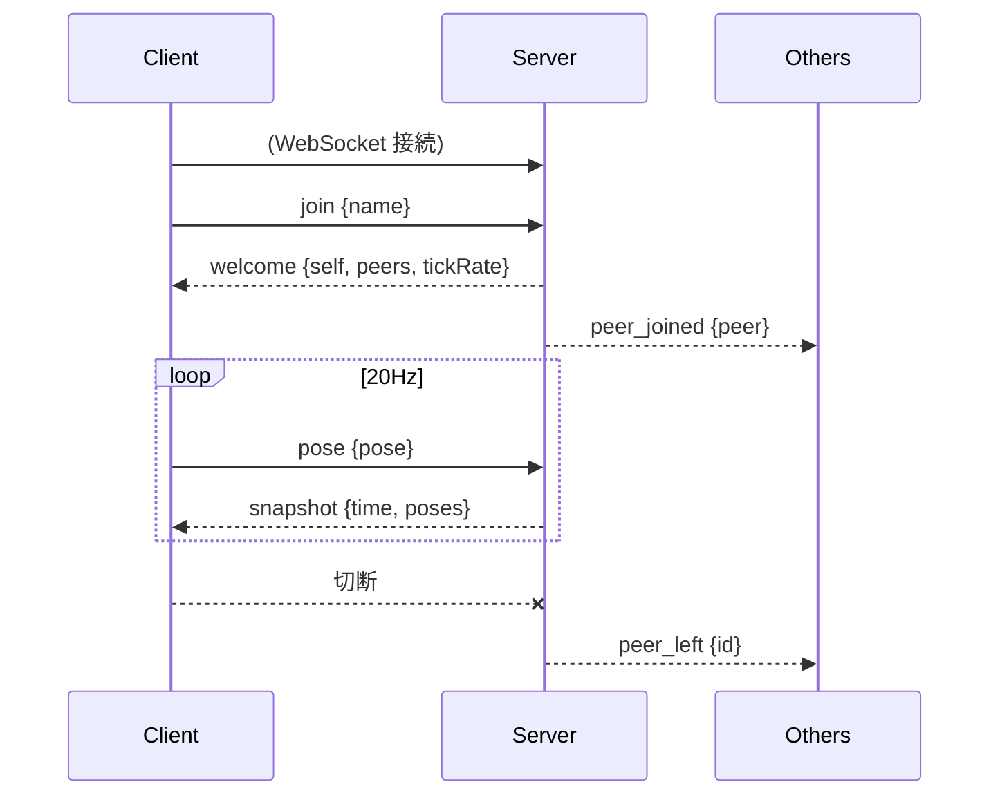
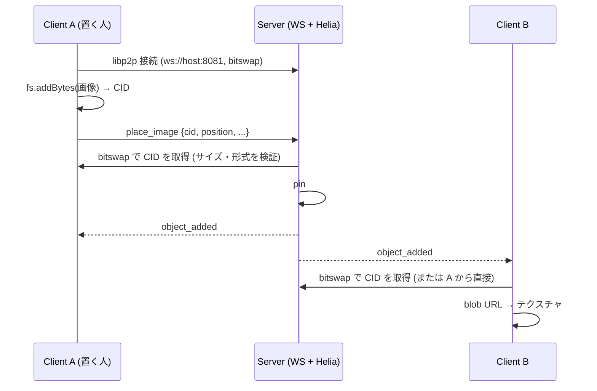

# 詳細設計

`architecture.md` の構成を前提に、プロトコル・同期・クライアント内部の設計を定める。
実装中に変更してよい。変更した場合はこのドキュメントを更新する。

## 1. 座標系・単位

- three.js の座標系に合わせる: 右手系、Y 軸が上、-Z が前方。
- 単位はメートル。
- 回転は **クォータニオン `[x, y, z, w]`** で表す (VR で頭の傾きが必要になるため、yaw のみにしない)。

## 2. データモデル

```ts
type Vec3 = [number, number, number];
type Quat = [number, number, number, number];

/** ユーザーの姿勢。将来 hands などを追加できるようにする。 */
interface Pose {
  position: Vec3; // 足元のワールド座標
  head: Quat;     // 頭の向き (ワールド)
}

interface PeerInfo {
  id: string;   // サーバーが採番
  name: string; // 表示名
  color: string; // "#rrggbb"。サーバーが割り当て
}

interface PeerState extends PeerInfo {
  pose: Pose;
}

/**
 * ワールドに置かれた画像。鉛直な平面で、法線は +Z を yaw (Y 軸回り, rad) 回した向き。
 * position は平面の下辺中央、width / height は m。
 */
interface ImageObject {
  id: string;      // サーバーが採番
  kind: "image";
  cid: string;     // 画像 (UnixFS ファイル) の CID。IPFS から取得する
  position: Vec3;
  yaw: number;
  width: number;   // 0.1〜20
  height: number;  // 0.1〜20
}
```

## 3. プロトコル

WebSocket 上で JSON テキストメッセージを送受信する。すべてのメッセージは `type` フィールドを持つ。

### Client → Server

| type | フィールド | 説明 |
|---|---|---|
| `join` | `name: string` | 入室要求。接続後に最初に 1 回だけ送る |
| `pose` | `pose: Pose` | 自分の姿勢。20Hz で送信 |
| `place_image` | `cid`, `position`, `yaw`, `width`, `height` | IPFS に追加済みの画像を置く (`ImageObject` から `id` / `kind` を除いたもの)。サーバーが中身を検証してから配置する |
| `ipfs_peer` | `peerId: string` | 自分の libp2p ピア ID を知らせる。他のブラウザから WebRTC で接続してもらえる状態になってから送る |

### Server → Client

| type | フィールド | 説明 |
|---|---|---|
| `welcome` | `self: PeerInfo`, `peers: PeerState[]`, `objects: ImageObject[]`, `ipfs: { peerId, wsPort }`, `tickRate: number` | `join` への応答。自分の ID、既存ユーザー、既に置かれているオブジェクト、サーバーの IPFS ノードの接続情報 |
| `object_added` | `object: ImageObject` | オブジェクトが置かれた (置いた本人を含む全員へ) |
| `peer_ipfs` | `id: string`, `ipfsPeerId: string` | 他のユーザーが IPFS ノードの準備を終えた。受け取った側がそのピアへ WebRTC で接続しに行く |
| `peer_joined` | `peer: PeerState` | 他ユーザーの入室 |
| `peer_left` | `id: string` | 他ユーザーの退室 |
| `snapshot` | `time: number`, `poses: Record<id, Pose>` | 全ユーザーの最新姿勢。20Hz |
| `error` | `message: string` | 不正な入力など。入室後の `place_image` 失敗では切断せず、client は HUD に表示する |

### シーケンス



### 画像の共有 (IPFS)

画像本体は WebSocket に載せず、IPFS (Helia 7 / libp2p) で共有する。ワールドには CID だけを載せる。



- **サーバーの Helia ノード**: libp2p の WebSocket (`IPFS_PORT`, 既定 8081) で待ち受ける。ブラウザの接続先、circuit relay、pin 済み画像の提供元を兼ねる。
  ブロックストアはメモリ上 (再起動で消える)。
- **ブラウザの Helia ノード**: 入室 (`welcome`) 後に起動し、`welcome.ipfs` とページのホスト名から組み立てた
  `/<host>/tcp/<wsPort>/ws/p2p/<peerId>` でサーバーに接続する。
  トランスポートは WebSocket / WebRTC / circuit relay。ルーティング (DHT・公開ゲートウェイ) は使わない。
- **取得**: CID を `unixfs.cat` で取得し (上限 5MB・30 秒)、Blob → blob URL → `TextureLoader` で読み込む。CID ごとにキャッシュする。
  失敗したら灰色の板のままにする。
- **検証 (server)**: `place_image` の CID を取得しながら、5MB を超えたら中止、先頭バイトが PNG / JPEG / GIF / WebP でなければ拒否 (SVG は不可)、
  20 秒で取得できなければ拒否する。通ったら pin する (pin 済みの CID は何もしない)。同時に検証するのは 4 件まで。オブジェクト数の上限は 100。
- **CID の形式**: UnixFS ファイルの CID (codec は dag-pb / raw、ハッシュは sha2-256) のみ。サーバーは正規化した文字列を保持する。
- **ブラウザ同士の直接接続**: ブラウザは中継に予約を作り (`/p2p-circuit/webrtc` のアドレスを持つ) 、
  ダイヤル可能になってから `ipfs_peer` を送る。サーバーは本人以外に `peer_ipfs` を送り、受け取った側が
  `<サーバーのアドレス>/p2p-circuit/webrtc/p2p/<相手>` へ接続する (既存の参加者 → 新しい参加者の一方向)。
  接続が確立すると bitswap が直接のピアからも取得するようになる。HUD の `P2P n` は直接接続の数。
  失敗しても (NAT 越えできないなど) サーバー経由の取得は続く。

### 検証ルール (server)

- `join` 前に `pose` を受けたら無視する。
- `name` は trim 後 1〜24 文字。空なら `Guest-xxxx` を割り当てる。
- `pose` の数値が有限 (`Number.isFinite`) でなければ破棄する。
- 位置は絶対値 1000 を超える場合破棄する。クォータニオンは受信時に正規化する。
- 1 メッセージの最大サイズは 4KB。超えたら切断する。
- `ipfs_peer`: `peerId` は英数字 10〜128 文字。
- `place_image`: `cid` は dag-pb / raw・sha2-256 の CID (128 文字以内)、`position` は有限かつ絶対値 1000 以下、`yaw` は有限、`width` / `height` は 0.1〜20。

## 4. 同期方式

### 送信側 (client)

- 毎フレームではなく、固定 20Hz (`setInterval` または累積時間) で `pose` を送る。
- 前回送信から変化がない場合も、生存確認を兼ねて送る (簡素化のため常時送信)。

### サーバー

- `Map<id, PeerState>` をメモリ上に保持。
- 20Hz のタイマーで `snapshot` を全員に送る。自分自身の姿勢も含めてよい (クライアントは無視する)。
- 接続が 1 つも無い間はタイマーを止めてもよい (最適化なので任意)。

### 受信側 (client): スナップショット補間

- 各ピアについて、受信した姿勢とサーバー時刻を小さなバッファ (直近 数件) に保存する。
- 描画時刻を **現在のサーバー時刻 − 100ms (= 2 tick 分)** に遅らせ、前後 2 つのスナップショット間で補間する。
  - 位置: 線形補間 (lerp)
  - 回転: 球面線形補間 (slerp)
- バッファが足りない場合は最新値をそのまま使う (外挿はしない)。
- サーバー時刻とクライアント時刻のずれは、初回 `snapshot` 受信時に `offset = serverTime - Date.now()` として一度だけ求める。簡素化のため再補正はしない。

### 自分自身

- ローカル入力で即座に反映し、サーバーからの値で補正しない (クライアント権威)。

## 5. クライアント設計

### 画面遷移

```
[入室画面: 名前入力] --Enter--> [接続中] --welcome--> [3D シーン]
                                    └ 失敗 → エラー表示して入室画面へ
```

切断された場合は入室画面に戻してメッセージを表示する (自動再接続は行わない)。

### モジュール構成 (apps/client/src)

```
main.tsx            エントリ
App.tsx             画面遷移 (Lobby / World)
Lobby.tsx           入室画面
net/
  connection.ts     WebSocket 接続・送受信、zustand ストア
                    (入退室・オブジェクトの「集合」・IPFS の状態・HUD 通知のみを state にする)
  ipfs.ts           ブラウザ内の Helia ノード (起動・サーバー接続・画像の追加と取得・ピアへの直接接続)
  interpolation.ts  スナップショットバッファと補間
world/
  World.tsx         <Canvas>、ライト、床、静的ボックス、HUD
  LocalPlayer.tsx   入力・移動・カメラ・pose 送信
  RemoteAvatar.tsx  他ユーザー 1 人分の描画
  Avatar.tsx        アバター見た目 + 名前タグ (canvas テクスチャの Sprite)
  DropTarget.tsx    画像ファイルのドロップ処理 (床への raycast、アップロード、配置)
  ImagePlane.tsx    置かれた画像 1 枚の描画 (CID から IPFS で取得してテクスチャ化)
```

### 状態管理の注意

- 他ユーザーの姿勢は **毎フレーム更新される** ため、React の state にしない。
  `useFrame` 内で ref の `position` / `quaternion` を直接更新する。
- React の state にするのはユーザーの「集合」(入退室) のみ。

### 入力・移動 (デスクトップ)

- WASD で水平移動、マウス (Pointer Lock) で視点回転。
- 速度は一定 (例: 3 m/s)。ジャンプ・重力・衝突は **実装しない** (床は Y=0 の平面とする)。
- カメラはプレイヤーの頭の位置 (高さ 1.6m) に置く一人称視点。
  自分のアバターは描画しない。

### アバター

- 簡易な形状: 胴体 (カプセル or 円柱) + 頭 (球)。色は `PeerInfo.color`。
- 向きが分かるように頭に「目」または前方を示すマーカーを付ける。
- 頭の上に名前を表示する (常にカメラの方を向く)。
- 見た目は `Avatar` コンポーネントに閉じ込め、将来 glTF / VRM に差し替え可能にする。

### ワールド

- 広さ 50m × 50m 程度の床 (グリッド)、ディレクショナルライト + 環境光。
- 位置関係が分かるよう、色付きのボックスを数個配置する。
- 床・ボックスは静的でハードコード (同期不要)。
- 画像オブジェクトは `welcome` / `object_added` で届いたものを描画する (同期対象)。

### 画像のドロップ

`DropTarget` が canvas の `dragover` / `drop` を受ける。

1. 画像ファイル以外・5MB 超・読み込めない画像は HUD に理由を表示して無視する。
2. ドロップ位置のスクリーン座標からカメラのレイを飛ばし、床 (Y=0) との交点を求める。
   当たらない (地平線より上) / 20m より遠い場合は、視線方向 4m 先の床にする。範囲はワールド内に丸める。
3. 画像の長辺を 2.5m に正規化してサイズを決める (縦横比を保つ)。
4. 置いた人の方を向くよう `yaw` を決める。複数ファイルは `right` 方向に間隔 0.3m で横並びにする。
5. IPFS に追加して CID を得て、`place_image` を送る (ブラウザの IPFS ノードがサーバーに接続済みである必要がある)。
6. `object_added` を受けた全員 (本人含む) が `ImagePlane` を描画する。本人もサーバー経由で表示する (経路を 1 本にするため)。

- `drop` 以外の場所にドロップしてもブラウザがページ遷移しないよう、`window` の `dragover` / `drop` も抑止する。
- Pointer Lock 中はマウスが固定されドラッグ操作ができないため、Esc で解除してからドロップする。
- テクスチャの読み込み中・失敗時は灰色の板を表示する。

## 6. サーバー設計

### モジュール構成 (apps/server/src)

```
index.ts     起動 (WebSocketServer、画像の検証と配置の受け付け)
room.ts      Room クラス: ピア管理、オブジェクト管理、snapshot ループ
ipfs.ts      Helia ノード (libp2p ws / circuit relay)、CID の取得・検証・pin
images.ts    マジックナンバーによる画像形式の判定
validate.ts  受信メッセージの検証・正規化
```

### 設定 (環境変数)

| 名前 | 既定値 | 説明 |
|---|---|---|
| `PORT` | `8080` | WebSocket (ワールド同期) の待受ポート |
| `IPFS_PORT` | `8081` | libp2p の WebSocket の待受ポート。ブラウザから到達できる必要がある |

### 色の割り当て

入室順に固定パレットから循環して割り当てる。

### 切断検知

`ws` の ping / pong を 30 秒間隔で行い、応答のない接続は切断する。

## 7. 共有パッケージ (packages/protocol)

- 上記 `Pose` / `PeerInfo` / `PeerState` / メッセージ型を `export` する。
- 定数: `TICK_RATE = 20`、`MAX_NAME_LENGTH = 24` など。
- 実行時依存は持たない (型と定数のみ)。検証ロジックは server 側に置く。

## 8. 将来の拡張ポイント

| 拡張 | 現設計での備え |
|---|---|
| WebXR / 手の姿勢 | `Pose` にオプショナルな `hands` を追加する |
| 複数ルーム | `join` に `roomId` を追加し、server に `Room` を複数持たせる |
| アバター差し替え | `PeerInfo` に `avatarUrl` を追加。`Avatar` コンポーネントを差し替える |
| ボイスチャット | 別途 SFU (LiveKit 等) を用意。ピア ID をトークン発行時の identity に使う |
| 画像以外のオブジェクト・移動・削除 | `WorldObject` に `kind` を追加し、`object_moved` / `object_removed` を足す。オブジェクト状態は既にサーバーが保持している |
| バイナリプロトコル | `type` 毎に固定レイアウトの `ArrayBuffer` へ移行 |

## 9. テスト・検証方針

- server: `validate.ts` の単体テスト (不正値の扱い)。それ以外は手動確認。
- client: 補間ロジック (`interpolation.ts`) の純粋関数部分の単体テスト。
- 結合: ブラウザタブを複数開いて、互いのアバターが見え、動き、退室で消えることを目視確認する。
