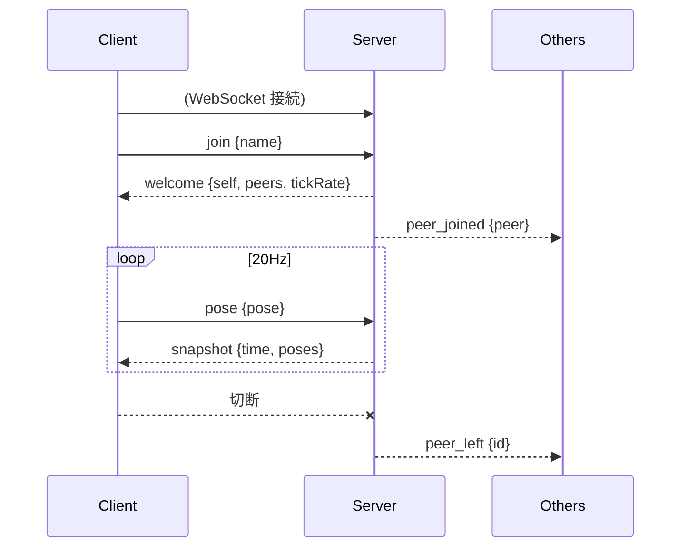
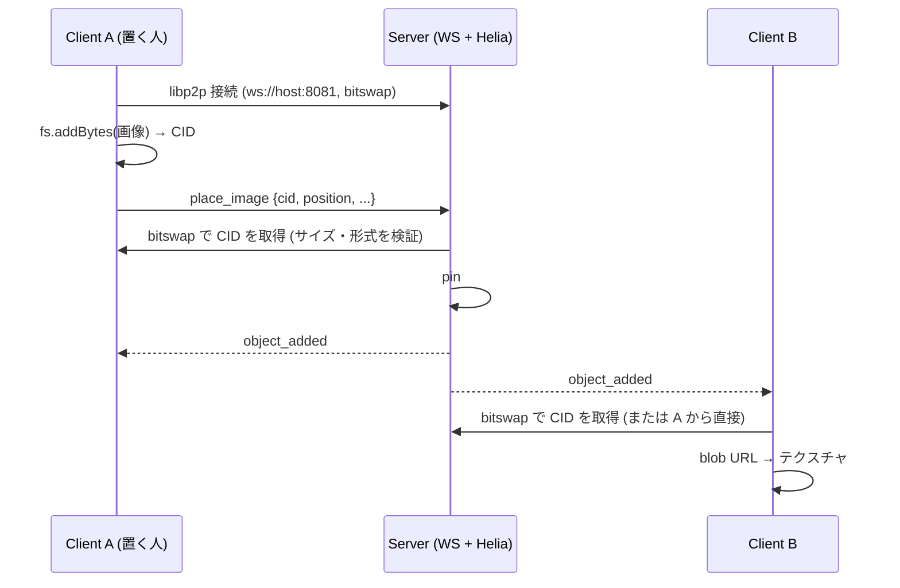

# 詳細設計

`architecture.md` の構成を前提に、プロトコル・同期・クライアント内部の設計を定める。
実装中に変更してよい。変更した場合はこのドキュメントを更新する。

## 1. 座標系・単位

- three.js の座標系に合わせる: 右手系、Y 軸が上、-Z が前方。
- 単位はメートル。
- 回転は **クォータニオン `[x, y, z, w]`** で表す (VR で頭の傾きが必要になるため、yaw のみにしない)。

## 2. データモデル

```ts
type Vec3 = [number, number, number];
type Quat = [number, number, number, number];

/** ユーザーの姿勢。将来 hands などを追加できるようにする。 */
interface Pose {
  position: Vec3; // 足元のワールド座標
  head: Quat;     // 頭の向き (ワールド)
}

interface PeerInfo {
  id: string;   // サーバーが採番
  name: string; // 表示名
  color: string; // "#rrggbb"。サーバーが割り当て
}

interface PeerState extends PeerInfo {
  pose: Pose;
}

/** ワールドに置かれたオブジェクトに共通の項目。 */
interface ObjectBase {
  id: string;      // サーバーが採番
  position: Vec3;  // 下辺中央
  yaw: number;     // Y 軸回り (水平方向) の向き。法線は +Z を yaw 回したもの
  pitch?: number;  // X 軸回り (垂直方向) の傾き (rad)。回転順序は YXZ。無ければ 0
  heldBy?: string; // 今つかんでいる人 (PeerInfo.id)。つかまれていなければ無い
}

/** 画像。鉛直な平面。width / height は m。 */
interface ImageObject extends ObjectBase {
  kind: "image";
  cid: string;     // 画像 (UnixFS ファイル) の CID。IPFS から取得する
  width: number;   // 0.1〜20
  height: number;  // 0.1〜20
  name?: string;   // 元のファイル名 (ダウンロード時の名前)
}

/** 任意のファイル。ファイルの形のアイコンの板 (FILE_ICON_WIDTH x FILE_ICON_HEIGHT = 0.9m x 1.2m、床から 0.6m 浮かせる)。 */
interface FileObject extends ObjectBase {
  kind: "file";
  cid: string;
  name: string;    // サーバーが sanitizeFileName で整えたもの
  size: number;    // stored ならサーバーが実際に取得して測ったバイト数。まだなら、ファイルのメタデータの宣言サイズ
  category: "audio" | "video" | "file"; // アイコンの種類。サーバーが名前と中身から判定する
  stored: boolean; // サーバーが中身を保持しているか。16MiB 超のファイルは、ダウンロードされるまで false (遅延転送)
  owner?: string;  // stored になるまで配っている人 (PeerInfo.id)
  offline?: boolean; // 保持しておらず、配っている人も退室した (取得できない)
}

/** デモ空間のボックス。サーバー同期オブジェクト。position は底面の中央。つかんで動かせ、複製・削除もできる (ダウンロードは無い)。 */
interface BoxObject extends ObjectBase {
  kind: "box";
  size: number;  // 一辺 (m)
  color: string; // "#rrggbb"
}

type WorldObject = ImageObject | FileObject | BoxObject;
```

## 3. プロトコル

WebSocket 上で JSON テキストメッセージを送受信する。すべてのメッセージは `type` フィールドを持つ。

### Client → Server

| type | フィールド | 説明 |
|---|---|---|
| `join` | `name: string` | 入室要求。接続後に最初に 1 回だけ送る |
| `pose` | `pose: Pose` | 自分の姿勢。20Hz で送信 |
| `place_image` | `cid`, `position`, `yaw`, `width`, `height`, `name?` | IPFS に追加済みの画像を置く。サーバーが中身を検証してから配置する |
| `place_file` | `cid`, `name`, `position`, `yaw` | IPFS に追加済みの任意のファイルを置く。`size` と `category` はサーバーが中身から決める (送っても無視される) |
| `request_file` | `id` | まだサーバーが保持していないファイル (遅延転送) を、ダウンロードするために取得させる。要求した人にだけ `prepare_progress` / `prepare_failed` が返り、終わると `object_updated` (`stored`) が全員に配られる |
| `place_box` | `position`, `yaw`, `pitch?`, `size`, `color` | ボックスを置く (デモ・テスト用。クライアントの UI からは送らない) |
| `ipfs_peer` | `peerId: string` | 自分の libp2p ピア ID を知らせる。他のブラウザから WebRTC で接続してもらえる状態になってから送る |
| `grab_object` | `id` | オブジェクトをつかむ。他の人がつかんでいると拒否される |
| `move_object` | `id`, `position`, `yaw`, `pitch?` | つかんでいる間の移動 (つかんでいる本人だけが送れる)。20Hz |
| `release_object` | `id` | 離す |
| `delete_object` | `id` | 削除する。他の人がつかんでいるものは削除できない |
| `duplicate_object` | `id` | 複製する (元の隣に置かれる) |

### Server → Client

| type | フィールド | 説明 |
|---|---|---|
| `welcome` | `self: PeerInfo`, `peers: PeerState[]`, `objects: ImageObject[]`, `ipfs: { peerId, wsPort }`, `iceServers?: IceServer[]`, `tickRate: number` | `join` への応答。自分の ID、既存ユーザー、既に置かれているオブジェクト、サーバーの IPFS ノードの接続情報、WebRTC 用の STUN / TURN 設定 (TURN 未設定なら省略) |
| `object_added` | `object: WorldObject` | オブジェクトが置かれた (置いた本人を含む全員へ) |
| `object_updated` | `object: ImageObject` | 位置・向き・つかまれている状態が変わった (オブジェクト全体を送る) |
| `object_removed` | `id: string` | オブジェクトが削除された |
| `place_progress` | `cid`, `loaded`, `total?`, `queued?` | 置こうとしている中身を、サーバーが取得している途中 (置いた本人にだけ)。`queued` は順番待ち |
| `prepare_progress` | `cid`, `loaded`, `total?`, `queued?` | `request_file` の進捗。サーバーが、置いた人から取得している途中 (要求した人にだけ) |
| `prepare_failed` | `cid`, `message` | `request_file` が失敗した (置いた人が退室した、容量が足りない、など) |
| `peer_ipfs` | `id: string`, `ipfsPeerId: string` | 他のユーザーが IPFS ノードの準備を終えた。受け取った側がそのピアへ WebRTC で接続しに行く |
| `peer_joined` | `peer: PeerState` | 他ユーザーの入室 |
| `peer_left` | `id: string` | 他ユーザーの退室 |
| `snapshot` | `time: number`, `poses: Record<id, Pose>` | 全ユーザーの最新姿勢。20Hz |
| `error` | `message: string` | 不正な入力など。入室後の `place_image` 失敗では切断せず、client は HUD に表示する |

### シーケンス



### 画像・ファイルの共有 (IPFS)

画像・ファイルの中身は WebSocket に載せず、IPFS (Helia 7 / libp2p) で共有する。ワールドには CID だけを載せる。
以下の流れと検証は画像の場合 (`place_image`)。ファイル (`place_file`) の違いは、次の「ファイルの配置とダウンロード」を参照。



- **サーバーの Helia ノード**: libp2p の WebSocket (`IPFS_PORT`, 既定 8081) で待ち受ける。ブラウザの接続先、circuit relay、pin 済み画像の提供元を兼ねる。
  ブロックストアはディスク (`BLOCKSTORE_DIR`、既定は一時ディレクトリ)。起動のたびに空にする (再起動でワールドの状態が消えるので、残しても参照されない)。
- **ブラウザの Helia ノード**: 入室 (`welcome`) 後に起動し、`welcome.ipfs` とページのホスト名から組み立てた
  `/<host>/tcp/<wsPort>/ws/p2p/<peerId>` でサーバーに接続する。
  トランスポートは WebSocket / WebRTC / circuit relay。ルーティング (DHT・公開ゲートウェイ) は使わない。
- **取得**: CID を `unixfs.cat` で取得し (上限 5MB・30 秒)、Blob → blob URL → `TextureLoader` で読み込む。CID ごとにキャッシュする。
  失敗したら灰色の板のままにする。
- **検証 (server)**: `place_image` の CID を取得しながら、5MB を超えたら中止、先頭バイトが PNG / JPEG / GIF / WebP でなければ拒否 (SVG は不可)、
  データが 20 秒届かなければ拒否する (合計の時間ではなく、止まっているかで見る)。通ったら pin する (pin 済みの CID は何もしない)。同じ人の分は 1 件ずつ順に、全体では同時に 4 件まで取り込む (順番待ち。後述)。オブジェクト数の上限は 100。
- **CID の形式**: UnixFS ファイルの CID (codec は dag-pb / raw、ハッシュは sha2-256) のみ。サーバーは正規化した文字列を保持する。
- **ブラウザ同士の直接接続**: ブラウザは中継に予約を作り (`/p2p-circuit/webrtc` のアドレスを持つ) 、
  ダイヤル可能になってから `ipfs_peer` を送る。サーバーは本人以外に `peer_ipfs` を送り、受け取った側が
  `<サーバーのアドレス>/p2p-circuit/webrtc/p2p/<相手>` へ接続する (既存の参加者 → 新しい参加者の一方向)。
  接続が確立すると bitswap が直接のピアからも取得するようになる。HUD の `P2P n` は直接接続の数。
  失敗しても (NAT 越えできないなど) サーバー経由の取得は続く。
- **STUN / TURN**: サーバーに `TURN_HOST` / `TURN_SECRET` が設定されていると、`welcome.iceServers` に STUN (自前の coturn と公開 STUN) と、ユーザーごとの時間制限つき TURN 認証情報 (`username = <期限>:<ユーザー ID>`、`credential = base64(HMAC-SHA1(共有秘密, username))`) を入れて配る。クライアントはこれを libp2p の WebRTC (`rtcConfiguration.iceServers`) に渡す。未設定のときは libp2p の既定 (公開 STUN のみ)。ページに `?ice=relay` を付けると中継 (TURN) だけを使う (診断用)。

### ファイルの配置とダウンロード

任意のファイルをドロップすると、ファイルの形のアイコン (`FileObject`) として置かれる。音声・映像は専用のアイコンで、種類が分かる。

**画像かファイルか (クライアントの振り分け)**
- PNG / JPEG / GIF / WebP で、5MB 以下で、画像として読み込めるもの (極端な縦横比でないもの) だけが画像 (`place_image`) になる。
- それ以外はすべてファイル (`place_file`)。SVG (スクリプトを含み得るので表示しない)、5MB を超える画像、読み込めない画像も、ファイルとして置かれる。
- 2 GiB (`MAX_FILE_BYTES`) を超えるものは置かない (HUD に通知)。フォルダは置けない (中身を読めないので、通知して無視する)。
- ファイルのアイコンは、画像と同じ「置いた人の方を向く・横並び」の規則で置き、床から 0.6m 浮かせる (正面を向いたまま狙いやすい高さ)。

**サーバーの検証 (`place_file`)**
1. `cid` が dag-pb / raw・sha2-256 でなければ拒否。`name` は `sanitizeFileName` で整える。
2. `fs.stat` でルートのブロックだけを取得し、ディレクトリなら拒否、サイズ (UnixFS のメタデータ) が上限を超えていれば、中身を取得する前に拒否する。
3. 中身を取得しながら、実際のバイト数を数える (申告ではなく実測)。2 GiB を超えたら中止。タイムアウトは「データが届かない状態が 30 秒続いたら」(画像は 20 秒)、合計の上限は 1 時間。取得の途中経過を、置いている本人に `place_progress` で知らせる。
4. 実測のサイズと、先頭 16 バイトを得る。`category` は `classifyFile(name, head)` で決める。
5. 合計容量の上限 (既定 20 GiB) に収まれば pin して、`object_added` を配る。容量は、ルートのブロックから分かる宣言サイズで、取得を始める前に予約する (大きなファイルを取得してから、容量が足りないと分かって捨てることのないように)。収まらなければ拒否して、取得したブロックを片付ける。

**アイコンの種類 (`classifyFile`)**
- 拡張子で判定する。音声: mp3 / wav / ogg / opus / flac / aac / m4a など。映像: mp4 / webm / mkv / mov / avi など。
- 拡張子が無い・未知のときだけ、先頭バイト (ID3、RIFF、OggS、fLaC、ftyp、EBML など) で補う。拡張子が申告より優先される。
- 判定はアイコンの表示にしか使わない (中身は検証・実行しない)。判定できなければ汎用のファイルアイコン。

**保持と解放 (`ContentStore`)**
- 画像・ファイルの中身は、CID ごとに 1 つだけ保持し、指しているオブジェクトの数 (参照) を数える。複製や同じファイルの再投入では、取得し直さず、容量も増えない。
- 最後の参照が無くなったら (`delete_object`) unpin し、gc でメモリを空ける。短時間の連続削除は 1 回の gc にまとめる。
- gc は、取得中のブロックを消さないよう、取得が終わっているときだけ行う。gc の最中に始まる取得は、終わるまで待たせる。
- 容量の判定と登録は同期的に行う (pin の待ち時間の間に、同時に始まった追加が容量を二重に使わないように)。

**大きなファイルの扱い (最大 2 GiB)**

2 GiB のファイルを、サーバーとブラウザのメモリを使い切らずに扱うための設計。

- **サーバー**: ブロックはメモリではなくディスク (`FsBlockstore`) に置く。サーバーのメモリは、ファイルのサイズに比例せず、転送 1 件あたり 150〜200MiB 程度で頭打ちになる。
- **アップロード (ブラウザ)**: ファイルを丸ごと読まず、**ブロックを保存もしない**。「このブロックは、ファイルの何バイト目から何バイト分か」という索引だけを作り (`FileBackedBlockstore`)、
  サーバーが取りに来たときに、元のファイルから該当部分を読んで渡す (読んだ内容は、CID と一致するか確かめてから渡す)。コピーを作らないので、メモリもディスクも使わず、取り込みはハッシュの計算の速さで済む。
  Helia と同じ設定 (CIDv1・1MiB の固定チャンク・均衡レイアウト・生のブロック) で取り込むので、同じファイルは Helia の `addByteStream` と同じ CID になる。
  索引は「生のブロックが書かれた順に、ファイルの先頭から並んでいる」ことを前提にするので、インポーターは `blockWriteConcurrency: 1` (順番に書く) で動かす。
- **サーバーが取り終えるまで配る**: サーバーが取り終えて `object_added` が届いたら、配るのをやめて索引を捨てる。取っている間は、サーバーの `place_progress` が届くたびに配り続ける時間を延ばし、通知が途絶えたら (断られた・失敗した) 2 分で諦める。
- **ダウンロード (ブラウザ)**: 取得したブロックは保存せず、流して Blob にする (`assembleBlob`)。全チャンクを配列に溜めず、32MiB ごとに Blob にまとめる。
  **チャンクは受け取った時点で必ずコピーする** (取得元がバッファを再利用して書き換えても、保存されるファイルが壊れないように)。
- **順番待ち (`PlacementQueue`)**: 同じ人の分は 1 件ずつ順に取り込む。同じ接続からの転送を並列にしても速くならないため。全体では同時に 4 件まで。順番待ちの間も、本人に `place_progress` (`queued`) を 10 秒ごとに送る。
  本人が退室したら、待っている分は取り消す。

> **IndexedDB は使わない**: 当初は、ブラウザ内のブロックストアを IndexedDB にしたが、Firefox では 1MiB あたり 0.2〜0.3 秒かかり、サーバーが数十ブロックを一度に要求すると応答が間に合わず、転送が止まった。
> メモリ上のブロックストアは速いが、ファイルのサイズ分のメモリを使う。そのため、上の「元のファイルから直接配る」設計にした。

**遅延転送 (16MiB を超えるファイル)**

大きなファイルは、置いた時点ではサーバーに送らず、**誰かがダウンロードしたときに初めて**サーバーが取りに行く。見ているだけの人には、元からファイル本体は届かない (画像と違い、アイコンの情報だけ)。
無駄だったのは、置いた時点でのサーバーによる取得だった。

- **置くとき (`place_file`)**: `ContentStore.probe` が、先頭 16 バイトと宣言サイズだけを取得する (`fetchVerified` の `headOnly`)。16MiB (`EAGER_FILE_MAX_BYTES`) 以下、またはサーバーが既に保持している内容は、従来どおり全部取得して pin する。
  16MiB を超えていれば、pin も容量の消費もせず、`stored: false`・`owner: <置いた人>` で `object_added` を配る。`size` は宣言サイズ (申告。実際に取得するときに上限を守らせる)。
- **置いた人のブラウザ**: `keepServing` で、元のファイルから配り続ける (このタブを開いたままにする必要がある。HUD に案内を出す)。サーバーが保持したら (`object_updated` で `stored`) 配るのをやめる。
- **ダウンロード (`request_file`)**: クライアントは、`stored` でない・自分が配っていないファイルに対して `request_file` を送り、`prepare_progress` を HUD に表示して待つ。
  サーバー (`stageFile`) は、置いた人から全部取得して pin し、`markStored` で `stored: true` にして `object_updated` を配る。クライアントはそれを見て、通常のダウンロードに進む。
  同じ内容を複数人が要求しても取得は 1 回 (`staging`)。順番待ちは、配っている人 (`owner`) ごとに 1 件ずつ (`PlacementQueue`)。
  自分が配っているファイルは、サーバーを経由せず、そのままダウンロードする。
- **置いた人が退室したら**: 保持していないファイルは `offline` になる (削除はしない)。ダウンロードは「アップロードした人が退室しているため、取得できません」で失敗する。保持済みのものは影響を受けない。
- **削除・複製**: 保持していないファイルは、サーバーの参照を数えない (`holdsContent`)。削除してもディスクは変わらない。
- **bitswap の再送の窓**: 送信側 (ブラウザ) は、直前 (約 5 秒以内) に送ったブロックを同じ相手に再送しない。先頭だけを調べた直後に全部を取りに来ると要求が無視されて止まるので、
  `fetchVerified` は、最初のデータが 4 秒届かなければ取り消して要求し直す (`retryAfterMs`)。置いた直後にダウンロードすると、準備に約 5〜8 秒余分にかかる。

**ダウンロード (`net/download.ts`)**
- リングメニューの「ダウンロード」。オブジェクトの `cid` を IPFS から取得し (上限は種類ごと。データが 30 秒届かなければ中止)、Blob にして、`<a download>` で保存する (ページは開かない)。
- ファイル名は `name` を、念のためクライアントでも `sanitizeFileName` にかけたもの。名前の無い画像は、`image-<CID の末尾>.<形式の拡張子>`。
- 進捗 (割合と取得済みのバイト数) と結果は HUD に表示する。同じオブジェクトの二重のダウンロードは始めない。
- 取得は、サーバーの Helia ノードか、直接つながったブラウザから行われる。置いた人が退室していても、サーバーが pin していれば取得できる (遅延転送のファイルは、上記のとおり)。

### 検証ルール (server)

- `join` 前に `pose` を受けたら無視する。
- `name` は trim 後 1〜24 文字。空なら `Guest-xxxx` を割り当てる。
- `pose` の数値が有限 (`Number.isFinite`) でなければ破棄する。
- 位置は絶対値 1000 を超える場合破棄する。クォータニオンは受信時に正規化する。
- 1 メッセージの最大サイズは 4KB。超えたら切断する。
- `ipfs_peer`: `peerId` は英数字 10〜128 文字。
- `grab_object` / `release_object` / `delete_object` / `duplicate_object` / `move_object`: `id` は UUID 形式。`move_object` の `position` は有限かつ絶対値 1000 以下、`yaw` は有限。
- `place_image`: `cid` は dag-pb / raw・sha2-256 の CID (128 文字以内)、`position` は有限かつ絶対値 1000 以下、`yaw` は有限、`width` / `height` は 0.1〜20。
- `place_file`: `cid` / `position` / `yaw` は `place_image` と同じ。`name` は `sanitizeFileName` で整える (パス区切り・制御文字・書字方向の制御文字を除く、120 文字まで、無ければ `file`)。`size` / `category` はクライアントから受け取らない。`place_image` の `name` は任意で、同様に整える。

## 4. 同期方式

### 送信側 (client)

- 毎フレームではなく、固定 20Hz (`setInterval` または累積時間) で `pose` を送る。
- 前回送信から変化がない場合も、生存確認を兼ねて送る (簡素化のため常時送信)。

### サーバー

- `Map<id, PeerState>` をメモリ上に保持。
- 20Hz のタイマーで `snapshot` を全員に送る。自分自身の姿勢も含めてよい (クライアントは無視する)。
- 接続が 1 つも無い間はタイマーを止めてもよい (最適化なので任意)。

### 受信側 (client): スナップショット補間

- 各ピアについて、受信した姿勢とサーバー時刻を小さなバッファ (直近 数件) に保存する。
- 描画時刻を **現在のサーバー時刻 − 100ms (= 2 tick 分)** に遅らせ、前後 2 つのスナップショット間で補間する。
  - 位置: 線形補間 (lerp)
  - 回転: 球面線形補間 (slerp)
- バッファが足りない場合は最新値をそのまま使う (外挿はしない)。
- サーバー時刻とクライアント時刻のずれは、初回 `snapshot` 受信時に `offset = serverTime - Date.now()` として一度だけ求める。簡素化のため再補正はしない。

### 自分自身

- ローカル入力で即座に反映し、サーバーからの値で補正しない (クライアント権威)。

## 5. クライアント設計

### 画面遷移

```
[入室画面: 名前入力] --Enter--> [接続中] --welcome--> [3D シーン]
                                    └ 失敗 → エラー表示して入室画面へ
```

切断された場合は入室画面に戻してメッセージを表示する (自動再接続は行わない)。

### モジュール構成 (apps/client/src)

```
main.tsx            エントリ
App.tsx             画面遷移 (Lobby / World)
Lobby.tsx           入室画面
net/
  connection.ts     WebSocket 接続・送受信、zustand ストア
                    (入退室・オブジェクトの「集合」・IPFS の状態・HUD 通知のみを state にする)
  ipfs.ts           ブラウザ内の Helia ノード (起動・サーバー接続・画像の追加と取得・ピアへの直接接続)
  interpolation.ts  スナップショットバッファと補間
  download.ts       オブジェクトの中身を IPFS から取得して保存する (進捗表示つき)
world/
  World.tsx         <Canvas>、ライト、床、オブジェクト (画像・ファイル・ボックス)、HUD
  LocalPlayer.tsx   入力・移動・カメラ・pose 送信
  RemoteAvatar.tsx  他ユーザー 1 人分の描画
  Avatar.tsx        アバター見た目 + 名前タグ (canvas テクスチャの Sprite)
  DropTarget.tsx    画像ファイルのドロップ処理 (床への raycast、アップロード、配置)
  ObjectFrame.tsx   置かれたオブジェクト (画像・ファイル) に共通の枠 (位置の補間、つかんだときの追従、輪郭の強調、当たり判定の登録)
  ImagePlane.tsx    置かれた画像 1 枚の描画 (CID から IPFS で取得してテクスチャ化)
  FilePlane.tsx     置かれたファイル 1 つの描画 (ファイルの形のアイコン。中身はダウンロードするときに初めて取得する)
  fileIcon.ts       ファイルアイコンの描画 (2D canvas。音声・映像・汎用の絵柄、ファイル名とサイズの欄)
  ObjectInteraction.tsx  画面中央のカーソルでの操作 (狙う、右ボタンでつかむ、中ボタンでメニュー、カーソル表示の制御)
  CursorDot.tsx     画面中央の白い点
  RingMenu.tsx      リング状のコンテキストメニュー (削除・複製)
  carry.ts          つかんだオブジェクトを運ぶ計算 (純粋関数)
  interaction.ts    操作の状態 (狙っている / つかんでいる / メニュー対象 / カーソル表示) と、つかんでいる物の手元の位置
  registry.ts       描画中のオブジェクトのメッシュ (当たり判定用)
```

### 状態管理の注意

- 他ユーザーの姿勢は **毎フレーム更新される** ため、React の state にしない。
  `useFrame` 内で ref の `position` / `quaternion` を直接更新する。
- React の state にするのはユーザーの「集合」(入退室) のみ。

### 入力・移動 (デスクトップ)

- WASD で水平移動、マウス (Pointer Lock) で視点回転。
- 速度は一定 (例: 3 m/s)。ジャンプ・重力・衝突は **実装しない** (床は Y=0 の平面とする)。
- カメラはプレイヤーの頭の位置 (高さ 1.6m) に置く一人称視点。
  自分のアバターは描画しない。

### アバター

- 簡易な形状: 胴体 (カプセル or 円柱) + 頭 (球)。色は `PeerInfo.color`。
- 向きが分かるように頭に「目」または前方を示すマーカーを付ける。
- 頭の上に名前を表示する (常にカメラの方を向く)。
- 見た目は `Avatar` コンポーネントに閉じ込め、将来 glTF / VRM に差し替え可能にする。

### ワールド

- 広さ 50m × 50m 程度の床 (グリッド)、ディレクショナルライト + 環境光。
- 位置関係が分かるよう、色付きのボックスを数個配置する。
- 床は静的でハードコード (同期不要)。ボックスはサーバー同期オブジェクト (`BoxObject`) で、サーバーの起動時に `Room.seedDemoBoxes` が配置する (つかんで動かせる)。
- 画像オブジェクトは `welcome` / `object_added` で届いたものを描画する (同期対象)。

### ファイル・画像のドロップ

`DropTarget` が canvas の `dragover` / `drop` を受ける。

1. 置けるか調べる: 2 GiB 超のファイルは HUD に理由を表示して無視する。フォルダは通知して無視する。
2. 画像 (PNG / JPEG / GIF / WebP で 5MB 以下・読み込める) か、ファイルかに振り分ける (上記)。
3. ドロップ位置のスクリーン座標からカメラのレイを飛ばし、床 (Y=0) との交点を求める。
   当たらない (地平線より上) / 20m より遠い場合は、視線方向 4m 先の床にする。範囲はワールド内に丸める。
4. 画像は長辺を 2.5m に正規化してサイズを決める (縦横比を保つ)。ファイルのアイコンは固定サイズ (0.9m x 1.2m)。
5. 置いた人の方を向くよう `yaw` を決める。複数ファイルは `right` 方向に間隔 0.3m で横並びにする。
6. IPFS に追加して CID を得て、画像は `place_image` (元のファイル名付き)、ファイルは `place_file` を送る (ブラウザの IPFS ノードがサーバーに接続済みである必要がある)。
7. `object_added` を受けた全員 (本人含む) が `ImagePlane` / `FilePlane` を描画する。本人もサーバー経由で表示する (経路を 1 本にするため)。

- `drop` 以外の場所にドロップしてもブラウザがページ遷移しないよう、`window` の `dragover` / `drop` も抑止する。
- Pointer Lock 中はマウスが固定されドラッグ操作ができないため、Esc で解除してからドロップする。
- テクスチャの読み込み中・失敗時は灰色の板を表示する。

### オブジェクトの操作

画面中央を「カーソル」にして、置かれたオブジェクト (画像・ファイル・デモ空間のボックス) を操作する (`ObjectInteraction`)。
床は対象外。

**カーソル (白い点)**
- 画面中央の小さな白い点 (`CursorDot`)。視点・位置が動いている間と、止まってから 3 秒間だけ表示する (入室直後も 3 秒)。
  つかんでいる間は表示し続け、メニューを開いている間は出さない。
- 選択はこの点を通るレイ (画面中央から、届く距離 `GRAB_REACH` = 8m) で行う。最初に当たったオブジェクトが「狙っている」対象で、白い輪郭で強調する。
  他の人がつかんでいるものは琥珀色の輪郭にする。

**つかむ (右ボタン)**
1. 右ボタンを押すと、狙っているオブジェクトをつかむ。他の人がつかんでいれば何もせず HUD に通知する。
2. `grab_object` を送り、応答を待たずに手元でつかみ始める (楽観的)。他の人に先を越されていた場合は、サーバーが本人にだけエラーと現在の状態 (`object_updated`) を返し、手元のつかみを取り消す。
3. つかんでいる間、オブジェクトは自分の動きについてくる。つかんだ瞬間の「カメラの水平な向きから見た相対位置・向き」を覚えておき、毎フレーム現在のカメラ位置と yaw から求め直す (`carry.ts`)。
   水平方向の範囲はワールド内に丸める。
   **移動モード (既定)**: マウスを上下に動かす (視点を上げ下げする) と、つかんだものが**視線の先に付いたまま**持ち上がる・下がる (高さ Y)。
   目の高さから見たオブジェクトの仰角に、視点を上下させた量を足して、水平距離のところの高さに直す (`liftedHeight`)。遠いものほど大きく動く。
   範囲は、床 (0m) から 20m まで。範囲に当たっても、仰角は丸めた高さから求め直すので、視点を戻せばすぐ動き出す。
   **遠近**: どちらのモードでも、マウスホイールで、つかんだものを視線に沿って遠ざける (上に回す) / 引き寄せる (下に回す)。1 目盛りで水平距離が 1.12 倍 (または 1/1.12 倍) になる (`pulled`)。
   カメラから見た向きと、目の高さから見た仰角は変えないので、視線の先に付いたまま近づく・遠ざかる (目の高さより下にあるものは、遠ざけると床へ向かい、引き寄せると上がる)。
   水平距離は 1m から 30m まで (範囲の外にあるものは、範囲の方向へだけ動く)。位置はワールド内 (±24m) に丸める。ホイールがページをスクロールしないよう、つかんでいる間は既定の動作を止める。
   **回転モード**: **E キー**で、移動モードと切り替える (つかんでいる間だけ。離すと移動モードに戻る)。回転モードでは視点を固定し (`LocalPlayer` が視点を動かさない)、
   マウスの動きでオブジェクトを回す: 左右 = 水平方向 (yaw)、上下 = 垂直方向 (pitch、手前の面がマウスの動きについてくる向き)。1px あたり視点操作と同じ 0.0022rad。
   回転は、位置の基準 (下辺または底面の中央) を中心にする。歩けば、回転モードでもオブジェクトはついてくる。HUD に、いまのモードと操作を表示する。
4. 手元の位置を 20Hz で `move_object` として送る。サーバーはつかんでいる本人からの移動だけを受け付け、**本人以外**に `object_updated` を配る。
5. 右ボタンを離す (ウィンドウが非アクティブになる場合も) と、最後の位置・向き (yaw・pitch) を `move_object` で送ってから `release_object` を送る。手元の状態にも最後の位置を反映して、古い位置に戻って見えないようにする。
6. つかんだまま切断すると、サーバーが自動で離す。

**排他制御 (サーバー)**
- オブジェクトごとに「つかんでいる人」(`heldBy`) を持つ。つかんでいる間は本人だけが動かせ、他の人はつかめない・削除できない。
- 1 人が同時につかめるのは 1 個まで。別のものをつかむと、前のものは自動で離される。
- 複製は、つかまれているものにもできる。複製には `heldBy` を引き継がない。

**他の人の画面**
- 受け取った位置・向きへ、毎フレーム滑らかに近づける (指数的に追従。20Hz の更新でも滑らかに見える)。
  自分でつかんでいるものは補間せず、手元の位置をそのまま使う (遅れないように)。

**リングメニュー (中ボタン)**
- 中ボタンで、狙っているオブジェクト (つかんでいればそれ) のメニューを画面中央に開く (`RingMenu`)。何も狙っていなければ HUD に通知する。
- ボタンは円環に等間隔で並ぶ (先頭が真上)。いまは「削除」「複製」「ダウンロード」(ボックスには出さない。`applies` で対象を絞る)。`ITEMS` に足せば増やせる。リングの中心には、対象の名前とサイズを表示する。
- マウスで選べるよう、開くときに Pointer Lock を解除し、選択したら (クリック = ユーザー操作の中で) 取り直す。
  外側のクリック・中ボタン・Esc で何もせず閉じる。開いている間は視点・移動を止める。
- 削除: `delete_object`。サーバーは、最後の参照が無くなった中身を unpin してメモリを空ける。
- 複製: `duplicate_object`。サーバーが、元の右・手前に 5cm ずらした位置 (向き・大きさ・内容は同じ) に新しいオブジェクトを置く。右へのずらし量は、画像は 0.6m、ファイルのアイコンは重ならない距離 (アイコンの幅 + 0.15m)、ボックスは一辺 + 0.2m。同じ描画面での重なり (描画のちらつき) を避けるため、手前に少しずらす。上限 (100 個) に達していれば拒否する。
- ダウンロード: 対象の中身を IPFS から取得して保存する (上記)。
  (同一平面での描画のちらつきを避けるため、手前に少しずらす)。上限 (100 個) に達していれば拒否する。

## 6. サーバー設計

### モジュール構成 (apps/server/src)

```
index.ts     起動 (WebSocketServer、画像・ファイルの検証と配置の受け付け)
room.ts      Room クラス: ピア管理、オブジェクト管理 (配置・つかむ・移動・削除・複製)、snapshot ループ
ipfs.ts      Helia ノード (libp2p ws / circuit relay)、CID の取得・検証・pin
content.ts   ContentStore: 保持する中身の管理 (種類ごとの検証・参照カウント・合計容量・unpin と gc)
images.ts    マジックナンバーによる画像形式の判定
validate.ts  受信メッセージの検証・正規化
```

### 設定 (環境変数)

| 名前 | 既定値 | 説明 |
|---|---|---|
| `PORT` | `8080` | WebSocket (ワールド同期) の待受ポート |
| `IPFS_PORT` | `8081` | libp2p の WebSocket の待受ポート。ブラウザから到達できる必要がある |
| `CONTENT_MAX_TOTAL_MB` | `20480` (20 GiB) | サーバーが保持する画像・ファイルの合計サイズの上限 (MB)。ディスクに置くので、ディスクの空きより十分小さくする |
| `BLOCKSTORE_DIR` | 一時ディレクトリの `vr-sns-proto-blocks` | 画像・ファイルの中身 (ブロック) を置くディレクトリ。起動のたびに空にする |

### 色の割り当て

入室順に固定パレットから循環して割り当てる。

### 切断検知

`ws` の ping / pong を 30 秒間隔で行い、応答のない接続は切断する。

## 7. 共有パッケージ (packages/protocol)

- 上記 `Pose` / `PeerInfo` / `PeerState` / メッセージ型を `export` する。
- 定数: `TICK_RATE = 20`、`MAX_NAME_LENGTH = 24` など。
- 実行時依存は持たない (型と定数のみ)。検証ロジックは server 側に置く。

## 8. 将来の拡張ポイント

| 拡張 | 現設計での備え |
|---|---|
| WebXR / 手の姿勢 | `Pose` にオプショナルな `hands` を追加する |
| 複数ルーム | `join` に `roomId` を追加し、server に `Room` を複数持たせる |
| アバター差し替え | `PeerInfo` に `avatarUrl` を追加。`Avatar` コンポーネントを差し替える |
| ボイスチャット | 別途 SFU (LiveKit 等) を用意。ピア ID をトークン発行時の identity に使う |
| 画像以外のオブジェクト・回転 / 拡大縮小・元に戻す | `WorldObject` に `kind` を追加する。`object_updated` はオブジェクト全体を送るので、プロパティを足せばそのまま同期できる。操作・排他制御はサーバーが既に持っている |
| 音声・映像の再生、ファイルのプレビュー | `FileObject.category` で音声・映像を既に区別している。再生用のオブジェクト種別 (または `FilePlane` の拡張) と、メディア要素の再生・同期を足す |
| バイナリプロトコル | `type` 毎に固定レイアウトの `ArrayBuffer` へ移行 |

## 9. テスト・検証方針

- server: `validate.ts` の単体テスト (不正値の扱い)。それ以外は手動確認。
- client: 補間ロジック (`interpolation.ts`) の純粋関数部分の単体テスト。
- 結合: ブラウザタブを複数開いて、互いのアバターが見え、動き、退室で消えることを目視確認する。
