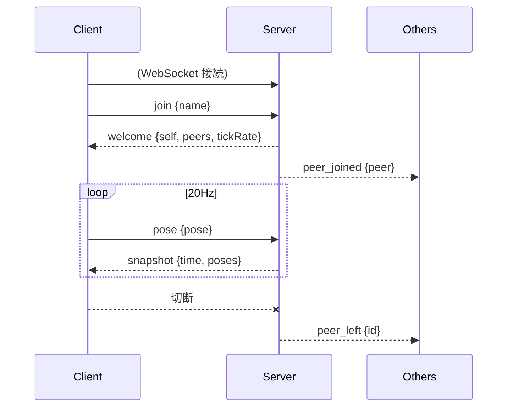

# 詳細設計

`architecture.md` の構成を前提に、プロトコル・同期・クライアント内部の設計を定める。
実装中に変更してよい。変更した場合はこのドキュメントを更新する。

## 1. 座標系・単位

- three.js の座標系に合わせる: 右手系、Y 軸が上、-Z が前方。
- 単位はメートル。
- 回転は **クォータニオン `[x, y, z, w]`** で表す (VR で頭の傾きが必要になるため、yaw のみにしない)。

## 2. データモデル

```ts
type Vec3 = [number, number, number];
type Quat = [number, number, number, number];

/** ユーザーの姿勢。将来 hands などを追加できるようにする。 */
interface Pose {
  position: Vec3; // 足元のワールド座標
  head: Quat;     // 頭の向き (ワールド)
}

interface PeerInfo {
  id: string;   // サーバーが採番
  name: string; // 表示名
  color: string; // "#rrggbb"。サーバーが割り当て
}

interface PeerState extends PeerInfo {
  pose: Pose;
}
```

## 3. プロトコル

WebSocket 上で JSON テキストメッセージを送受信する。すべてのメッセージは `type` フィールドを持つ。

### Client → Server

| type | フィールド | 説明 |
|---|---|---|
| `join` | `name: string` | 入室要求。接続後に最初に 1 回だけ送る |
| `pose` | `pose: Pose` | 自分の姿勢。20Hz で送信 |

### Server → Client

| type | フィールド | 説明 |
|---|---|---|
| `welcome` | `self: PeerInfo`, `peers: PeerState[]`, `tickRate: number` | `join` への応答。自分の ID と既存ユーザー |
| `peer_joined` | `peer: PeerState` | 他ユーザーの入室 |
| `peer_left` | `id: string` | 他ユーザーの退室 |
| `snapshot` | `time: number`, `poses: Record<id, Pose>` | 全ユーザーの最新姿勢。20Hz |
| `error` | `message: string` | 不正な入力など。送信後に切断してよい |

### シーケンス



### 検証ルール (server)

- `join` 前に `pose` を受けたら無視する。
- `name` は trim 後 1〜24 文字。空なら `Guest-xxxx` を割り当てる。
- `pose` の数値が有限 (`Number.isFinite`) でなければ破棄する。
- 位置は絶対値 1000 を超える場合破棄する。クォータニオンは受信時に正規化する。
- 1 メッセージの最大サイズは 4KB。超えたら切断する。

## 4. 同期方式

### 送信側 (client)

- 毎フレームではなく、固定 20Hz (`setInterval` または累積時間) で `pose` を送る。
- 前回送信から変化がない場合も、生存確認を兼ねて送る (簡素化のため常時送信)。

### サーバー

- `Map<id, PeerState>` をメモリ上に保持。
- 20Hz のタイマーで `snapshot` を全員に送る。自分自身の姿勢も含めてよい (クライアントは無視する)。
- 接続が 1 つも無い間はタイマーを止めてもよい (最適化なので任意)。

### 受信側 (client): スナップショット補間

- 各ピアについて、受信した姿勢とサーバー時刻を小さなバッファ (直近 数件) に保存する。
- 描画時刻を **現在のサーバー時刻 − 100ms (= 2 tick 分)** に遅らせ、前後 2 つのスナップショット間で補間する。
  - 位置: 線形補間 (lerp)
  - 回転: 球面線形補間 (slerp)
- バッファが足りない場合は最新値をそのまま使う (外挿はしない)。
- サーバー時刻とクライアント時刻のずれは、初回 `snapshot` 受信時に `offset = serverTime - Date.now()` として一度だけ求める。簡素化のため再補正はしない。

### 自分自身

- ローカル入力で即座に反映し、サーバーからの値で補正しない (クライアント権威)。

## 5. クライアント設計

### 画面遷移

```
[入室画面: 名前入力] --Enter--> [接続中] --welcome--> [3D シーン]
                                    └ 失敗 → エラー表示して入室画面へ
```

切断された場合は入室画面に戻してメッセージを表示する (自動再接続は行わない)。

### モジュール構成 (apps/client/src)

```
main.tsx            エントリ
App.tsx             画面遷移 (Lobby / World)
net/
  connection.ts     WebSocket 接続・送受信・型付きメッセージ
  peerStore.ts      ピア状態 (zustand 等の簡易ストアか、素の外部ストア)
  interpolation.ts  スナップショットバッファと補間
world/
  World.tsx         <Canvas>、ライト、床、オブジェクト
  LocalPlayer.tsx   入力・移動・カメラ・pose 送信
  RemoteAvatar.tsx  他ユーザー 1 人分の描画
  Avatar.tsx        アバター見た目 (共通)
  NameTag.tsx       名前表示 (drei の Html か Billboard + Text)
```

### 状態管理の注意

- 他ユーザーの姿勢は **毎フレーム更新される** ため、React の state にしない。
  `useFrame` 内で ref の `position` / `quaternion` を直接更新する。
- React の state にするのはユーザーの「集合」(入退室) のみ。

### 入力・移動 (デスクトップ)

- WASD で水平移動、マウス (Pointer Lock) で視点回転。
- 速度は一定 (例: 3 m/s)。ジャンプ・重力・衝突は **実装しない** (床は Y=0 の平面とする)。
- カメラはプレイヤーの頭の位置 (高さ 1.6m) に置く一人称視点。
  自分のアバターは描画しない。

### アバター

- 簡易な形状: 胴体 (カプセル or 円柱) + 頭 (球)。色は `PeerInfo.color`。
- 向きが分かるように頭に「目」または前方を示すマーカーを付ける。
- 頭の上に名前を表示する (常にカメラの方を向く)。
- 見た目は `Avatar` コンポーネントに閉じ込め、将来 glTF / VRM に差し替え可能にする。

### ワールド

- 広さ 50m × 50m 程度の床 (グリッド)、ディレクショナルライト + 環境光。
- 位置関係が分かるよう、色付きのボックスを数個配置する。
- ワールド内容は静的でハードコード (同期不要)。

## 6. サーバー設計

### モジュール構成 (apps/server/src)

```
index.ts     起動 (ポート、WebSocketServer)
room.ts      Room クラス: ピア管理、snapshot ループ
validate.ts  受信メッセージの検証・正規化
```

### 設定 (環境変数)

| 名前 | 既定値 | 説明 |
|---|---|---|
| `PORT` | `8080` | WebSocket 待受ポート |

### 色の割り当て

入室順に固定パレットから循環して割り当てる。

### 切断検知

`ws` の ping / pong を 30 秒間隔で行い、応答のない接続は切断する。

## 7. 共有パッケージ (packages/protocol)

- 上記 `Pose` / `PeerInfo` / `PeerState` / メッセージ型を `export` する。
- 定数: `TICK_RATE = 20`、`MAX_NAME_LENGTH = 24` など。
- 実行時依存は持たない (型と定数のみ)。検証ロジックは server 側に置く。

## 8. 将来の拡張ポイント

| 拡張 | 現設計での備え |
|---|---|
| WebXR / 手の姿勢 | `Pose` にオプショナルな `hands` を追加する |
| 複数ルーム | `join` に `roomId` を追加し、server に `Room` を複数持たせる |
| アバター差し替え | `PeerInfo` に `avatarUrl` を追加。`Avatar` コンポーネントを差し替える |
| ボイスチャット | 別途 SFU (LiveKit 等) を用意。ピア ID をトークン発行時の identity に使う |
| ワールド内オブジェクト同期 | メッセージに `object_*` 系を追加。サーバーに権威状態を持たせる |
| バイナリプロトコル | `type` 毎に固定レイアウトの `ArrayBuffer` へ移行 |

## 9. テスト・検証方針

- server: `validate.ts` の単体テスト (不正値の扱い)。それ以外は手動確認。
- client: 補間ロジック (`interpolation.ts`) の純粋関数部分の単体テスト。
- 結合: ブラウザタブを複数開いて、互いのアバターが見え、動き、退室で消えることを目視確認する。
