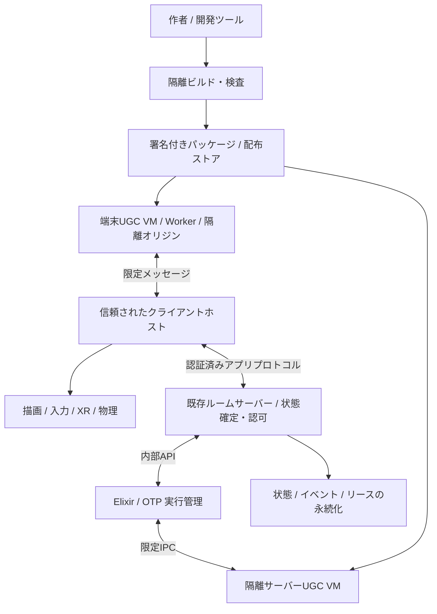

# UGC動作基盤設計: Elixir / BEAM・WebAssemblyと分散実行

状態: 設計提案。ランタイム・プロトコル・APIは未実装。

> **現行との関係**: 現在の同期は space v2（`Space.Store` / `Reader` / `Writer`）のみで、
> 旧 legacy / `crdt-v1` の比較表は歴史的資料である。UGC プログラムを WASM 実行環境で動かし、
> プログラムごとに Reader / Writer を割り当てる要件は `docs/n-dim-client-original.md` を正とする。
作成日: 2026-10-20。
評価範囲: Elixir / BEAMに加え、直接Wasm実行と代替スクリプト実行方式を比較する。性能の優劣は未測定。

## 1. 設計の要旨

UGCの振る舞いをElixirで記述し、クライアントとサーバーに配置できるアクターとして実行する。BEAMの軽量プロセス、メッセージ通信、OTPの監督機構を活用し、オブジェクトの操作、ワールド内のギミック、共有ゲームロジックを構築できるようにする。

ただし、**全クライアントを同じDistributed Erlangクラスタに参加させる構成は採らない**。端末もUGCも未信頼であり、BEAMプロセスは悪意あるコードに対するサンドボックスではない。インターネットをまたぐ連携は、明示的な宛先・権限・期限を持つアプリケーションプロトコルで実現する。

推奨する責務分割:

| 層 | 責務 | 初期方針 |
| --- | --- | --- |
| クライアントホスト | 描画、入力、XR、物理、ネットワーク、権限検証 | 既存TypeScript基盤を維持 |
| クライアントUGCランタイム | ローカル演出、入力への応答、許可された共有操作の提案 | Worker内のWasm版BEAMをPoCで評価 |
| 信頼された実行管理 | 配置、ライフサイクル、論理アドレス、実行者リース | Elixir/OTPの追加サービス |
| 隔離されたサーバー実行 | 共有ロジック、端末非依存の継続実行 | 管理サービスとは別のサンドボックス |
| 状態確定・認可 | 更新の妥当性、所有権、重複排除、永続化 | ルームごとに単一の確定主体 |

「分散実行」は、任意の関数を任意の端末へ透過的に送ることではない。配布済みパッケージのアクターを適切な実行場所に配置し、メッセージで協調させることを意味する。

第3節ではBEAM、直接WebAssembly、WASI / Component Model、JavaScript、QuickJS、Lua / Luau、制限付きDSLを比較する。Elixirを作者言語として使う既存案を基準としつつ、実行管理のElixir採用と、UGCの言語・ランタイム選定は別の判断として扱う。

### 現状からの差分

現在はRust / Bevyのネイティブクライアントと、Elixir/OTP（Cowboy）サーバーで構成される。space v2の次元エンティティ、Reader / Writer、ケーパビリティの基盤はあるが、スクリプト添付、WASM実行基盤、プログラム用Reader / Writer、プログラムへのインターネット接続、UGC用権限モデルは存在しない。本提案のBehaviorやcomponentは追加設計である。UGCプログラムをWASM実行環境で動かすという要件は `docs/n-dim-client-original.md` を正とする。

既存の同期モードには次の違いがある。

| 項目 | 既定のlegacy | 実験用`crdt-v1` |
| --- | --- | --- |
| オブジェクト状態 | サーバーメモリ内で管理 | クライアント・サーバーのYjs文書 (実験当時) |
| つかみの競合 | サーバーで排他 | 期限付きのadvisory claim。厳密な分散ロックではない |
| 永続化 | 再起動で消失 | 文書をIndexedDB / サーバーファイルへ保存 |
| UGC確定状態の用途 | 新しい認可・保存経路が必要 | 生のYjs更新をそのまま権威ある状態に使えない |

表示名による参加のみでアカウント認証はなく、現状のつかみ排他は永続的な所有権・編集権限ではない。公開UGCを有効化する前に、認証済みセッション、ワールド管理者、パッケージ公開者、entity単位の認可を追加する必要がある。既存の少人数・信頼グループ向け実験を、そのまま公開マルチテナント基盤とみなさない。

IPFS (Kubo / rust-ipfs) は引き続きコンテンツの配布に使える。パッケージもCIDで運べるが、CIDは内容の識別・検証であり、作者の認証や実行許可ではない。動画再生用のメディア経路 (将来実装) をUGCの実行環境として転用しない。

導入時の主な接続先:

- `apps/client/src/world/`: オブジェクトへのBehavior添付と、ホスト側effectの反映。描画コードをUGCへ渡さない。
- `apps/client/src/net/`: UGC transport adapter。姿勢同期・既存編集とはメッセージを分離する。
- `apps/server/lib/proto_server/space/store.ex`: UGC更新要求とStoreの整合。認可は新規に追加する。
- `apps/server/lib/proto_server/space/writer.ex`: UGCプログラム用のWriterスコープとcommand検証を追加する。
- `packages/protocol/src/index.ts`: バージョン付きUGCメッセージの型と上限。Elixir側でも実行時検証する。
- `packages/world-sync`: 共同編集データへのBehavior参照の追加。重要な実行状態・Grant・リースは別の確定用ストアに置く。

初期はlegacy側のadapterを先行し、`crdt-v1`では`local`のみとする。共有UGCをCRDT実験へ接続する段階で、認可済み確定状態を別チャネルで配布する。双方から同じフィールドを書き換える二重マスター構成にはしない。

## 2. 目標と非目標

### 目標

- ワールドやオブジェクトに、再利用可能な振る舞いパッケージを取り付けられる。
- ローカル処理は端末内で完結させ、共有処理だけをネットワークへ流す。
- 同じSDKの範囲で、クライアント実行とサーバー実行を選択できる。
- 不正なコード、過負荷、端末切断の影響を限定し、ワールドへの参加を維持できる。
- 振る舞いの停止、更新、状態復元をユーザーに見える形で管理できる。
- 既存プロトタイプに段階的に導入できる。

### 非目標

- 任意のHexパッケージ、NIF、OSコマンドを無制限に実行すること。
- BEAMのPID、クロージャ、メールボックスを別端末にそのまま移送すること。
- 全端末での完全な決定論、ネットワーク越しのexactly-once実行、ハードリアルタイム保証。
- 未信頼クライアントによる計算結果を、金銭・所有権・ランキングの正として採用すること。
- 初期段階での既存サーバー全面置換、P2Pフルメッシュ、汎用分散計算マーケット。

## 3. Elixir / BEAMと代替実行技術の評価

ElixirはUGC作者向け言語と、信頼された実行管理サービスの両方に採用する。OTPの監督木は障害復旧の設計に適するが、Supervisionだけで状態永続化やセキュリティ隔離が得られるわけではない。

### ランタイム候補

| 候補 | 利点 | 制約・判断 |
| --- | --- | --- |
| ネイティブErlang/OTP | 標準OTPとの互換性、サーバーでの成熟度 | サーバーの第一候補。端末利用には専用アプリとOS隔離が必要 |
| OTPをWasm化したPopcorn | ブラウザでBEAM、GenServer、Supervisorを利用可能 | クライアントPoCの第一候補。ただし調査した版はプレリリースで、隔離設計と実機測定が必要 |
| AtomVM / AtomVMベースのPopcorn | 小型VMとしての選択肢 | BEAM命令・OTP/Elixirライブラリが部分実装。標準OTPと同等とみなさない |
| SDKを維持してサーバーのみ実行 | 端末ランタイム導入を待たずに共有ギミックを実装可能 | 端末ローカルUGCの代替ではないが、非対応端末へのフォールバックになる |

この表はElixirを作者言語に維持する場合の候補である。作者言語も変更可能な場合の直接Wasm等との比較は、本節の後半に記す。

調査したPopcorn `0.4.0-next.4`の資料では、OTP/BEAMのWebAssembly実行とWorkerが使われる一方、Erlang distribution、ネイティブTCP/UDP、OS subprocess、動的NIFロードは非対応である。AtomVM系の版とは実装が異なるため、単に「Popcornを使う」とだけ決めず、ランタイム・SDK・OTP・Elixir・ビルドツールの版を一組で固定する。

同資料ではVMあたりのWasmメモリは初期64 MiBで、JavaScriptや仮想ファイルシステムのメモリは別途必要となる。このため「オブジェクトごとにVMを起動」は初期方針にしない。複数の振る舞いを束ねる場合も、同じ作者だからという理由だけで隔離を解除せず、同じ権限・情報公開範囲でよい単位に限定する。

本設計の採用判断は条件付きである。ブラウザで必要な隔離または性能を達成できなければ、SDKと論理モデルを維持してサーバー実行を先行し、クライアントBEAMの公開を延期する。

### 比較する技術のレイヤー

BEAMとWebAssemblyは完全に同じレイヤーの代替品ではない。PopcornのようにBEAMをWasm上で動かす構成もあるため、作者の言語、コードの実行モデル、ホストとの境界を分けて評価する。

| レイヤー | 選択肢 | この基盤で決めること |
| --- | --- | --- |
| 作者向け言語・表現 | Elixir、Rust等、JavaScript / TypeScript、Lua / Luau、制限付きDSL | 学習負担、ライブラリ、ライブ編集、表現力 |
| ゲスト実行モデル | BEAM、直接Core Wasm、埋め込みスクリプトVM、DSLインタープリター | スケジューリング、例外、実行予算、状態の取り出し方 |
| ホスト接続 | 独自ABI、WIT / Component Model、限定メッセージブリッジ | データ型、許可するAPI、バージョン互換性 |
| 実行場所・防御 | ブラウザWorker、専用オリジン、ネイティブプロセス、コンテナ / microVM | ホスト権限、停止単位、エンジン脆弱性への多層防御 |

以下は本用途に対する設計評価であり、汎用ベンチマークの順位ではない。どの方式でも、サーバーによる認可・状態確定、署名付き配布、リース、重複排除は別に必要となる。特にWasmのメモリ隔離は、クライアントが返した計算結果の正しさをサーバーへ証明しない。

### 直接WebAssemblyを実行する案

作者のRust / C / C++等からUGCをCore Wasmへコンパイルし、ブラウザではWorker内の標準WebAssembly API、サーバーではWasmtime等のエンジンで実行する。作者向けツールチェーンは言語ごとに追加が必要で、Elixirをそのまま直接Wasmへ変換する標準的な代替として扱わない。言語によってはGCや標準ライブラリ等のランタイムも同梱されるため、「Wasmなら小さい」とは限らない。

**利点**: 線形メモリの境界とimport/exportによってホストへの接点を明示しやすく、多言語の成果物を共通の実行形式へまとめられる。数値計算・手続き生成などの候補になる。BEAMのプロセス・OTPライブラリを必要としない小さなBehaviorなら、それらを同梱せずに構成できる。

**不足するもの**: アクター、メールボックス、監督木、タイマー、永続化、分散配置はCore Wasmの標準機能ではない。小さな`入力 + 状態 -> 次状態 + effect`を実行するホスト側スケジューラーを実装し、OTPで実行管理する場合もWasmの内部スレッドをBEAMプロセスと同一視しない。

隔離と実行予算はブラウザとサーバーで異なる。

| 項目 | ブラウザの標準WebAssembly API | Wasmtimeによるサーバー実行 |
| --- | --- | --- |
| ホストアクセス | 提供するimport / 参照が入口。DOMやネットワークを直接持つわけではない | 提供するimport / WASIリソースが入口。不要な権限はリンクしない |
| CPU打ち切り | 標準のfuel APIはない。Worker外部から停止するか、検証済み命令計量を別途導入 | fuelまたはepoch interruptionを明示設定できる |
| メモリ制限 | memoryの最大値と個数、table、機能を事前検証。JS・コンパイル領域等は別管理 | `ResourceLimiter`等とOSの総量制限を併用。ランタイム全体のメモリ上限とは別 |
| 並行処理 | threads / shared memoryを使うと対応環境と隔離要件が増える | ホストが実行枠と共有リソースを管理する必要がある |
| 停止後の復旧 | WorkerとInstanceを破棄し、明示checkpointから起動 | trapで打ち切る構成では呼び出しを再開できない。checkpointから復旧 |

ブラウザでは`Promise.race`や同じWorker内のタイマーで、同期Wasmの無限ループを強制中断できるとは考えない。命令計量を行うなら、作者の自己申告ではなく、配布前の信頼された変換と最終成果物の検証を必要とする。start関数や初期化も実行予算の対象である。メインスレッドでUGCの同期関数を直接呼ばない。

WasmtimeのfuelはWasm計算の計量、epochは外部からの割り込み機会であって、ホスト関数が行うI/Oや高コストな処理の予算を自動で管理しない。ホスト呼び出しの回数・バイト数・時間・キャンセルも別途制限する。fuelをブラウザ・サーバー間で共通の実行時間単位として使わない。

初期PoCの直接Wasm用プロファイル案:

- 単一の非共有memoryと限定tableを使い、宣言された初期値・最大値、関数数、コード・データサイズに上限を設ける。モジュール定義のmemory上限は、外側で`WebAssembly.Memory`を作るだけでは変更できない。
- 最初はthreads、共有memory、動的リンク、任意のJS glue、ホストオブジェクトの`externref`を許可しない。追加機能は対象ブラウザと予算管理が確認できたものだけにする。
- 配布対象は検証済み`.wasm`とデータに限定する。作者の`wasm-bindgen` / Emscripten等が生成した任意JavaScriptを、ホストの権限でそのまま実行しない。
- ABIは`init` / `handle_event` / `snapshot`相当の明示的な呼び出しに限定する。独自ABIなら状態・イベント・effectを上限付きバッファで受け渡し、ポインター、長さ、文字列、JSON構造をホストが検証する。
- コンパイル・検証・初期化の時間とメモリも制限する。実行時fuelだけでは、巨大なモジュールのコンパイルによる過負荷を防げない。

Wasmの線形メモリ内ではC/C++等のバッファ破壊が起き得る。ゲスト内部の破壊を、同じゲストに入れた秘密やホスト認可情報で食い止めようとしない。また、WasmエンジンやホストABIの脆弱性は残るため、サーバーでは別プロセス等の多層防御を維持する。

同じ`.wasm`を実行できても、使う命令・import・ABI・ランタイム依存が一致しなければ可搬性は得られない。時刻・乱数・非同期入力、NaN表現、relaxed SIMD、メモリ拡張の成否なども決定性に影響する。ブラウザとサーバーの完全一致は前提にせず、重要な結果はサーバーで確定する。checkpointは版付きの論理状態とし、線形メモリの丸ごと保存だけで異なるエンジンへ移行できるとは約束しない。

**評価**: BEAMと並べてPoCを行う有力候補。多言語対応と明示的なホストAPIを重視するなら直接Wasmが有利な設計になり得る。一方、Elixirのプロセスモデルを作者に提供する要件を、それだけで代替するものではない。

### WASI / Component Modelを使う案

WASIはWasm用のシステムAPI群、Component Modelは型付きインターフェースで異なる言語の部品を接続する仕組みである。どちらも「Wasmの別名」でも、UGC用の分散アクターフレームワークでもない。WITの`world`はimport/exportの契約を指し、このプロジェクトの3Dワールドとは別概念である。

WITでUGCイベント・状態・effectの型を定義できれば、独自のポインターABIや言語別バインディングを減らせる。WASIのファイル・通信等は必要なcapabilityだけを渡す。UGCには時計や乱数も無条件に付与せず、ホストが与える論理時刻・記録可能な入力を優先する。型が一致することと、entityへの書き込み権限があることは別である。

ブラウザでCore Wasmが動くことから、WASIやComponentバイナリも標準APIだけで直接動くとは推論しない。jco等の変換・バインディング・ブラウザ向け実装を評価する必要がある。調査時のjco資料には実験的で安定性・セキュリティ等の保証がない旨の記載があり、生成JSとWASI shimも信頼境界の一部として検査する。WASIが提供するAPIのうち、ブラウザで同じ意味を実現できる範囲も確認する。

WASIは複数の版があり、版と実装によって非同期処理や型の扱いが異なる。「最新対応」とだけ書かず、WIT、WASI、コンポーネントツール、ブラウザ側adapter、サーバーエンジンの版を固定する。import宣言を検査しても、ホストが広すぎるリソースを渡せば過剰権限になる。

**評価**: SDKの多言語化と長期的なAPI契約には有望だが、最初のMVPの必須条件にはしない。Core Wasmの小さなABIで共通契約を先に検証し、Component対応がクライアント配布・セキュリティ・ツール保守を実際に改善すると確認できた段階で採用する。

### JavaScript / TypeScriptを直接実行する案

TypeScriptをJavaScriptへ変換し、隔離オリジンのiframe / Workerで実行する。TypeScriptの型は実行時の権限やCPU上限を保証しない。同じ画面の`eval`、`Function`、動的importで作者コードをロードする構成は採らない。

**利点**: 既存Web開発との親和性、DevToolsやソースマップ、作者の参加しやすさ。ブラウザ内蔵エンジンを使う場合は、スクリプトVM本体の配布を省ける。

**制約**: 通常のWorkerには`fetch`やストレージ等のWeb APIがある。名前を隠す・オブジェクトをfreezeするだけでは未信頼コード用の隔離にならず、専用オリジン、フレーム権限、CSP、限定チャネルを組み合わせて検証する必要がある。ブラウザ標準にはゲスト単位の命令fuelや厳密なJS heap上限を設定する一般的なAPIがない。ホスト外部からの停止と、メッセージ・effectの予算制御を基本にする。

iframeの`sandbox`属性はCPUやメモリの割り当て機構ではなく、別スレッド実行も保証しない。親と同じオリジンで`allow-scripts`と`allow-same-origin`を併用する構成は、sandboxを解除できる危険があるため避ける。別オリジンに置く場合も、許可フラグと利用できるAPIを明示的に検証する。

Promiseや`async`は協調処理であり、無限ループにプリエンプションを付与しない。サーバー側の`node:vm`もNode.js公式にセキュリティ機構ではないと明記されているため、公開UGCの隔離として使わない。NodeのWorkerも、専用OSプロセスの権限隔離を自動で代替しない。

**評価**: 信頼された開発者向けプロトタイピングには導入しやすい。公開UGCでは広いWeb APIと細粒度予算の制約があり、既存TypeScript基盤だからという理由だけでは第一候補にしない。永続状態は明示的にJSON等へ出し、Promise・クロージャ・JS heapの端末間移送は前提にしない。

### QuickJS等の埋め込みJavaScript VMを使う案

ブラウザ内蔵JSとは別のVMに作者コードを入れ、QuickJSをWasm化した実装等から明示的なホスト関数だけを提供する。サーバーでも埋め込みVMを使えるが、ネイティブ実装とWasm実装の構成・版を一致させて評価する必要がある。

**利点**: 作者はJavaScriptを使いつつ、DOM・ネットワーク・ファイルへの入口をホストが列挙できる。QuickJSにはruntime単位のmemory limit、stack limit、interrupt handlerがあり、ブラウザ内蔵JSを直接使う場合より予算管理を組み込みやすい。

**制約**: 上限はVMが追跡する資源に対するもので、ホスト側データ、Wasm外のメモリ、ブリッジのI/Oまで含む総予算ではない。interruptの実装もすべてのホスト処理を即座に止めるものではなく、停止・例外と、一時停止後の継続実行を同一視しない。Promise job queueの駆動・上限・打ち切りもホストの責務となる。

作者コードにNode.jsやブラウザの標準APIがそのまま使えるわけではない。型検査やnpm互換性とは別に、依存コードのAPI要求を審査する。QuickJSのcontext分離を、異なる敵対的作者間の強い隔離とみなさず、少なくとも権限ドメインごとのruntime分離を基本に外側のWorker / OS隔離を維持する。

QuickJSのbytecodeは版依存で、未信頼bytecodeをそのまま読ませない。検査済みソースをホストがコンパイルするか、固定ツールチェーンからの署名済み成果物だけを扱う。独自のbinary JSON形式を永続化の契約にせず、論理状態のスキーマを別に持つ。

**評価**: JavaScript作者体験を優先する場合の有力な比較候補。BEAMのactor / supervisionや分散基盤は付かないため、メッセージ配送とライフサイクルは共通ホスト側で補う。「JSをWasm上で解釈する」経路の性能は、内蔵JS・直接Wasm・BEAM-on-Wasmと実測比較する。

### Lua / Luauを使う案

ゲーム内スクリプトとしてLuaまたはLuauを埋め込み、ブラウザではWasm化したVMを使う。LuauはLuaと関連する別の言語・実装であり、Luaのライブラリ・bytecode・バインディングがそのまま共通になるとは扱わない。

**利点**: 小さなホストAPIとイベント駆動の作者向けモデルを設計しやすい。Luaにはallocatorや命令hook、Luauにはsandboxとinterruptの仕組みがあり、適切に組み込めばスクリプトの予算を管理できる。coroutineはシーケンス記述に使えるが、BEAMのプロセスと同等のプリエンプティブな分離ではない。

**制約**: Lua標準の`io` / `os` / `package` / `debug`等を無条件に公開しない。Luauのsandbox機能も、ホストAPIの認可や全リソースの上限を自動で実装しない。Luauでは既定メモリが無制限で、長いC関数の実行中はinterruptが遅れ得ると公式資料に記載されている。ホスト関数、イベントキュー、描画資源にも独立した上限を置く。

同一VM内でglobal環境だけを分け、機密性・メモリ予算も作者ごとに分離できると考えない。Luaは独立state、Luauも公式に推奨される隔離方法を採用版で確認し、外側のWasm / Worker / OS境界を含めて検証する。Luaであればtext-only load等を使い、Luauでも信頼できるコンパイラー経由とし、任意bytecodeの直接投入は許可しない。

公式LuauのWeb向けビルドや実行例の存在は、公開UGC用の予算管理・隔離・永続化が完成していることを意味しない。ブラウザ対応の配布物、保守主体、デバッグ方法、必要なAPIの範囲を別途評価する。checkpointには値として取り出せる論理状態だけを使い、実行中coroutineのスタック移行は約束しない。

**評価**: ゲームギミック中心の作者体験と小規模VMを狙うなら候補。ただし実サイズ・メモリ・速度は未測定であり、Elixirと別の言語・SDK・ツール保守を導入する費用がある。初期からBEAMと併設せず、作者要件が合う場合に比較PoCへ進める。

### 制限付きDSL / ビジュアルグラフを使う案

イベント、条件分岐、数値演算、状態変数、許可されたeffectを宣言データとして保存し、ホストのインタープリターで解釈する。これは製品の既存機能ではなく、本基盤で独自に設計する選択肢である。グラフの見た目自体に安全性はなく、汎用JSへ変換して無制限実行すればその制約を引き継ぐ。

**利点**: 任意ループ・再帰・動的コードを禁止し、ノード数・ステップ数・データサイズを制限すれば、予算と効果を追跡しやすい。作者向けUIと保存形式を一致させ、単純なドア・ボタン・タイマーのギミックを扱える。Elixirから解釈しても、ブラウザ側で解釈してもよい。

**制約**: 機能を増やすほど言語処理系・エディター・デバッガーの開発保守が必要になる。イベント循環、巨大なコレクション、文字列処理、timer増殖、ホストの高コスト演算でも過負荷になるため、ステップ数だけでは不十分。データ参照・書き込み権限の検証も残る。

**評価**: 初心者向け・限られたギミックには有望だが、汎用ユーザーコードの完全な代替にはしない。将来の作者UIとして、制限付きデータを共通のイベント / effect契約へ接続する。決定的な演算と順序を定義できる余地はあるものの、独立実装間の適合性テストなしに同一結果を保証しない。

### 比較のまとめと暫定方針

| 方式 | 作者体験・適する処理 | 隔離・予算の主要な条件 | 追加で必要な実行管理 | 本提案での位置付け |
| --- | --- | --- | --- | --- |
| BEAM-on-Wasm | Elixir、actor、イベント協調 | VM外の隔離、総メモリ、ブリッジ制限 | 権限・永続化・端末間配置。OTP監督は活用可能 | Elixir要件を満たす既存案の第一候補 |
| 直接Core Wasm | 多言語、数値計算、小さなcallback | import制限、ブラウザ停止手段、memory等の検証 | actor相当の配送・スケジューラー・復旧 | BEAM案と並べる優先PoC候補 |
| WASI / Component Model | 多言語SDK、型付き接続 | capability付与、browser adapter、固定版 | 分散・監督は別途必要 | 長期API契約の拡張候補 |
| 内蔵JSの隔離実行 | Web作者、ライブ編集 | 専用オリジン、広いWeb API、粗いCPU/heap管理 | 配送・監督・復旧 | 信頼された試作から評価 |
| QuickJS-on-Wasm等 | JS作者、限定ホストAPI | runtime上限と外側の停止、job queue管理 | 配送・監督・復旧 | JSを重視する場合の代替候補 |
| Lua / Luau-on-Wasm | ゲームスクリプト | ライブラリ削減、allocator / interrupt、host予算 | 配送・監督・復旧 | 作者要件に応じた代替候補 |
| 制限付きDSL | 単純ギミック、非プログラマー | ノード・値・イベント循環の制限 | 解釈器・編集UI・版移行 | 将来の補助的な作者表現 |

コンテナ・microVMは上記のゲスト実行方式と競合する作者言語ではなく、サーバーの多層防御として組み合わせる。任意ネイティブコードのクライアント配布はブラウザ要件と安全な配布・隔離の負担に合わないため、初期対象外とする。

暫定的には、**実行管理のElixir / OTP採用と、クライアントUGCのランタイム選定を分離する**。作者もElixirでプロセスを組む価値が高ければBEAMを優先する。多言語・小さなcallback・明示的なimport境界を優先する場合は直接Wasmが適する可能性があり、同じ課題・権限・停止条件で比較して決める。Elixir管理サービスから直接Wasmを使う場合も、初期は別プロセスのWasmtime実行ワーカー等を内部APIで管理し、未信頼処理を管理BEAMのNIFに直接入れない。

ランタイムを差し替えても共通にするのは、イベント、effect、論理状態、権限、パッケージの識別、確定プロトコルである。同じソース・bytecodeや内部状態が全方式で互換になるとはしない。manifestの`runtime_profile`に加え、`abi_version`と必要機能を明示する。最初から全ランタイムを製品対応せず、PoCで比較した後はMVPの公開プロファイルを絞り、テストとセキュリティ更新の対象を限定する。

## 4. 全体構成と信頼境界



Elixir管理サービスでは、InstanceごとのライフサイクルをGenServerで管理し、DynamicSupervisorで起動・停止を監督する。管理プロセスが扱うのは外部UGC VMのハンドルと確定済みメタデータであり、管理VM内にUGCモジュールをロードしない。サーバーUGCのeffectも管理サービス経由で状態確定側へ転送し、確定結果だけを配布する。

信頼境界は次のように扱う。

- UGCコードとそのVM内部は、原則としてすべて未信頼。SDKを迂回した要求も届くと考える。
- クライアントホストは端末内の境界を守るが、サーバーから見た端末全体は未信頼。
- 管理サービスと状態確定サービスだけが、インスタンス作成・権限付与・リース発行を行う。
- サーバー上で実行してもUGCは未信頼。ワールド作者のロジックに、プラットフォーム全体の権限を与えない。
- 同じVM内の別プロセス間には、機密性・敵対的コードの隔離を期待しない。

### ブラウザでの隔離

Workerはメインスレッドのブロック回避と停止単位として使う。Worker単独やWasm単独を、ホストの認証情報や通信を守る完全な境界とはみなさない。Wasmが呼べるJavaScript importやブリッジが実効的な権限を決める。

公開UGC向けには、ホストと異なる専用オリジンの隔離フレーム内でVMを起動し、専用MessageChannelで許可されたメッセージだけを渡す構成を検証する。オリジン分離だけで通信・権限が制限されるわけではない。以下は公開前の必須条件とする。

- ホストのCookie、認証トークン、ストレージ、DOM、任意JavaScriptオブジェクト参照を渡さない。
- ブリッジの任意JS評価・関数実行・参照取得経路を調査し、削除または隔離領域内に封じ込める。SDKで隠すだけでは不十分。
- UGCからの任意通信を禁止する。CSPの`connect-src`等、ランタイムに組み込まれた通信・JS経路、依存コードを合わせて検証する。単なるCORS依存では送信禁止にならない。
- ブート資産は固定配布元・固定ハッシュに制限し、UGCから任意の追加実行コードを取得させない。
- チャネルの相手、メッセージ型・サイズ、起動世代を検証し、ワイルドカードの`postMessage`に依存しない。
- ホスト側はチャネルに紐付いたインスタンスIDで認可する。UGCが申告する作者・ユーザー・権限IDを信用しない。
- 各VMのWasmメモリ上限を明示し、ホスト側にキュー制限・監視・停止処理を置く。Worker内の自己申告だけで監視しない。

Popcornの調査版はCOOP/COEPヘッダーと、ブリッジ用のCSP `unsafe-eval`を要求する。ホスト本体のCSPを無条件に緩めず、隔離領域への限定と、XR・外部アセット・iframe・SharedArrayBuffer要件の両立を実機検証する。成立しなければ公開UGCを有効化しない。ブラウザ全体のメモリ枯渇やタブ停止を完全には防げないことも残余リスクとする。

これはPopcornの調査版に対する条件であり、非共有memoryを使う直接Core Wasmにも、同じヘッダー・JS評価許可が必ず必要という意味ではない。ランタイムごとに実際のthreads・ブリッジ・CSP要件を調べ、不要な許可は付与しない。

### サーバー・ネイティブ端末での隔離

UGCは管理用BEAMとは別OSプロセスとし、サーバーの公開マルチテナント実行はmicroVM等の隔離強化も評価する。専用非特権ユーザー、CPU/メモリ/PID上限、読み取り専用ファイルシステム、秘密情報を含まない環境、ネットワークの原則禁止を適用する。コンテナだけで十分と決めつけず、脅威モデルに応じて境界を選ぶ。

UGC用VMを管理クラスタのDistributed Erlangに接続しない。管理側との通信はサイズ制限付きIPCとする。Distributed Erlangを利用する場合は、運営管理下の信頼されたサービス間だけに限定し、TLS、ネットワーク分離、ノード認証を行う。Cookieやhidden nodeはUGC認可の代替にならない。

## 5. UGCの単位と作者向けモデル

### データモデル

| 単位 | 内容 |
| --- | --- |
| Package | ソース、ビルド成果物、依存ロック、SDK版、要求権限、状態スキーマ。内容ハッシュで識別 |
| Behavior | オブジェクトへ取り付ける振る舞い定義。エントリポイント、イベント型、配置制約を持つ |
| Instance | ワールド内での具体的な取り付け。`world_id / entity_id / behavior_slot / instance_id`で識別 |
| Actor | Instanceを処理する論理的な実行単位。PIDとは独立した安定IDを持つ |
| Placement | `local`、`delegated`、`authoritative`の実行配置 |
| Grant | 要求権限のうち、ワールド管理者・利用者・サーバーポリシーが実際に許可したもの |

オブジェクト削除時には関連Instanceを停止し、Grantとタイマーを失効させる。同じオブジェクトIDを再利用しても古いInstanceの権限は継承しない。

### 実行配置

| 配置 | 例 | 書き込みと信頼 |
| --- | --- | --- |
| `local` | ホバー表示、音、個人UI、アニメーション | 自分の端末の表示のみ。共有操作は別途要求として送る |
| `delegated` | ドアの開閉、非競争的な共有ギミック | 選出端末が更新を提案。サーバーは権限・範囲・リースを検証するが、計算の正しさまでは保証しない |
| `authoritative` | 共有ゲーム進行、重要なアイテム操作 | 隔離サーバー実行。プラットフォーム共通の認可・残高等はさらに信頼されたサービスで検証 |

初期MVPは`local`と`authoritative`だけにする。`delegated`は実行者交代と不正対策の検証後に追加する。単一Behaviorを動かす場所は宣言的に選ぶが、端末専用入力やAPIを使うBehaviorを無条件にサーバーへ移せるわけではない。

### 作者向けAPI

初期SDKは、イベントを受けて`次の状態 + effectの要求`を返すコールバック方式とする。以下は説明用の擬似APIであり、既存モジュールではない。

```elixir
defmodule Example.Door do
  @behaviour UGC.Behavior

  def init(_config), do: %{"open" => false}

  def handle_event(%{"type" => "interact"}, state, _context) do
    next = Map.update!(state, "open", &(!&1))

    effects = [
      {:propose_component, "door", %{"open" => next["open"]}}
    ]

    {:ok, next, effects}
  end

  def handle_event(_event, state, _context), do: {:ok, state, []}
end
```

`context`にはホストが与えた論理時刻、イベントID、許可された入力だけを含める。`interact`のユーザーIDや到達可能距離はサーバー側でも検証する。`propose_component`は変更要求であり、共有状態の確定や物理コライダーの変更を直接行わない。拒否・競合の結果は後続イベントで返し、作者はローカル状態と確定状態の差を扱う。

SDKは、イベント購読、範囲制限付き状態読取、component更新要求、論理タイマー、上限付きログから始める。任意HTTP、ファイル操作、コード評価、他Instanceへの直接PID通信は公開しない。将来のアクター間通信も論理宛先と受信側の許可を通す。

OTPに慣れた作者向けの独自GenServer等は将来拡張とする。初期の永続化契約はコールバック状態のみとし、子プロセスやETSの内容を自動復元できるとは約束しない。API制限は開発体験の契約であり、敵対的コードに対する隔離は前節の境界で実施する。

## 6. ホストAPIと権限

権限は「パッケージが要求したから許可」ではなく、要求・ワールドポリシー・利用者の同意・実行配置の積で決める。権限の拡張を伴う更新は再承認を必要とする。

例:

| 権限 | スコープ | 検証する場所 |
| --- | --- | --- |
| `world.read` | 自オブジェクトと公開された周辺情報 | ホスト、サーバー |
| `component.propose` | 指定entity・component・フィールド | 状態確定サービス |
| `ui.local` / `audio.local` | ローカル描画・音量・同時再生数 | クライアントホスト |
| `input.subscribe` | 対象オブジェクトへの操作イベント | ホスト、必要ならサーバー |
| `actor.send` | 許可された宛先・メッセージ型 | 送信側と受信側のゲートウェイ |
| `storage.write` | Instance専用領域・容量上限 | ストレージサービス |

ホストとサーバーは、認証セッション・Instance・パッケージハッシュ・権限世代・ワールド・対象entityを結び付けて認可する。ネットワーク上の認証情報をUGCへ渡さず、UGC要求はホストが認証済み通信へ載せる。公開情報しかないという理由で書き込み権限を省略しない。

XR姿勢、音声、カメラ、連絡先などは初期UGCへ渡さない。必要な場合も「クリックされた」などの最小イベントへ変換する。データが共有イベントに入ると他端末へ配布されるため、読取許可と公開許可を区別する。

実行予算はCPUだけでなく、VM数、プロセス数、atom数、ETS、binary、受信キュー、effect件数、ログ、描画オブジェクト、音源、送受信バイトに設ける。BEAMのreductionsは計算量の観測には使えるが、実時間・全メモリ・ネイティブ処理を含む強制上限ではない。`max_heap_size`もVM全体の上限ではない。

## 7. メッセージプロトコル

ブラウザとサーバー間は既存接続を入口として拡張し、最初から専用P2P網を作らない。TypeScriptとElixirで同じスキーマ・制限・適合性テストを共有する。

現在の space v2 WebSocket は 4 KiB 上限である。後述のUGC用16 KiB予算が既に利用可能なわけではない。導入時にはネゴシエート済みUGCフレームに限ったtransport変更、または別エンドポイントを明示的に追加する。既存フレームの検証を無条件に緩和しない。

説明用のenvelope:

```json
{
  "protocol": "ugc/1",
  "world_id": "world-1",
  "instance_id": "instance-42",
  "package_hash": "sha256:...",
  "epoch": 7,
  "message_id": "message-unique-id",
  "type": "effect.propose",
  "base_revision": 104,
  "payload": {
    "entity_id": "door-1",
    "component": "door",
    "value": {"open": true}
  }
}
```

これはホスト・サーバー間の形式であり、UGCに`epoch`やIDを申告させて認証するものではない。受信側がセッション・チャネル・現在の配置と照合する。ネットワークで受けたElixirモジュール名や関数名を`apply`するようなRPCにはしない。

- ワイヤ形式は初期JSONとし、文字列キー・有限数値・許容深さ・件数を検証する。大きな整数の表現は明示する。
- 任意ETF term、PID、fun、参照、atomの持ち込みを認めない。外部入力から動的atomを生成しない。
- `message_id`とeffect内の連番を使い、再送時も同じIDを維持する。重複排除の保持期間を再送可能期間以上にする。
- 重要操作は受領確認・再送可能な要求とし、期限切れは拒否する。表示上の一時イベントは欠落を許容する。
- 順序はInstance単位の確定リビジョンで表現する。異なる送信元間の到着順やグローバル順序は保証しない。
- 入力キューと出力キューは有界にする。姿勢・進捗通知は最新値へ集約できるが、重要操作は黙って捨てず過負荷を返す。

## 8. 状態と整合性

すべてをCRDT化したり、すべてのBEAM状態を同期したりはしない。

| 状態の種類 | 例 | 整合性・保存 |
| --- | --- | --- |
| 共同編集データ | オブジェクト定義、設定、パッケージ参照 | 既存CRDTを利用。ただし認可は別途必要 |
| ローカル一時状態 | UI、補間、アニメーション途中 | 端末内のみ。失ってよい |
| アクターの論理状態 | ドアの状態、ギミック進行 | 単一実行者と版付きcheckpoint |
| 共有確定状態 | 所有者、共有component、重要なゲーム進行 | サーバーが認可・競合検査して確定 |
| 物理・アバターの高頻度状態 | 移動、衝突、姿勢 | 既存経路を維持し、UGCイベントから分離 |

クライアント編集可能なCRDTフィールドに、権限や重要な確定結果をそのまま置かない。サーバーが検証した射影をCRDTへ配布する場合も、その更新はサーバーだけが書ける経路にし、クライアント由来の更新と区別する。CRDTの収束は認可やゲームルールの正しさを保証しない。

初期段階は全端末で同じイベントを実行して結果を多数決する方式ではなく、確定済み更新を配布する方式とする。時刻、乱数、浮動小数、タスク順序、外部応答があるため、同じBEAMコードなら同じ結果になるとは限らない。

### イベント処理と復元

永続化可能な状態は、スキーマ付きのmap・list・文字列・数値・真偽値などに限定する。PID、fun、port、reference、ETS ID、端末内ハンドルを含めない。

サーバー実行では、処理対象イベントID、次状態、確定する共有更新、外部effectのoutboxを同一トランザクションで記録する。SDKコールバックから直接外部副作用を実行させない。コミット前の障害なら再実行し、コミット後の再送は同じイベントIDで重複排除する。

外部サービスへの配送はoutbox経由とし、受信側の冪等性も必要となる。メールボックスやPIDを復元するのではなく、最後に確定した状態と未処理の永続イベントを新しいVMへ渡す。初期MVPでこの永続化を実装しない場合は「ルーム再起動でリセット」と明示し、永続実行とは呼ばない。

## 9. 配置・リース・実行者交代

Instanceの状態遷移は`created -> starting -> running -> draining -> stopped`を基本とし、失敗時は`faulted`、配布停止時は`quarantined`へ移す。再起動回数に上限を置き、無限再起動で過負荷を増幅しない。

`delegated`を追加するときは、実行者の権限を`instance_id + executor_session + epoch + expires_at`のリースで管理する。実行候補は同意済み端末に限定し、最低性能・バッテリー配慮・回線・パッケージ互換性を確認する。実行権限とオブジェクト所有権は別の概念とする。

1. サーバーが対象Instanceのリースを排他的に発行する。端末間の自律選挙で確定権限を作らない。
2. 実行者はイベントを処理し、共有更新の提案と必要なcheckpointを送る。
3. 状態確定側は更新ごとに現在の実行者、epoch、期限、権限、base revisionを検証する。
4. 切断・期限切れ・過負荷時は新しいepochを発行し、最後にサーバーが確認したcheckpointから再起動する。
5. 古い実行者が復帰しても旧epochの書き込みは拒否する。新実行者へ未確認の端末状態を正として持ち込まない。

リース時計はサーバー側で判定する。クライアント時計や「heartbeatが来ない」ことだけで排他性を保証しない。複数サーバー化では、epochの発行と状態更新の検証を同じ強整合の根拠に結び付け、DBの条件付き更新や合意機構で二重発行を防ぐ。単一確定主体のMVPを、単なるPubSub接続で水平分割しない。

分断中は共有更新を停止し、ローカル演出だけ継続できる。可用性より共有状態の一貫性を優先する。checkpoint間の未確定状態は失われ得るため、共有操作のACKは確定後に返す。

`delegated`のcheckpoint自体は未信頼である。スキーマと範囲の検証で意味的な不正は除去できないため、重要な処理には使わない。`authoritative`との間で安全に移行できるBehaviorだけを配置変更の対象にする。

## 10. 配布・ビルド・更新

UGCのコンパイルも未信頼コード実行として扱う。Elixirはマクロ・コンパイル時評価・ビルドタスクから任意処理を実行できるため、ASTや`.beam`の検査だけを安全性の根拠にしない。

1. 作者がソース・依存ロック・要求権限・状態スキーマを登録する。
2. 秘密情報と署名鍵を持たない隔離ビルダーで、時間・メモリ・展開サイズを制限してコンパイルする。
3. 依存取得を制御し、検査済みキャッシュを使う。作者の`mix.exs`やマクロも信頼しない。
4. SDK適合、禁止依存、ランタイム互換性、権限要求、テスト結果を検査する。
5. 検査済み成果物とmanifestのハッシュを、ビルダー外の署名サービスで署名する。
6. クライアントは署名・ハッシュ・対応ランタイム・失効状態を検証してから読み込む。

署名は出所と改ざん防止のためであり、安全な振る舞いの保証ではない。manifestには`package_hash`、`sdk_version`、`runtime_profile`、`entrypoint`、`requested_capabilities`、`state_schema_version`、配置可能範囲、予算クラスを含める。

代替ランタイムを採用する場合は、`abi_version`、必要なWasm機能 / import、言語処理系・コンパイラー・変換ツールの版も検証対象にする。Rustのbuild scriptやJavaScriptのビルドプラグイン等も実行コードであり、Wasmやスクリプト向けのビルドだから隔離を省略してよいわけではない。

更新は新ハッシュの配布として扱い、実行中パッケージを上書きしない。イベント受付を止めて確定境界を作り、旧状態をcheckpointし、隔離環境で状態移行を行い、新しいepochで起動する。状態移行にも上限を設ける。移行失敗は旧版を維持するか、明示的なリセットにする。

初期はBEAMのhot code loadingによる透過更新を使わず、停止・復元の手順を統一する。ロールバックも旧コードへ戻すだけでは不十分で、対応checkpointまたは逆移行が必要となる。脆弱なパッケージやランタイムはハッシュ単位で失効させ、既存Instanceも停止できるようにする。

## 11. 描画・物理との接続

描画フレーム、XR入力、物理ステップはホストの責務に残す。フレームごとの同期的なBEAM呼び出しは避け、イベントとまとめられたeffectを非同期に交換する。

- ホストは操作対象・可視範囲・権限に応じて入力を整形し、UGCへ渡す。
- UGCはアニメーション目標や共有状態の変更要求を返す。
- ホストはeffectを検証・適用し、毎フレームの補間や物理判定を行う。
- 共有オブジェクトの移動・取得・解放は既存のつかみルールと新しい認可へ接続する。CRDTのadvisory claimを実行者リースや所有権と同一視しない。
- UGC停止時は標準表示・標準衝突を維持し、装飾や追加操作だけを無効化できるようにする。

VRのフレーム時間を守るため、ホストが処理するeffect件数も制限する。Workerが軽くても、ホストへ大量の描画要求を送れば過負荷になる。UGCの論理tickは表示フレームと分離し、必要なBehaviorだけに割り当てる。

## 12. 運用とユーザー体験

ワールド参加時には、実行するパッケージ・要求権限・端末負荷の概算を表示する。利用者はUGC全停止、作者・パッケージ単位の停止、ローカル演出のみの許可を選べる。非対応端末や停止中の利用者には、確定した共有状態と標準表示を提供する。参加に必須のBehaviorがあるワールドは、その条件を入室前に明示する。

観測項目は、起動失敗、イベント遅延、queue長、VMメモリ、再起動回数、effect拒否、権限拒否、リース失効、パッケージ版とする。UGC本文や個人入力をデフォルトで集約ログへ送らず、構造化エラーコードと相関IDを中心に記録する。ログ自体にもレート上限を置く。

作者向けには、ローカル実行、イベント記録・再生、権限拒否の理由、状態スキーマ検証、起動・停止・更新の可視化を提供する。イベント再生はデバッグ機能であり、任意コードの完全な決定論を保証する機能とはしない。

## 13. 段階導入と検証条件

以下の数値は初期PoCの仮置き予算であり、実測結果や製品保証ではない。対象端末とテスト条件を固定して更新する。

| 項目 | 初期の検証基準 |
| --- | --- |
| 端末内分離 | ホスト認証情報・DOM・任意通信・別VMの状態へアクセスできない |
| VMメモリ | PoCでは1 VM、Wasm上限128 MiBから開始。JS・資産・描画を含む追加メモリも測定 |
| ホスト側負荷 | 代表シーンでUGCブリッジ追加処理のp95が1フレーム1 ms以内を目標 |
| 論理処理 | 10 Hz以下のギミックから開始。正常イベントのp95処理20 ms以内を目標 |
| 過負荷 | 仮に500 msの無応答を停止判定とし、Worker群を停止してホスト操作を復旧できることを確認 |
| メッセージ | 初期上限16 KiB/件、受信キュー100件/Instance。超過を明示的に拒否 |
| 障害 | 切断、VM停止、二重配送、旧epoch更新を注入し、共有状態が二重確定しない |

ブラウザのバックグラウンド化でタイマーや監視が遅れるため、上記の応答・停止時間は前景実行時の検証目標であって絶対保証ではない。初回起動時間、圧縮転送量、VMごとの実メモリ、モバイルでの発熱・電池、XRフレーム落ちは別途計測する。

### ランタイム比較PoC

最低限、BEAM-on-Wasmと直接Core Wasmを比較する。JavaScript作者体験が必要ならQuickJS系を追加し、他の候補は要件がある場合に絞って検証する。全候補を一度に製品へ組み込む計画にはしない。

1. 同じドア開閉、10 Hzの状態更新、上限付き数値計算を、同じイベント・状態・effect契約で実装する。Elixirソースの互換試験ではなく、同じ振る舞いの比較とする。
2. 端末・ブラウザ・エンジン・ビルド版を固定し、初回とキャッシュ後の起動時間、圧縮配布量、CPU、総メモリ、GC / pause、ホスト呼び出しとコピーの費用を計測する。
3. 同一権限ドメイン内のBehaviorを1 / 10 / 100個と増やす場合と、異なる権限ドメインで隔離VMを増やす場合を分ける。VMの基礎コストとBehaviorあたりの追加コストを混同しない。既存シーンのフレーム時間との差を記録する。
4. 無限ループ、初期化中の暴走、巨大memory / table、深い再帰、大量job / timer、ホストAPIへの連続要求、巨大モジュール、任意通信を試す。エンジン別の打ち切り手段と、停止後にホスト操作が戻るかを確認する。
5. 明示checkpointから復旧し、サーバーとブラウザで同じ状態スキーマ・effect検証を通す。リース失効・重複メッセージ・旧パッケージ版も試す。端末結果の信頼性は別の問題として維持する。
6. 隔離・認可・停止の必須条件に不合格なら、平均速度が良くても公開UGCには採用しない。合格した候補で、作者体験と実機予算に基づきMVPのランタイムを決定する。

上表の128 MiBはBEAM PoCの仮置き上限であり、全方式に同じ初期確保を要求するものではない。総メモリを比較し、少ない実メモリで動く場合も、エンジン外やホスト側の費用を除外しない。BEAMのreductions、Wasmtimeのfuel、JS / Luaのinterrupt回数は同じ単位ではないため、相互の数値を速度・公平性の比較に直接使わない。

### Phase 0: 実現性と脅威モデル

- ランタイム版を固定し、専用テスト画面でWorker・隔離オリジン・ブリッジを検証する。
- 対象ブラウザ・モバイル・XRで、COOP/COEP/CSPと既存資産読み込みの両立を確認する。
- 無限ループ、大量spawn、atom/binary生成、巨大ログ、任意JS・fetch、ホスト偽装、再起動ループを試験する。
- 信頼されたサンプルでの成功と、公開UGCを安全に実行できることを区別して判定する。

### Phase 1: ローカルUGC

- 自オブジェクトのクリックで色や音を変えるBehaviorを実装する。
- `local`配置、限定SDK、パッケージ検証、予算、利用者による停止を実装する。
- 共有書き込みはまだ許可しない。未対応・無効化端末でも既存ワールドが動作することを確認する。

### Phase 2: サーバー権威型UGC

- アカウント・セッション認証とentity単位の認可を追加する。信頼された小規模PoCと公開運用の完了条件を分ける。
- Elixir実行管理サービスと隔離サーバーVMを追加し、共有ドアなどを実装する。
- 単一の状態確定主体、認可、リビジョン、重複排除、checkpoint/outboxの契約を実装する。
- 複数利用者による同時操作、途中切断、再送、サーバー再起動を検証する。

### Phase 3: 端末への実行委譲

- 非重要ギミックに限定し、リース、epoch、確認済みcheckpoint、実行者交代を導入する。
- サーバーフォールバック可能なBehaviorと、停止が必要なBehaviorを区別する。
- 悪意ある実行者が結果を偽装する試験を行い、保証範囲をUIと仕様に明示する。

### Phase 4: 拡張

- 実測に基づくVMの共存数・隔離単位、依存ライブラリの許可、ホットリロード体験を拡張する。
- ルームをまたぐアクター、内部サービスの分散化、計算委譲は個別の要件と脅威モデルで設計する。

## 14. 未決事項

| 論点 | 本提案の初期値 | 確定に必要な材料 |
| --- | --- | --- |
| 主対象 | 既存Webクライアントを維持 | 専用ネイティブクライアントの予定、対象XR端末 |
| ブラウザVM | Wasm版OTPと直接Core Wasmを比較PoC | 作者言語の優先度、配布サイズ、実メモリ、ブリッジ隔離、安定性 |
| Wasm接続契約 | 小さな独自ABIで評価、WITは拡張候補 | 言語数、browser adapter、版固定と生成コードの保守費用 |
| 隔離単位 | 権限・公開範囲を共有できる信頼ドメインごと | 同時UGC数とモバイルのメモリ予算 |
| 作者の自由度 | 小さなイベントSDKから開始 | マクロ、独自OTP、ライブラリ利用の要求 |
| 永続性 | 重要共有状態はサーバー確定 | ワールド寿命、DB選定、復旧時間の要求 |
| オフライン | ローカル演出のみ継続 | 共同編集・保存との競合仕様 |
| 端末委譲 | 初期MVPでは無効 | 不正許容範囲、所有権ルール、バッテリー配慮 |

## 15. 関連資料・調査根拠

リポジトリ内の既存方針は[全体設計](design.md)、[アーキテクチャ](architecture.md)、[CRDT実験](crdt-experiment.md)を参照する。本資料はUGC実行基盤の追加提案であり、既存の実装済み機能を置き換えた記述ではない。

以下は2026-10-20に参照した一次資料。採用時には固定する版の資料を再確認する。

- [Erlang/OTP: Distributed Erlang](https://www.erlang.org/doc/system/distributed.html): ノード間通信、Cookie、TLS、接続範囲とセキュリティ上の注意。
- [Popcorn 0.4.0-next.4: Introduction](https://popcorn.hexdocs.pm/0.4.0-next.4/introduction.html): Wasm版OTP/BEAMとWorkerによるブラウザ実行。
- [Popcorn 0.4.0-next.4: Compatibility](https://popcorn.hexdocs.pm/0.4.0-next.4/compatibility.html): distribution等の非対応機能、メモリ・依存の制約。
- [Popcorn 0.4.0-next.4: JavaScript API](https://popcorn.hexdocs.pm/0.4.0-next.4/JS.html): メモリ設定、COOP/COEP、CSP、JSとの値変換。
- [Popcorn repository](https://github.com/software-mansion/popcorn): OTP系プレリリースとAtomVM系stableチャネルの区別。可変のmain記述を固定版の保証とみなさない。
- [AtomVM 0.7.0-alpha.1: Programmer's Guide](https://doc.atomvm.org/v0.7.0-alpha.1/programmers-guide.html): 対応命令、OTP/Elixir標準ライブラリの部分実装と移植上の制約。
- [MDN: Worker.terminate()](https://developer.mozilla.org/en-US/docs/Web/API/Worker/terminate): 協調終了を待たずにWorkerを停止する手段。複数Workerを使うランタイムでは関連Workerすべての終了も検証する。
- [WebAssembly: Security](https://webassembly.org/docs/security/): メモリ・制御フローの隔離、import経由のホスト接続、線形メモリ内の破壊やside channel等の残余リスク。
- [MDN: WebAssembly.Memory()](https://developer.mozilla.org/en-US/docs/WebAssembly/Reference/JavaScript_interface/Memory/Memory): 初期・最大memory、共有memoryとホストとの参照共有。
- [Wasmtime: Interrupting Execution](https://docs.wasmtime.dev/examples-interrupting-wasm.html): fuel、epoch、trapとasync yieldの違い。ブラウザ標準の機能とは区別する。
- [Wasmtime: ResourceLimiter](https://docs.rs/wasmtime/latest/wasmtime/trait.ResourceLimiter.html): memory / table等の制限範囲と、全ホストメモリを計上しない制約。
- [Wasmtime: Deterministic Execution](https://docs.wasmtime.dev/examples-deterministic-wasm-execution.html): import、NaN、relaxed SIMD、memory / table拡張、割り込みと決定性。
- [Wasmtime: Security](https://docs.wasmtime.dev/security.html): Wasm sandboxと多層防御、ホストへの明示的な接続。
- [WASI: Security](https://wasi.dev/security): 明示的に付与するcapabilityに基づくアクセス。採用版ごとにAPIと実装を確認する。
- [WebAssembly Component Model](https://component-model.bytecodealliance.org/): WIT、インターフェース、world、コンポーネント接続の位置付け。
- [jco: Introduction](https://bytecodealliance.github.io/jco/): JS環境向け変換、WASI対応、実験的実装としての注意。
- [WHATWG: Web Workers](https://html.spec.whatwg.org/multipage/workers.html) / [iframe sandbox](https://html.spec.whatwg.org/multipage/iframe-embed-object.html#attr-iframe-sandbox): Workerとiframeの機能・制約、同一オリジンでの危険な許可組合せ。
- [Node.js: VM](https://nodejs.org/api/vm.html): 未信頼コードのセキュリティ境界として使えない旨とtimeoutの注意。
- [QuickJS: Documentation](https://bellard.org/quickjs/quickjs.html) / [quickjs-emscripten](https://github.com/justjake/quickjs-emscripten): runtime単位の制限、interrupt、Promise jobs、bytecodeとbinary JSONの制約。
- [Lua 5.4 Reference Manual](https://www.lua.org/manual/5.4/manual.html): allocator、命令hook、coroutine、標準ライブラリ、text / binary loadの契約。
- [Luau: Sandboxing](https://luau.org/sandbox/) / [公式Web実行例](https://github.com/luau-lang/luau/blob/master/CLI/src/Web.cpp): 別VMによる分離、メモリ・interruptの制約、Web例と本番隔離実装の区別。
